# Chapter 1: Understanding Data through Measures and Visualizations

## 1.1 Introduction

Imagine you are a university researcher investigating student well-being. You want to understand how sleep, stress, and lifestyle choices impact academic performance. To answer this, you collect data from 253 college students over a single semester. You record their average weekday and weekend sleep hours, semester GPA, and classes missed. You also give them standard psychological screenings to measure depression, anxiety, and stress levels.

Now you have a spreadsheet filled with hundreds of rows and columns. Looking at the raw numbers can feel overwhelming. How do you make sense of it all? Where do you even begin?

This chapter shows you how to take that first step in any research project: getting to know your data. Before we can answer complex questions about whether high anxiety causes lower GPAs, we need to understand what our data looks like.

The dataset `student_lifestyle_sleep.csv` included with this text has all this raw data from a real study. If you open it in software, you'll see it is filled with hundreds of rows and columns. To help you make sense of this information, here is a dictionary of the specific variables we will analyze in this chapter. (Note that while the full dataset contains many more survey responses, a good researcher isolates and defines only the variables necessary for their current questions).

* **`WeekdaySleep`**: A numerical variable recording the average number of hours the student sleeps on a typical school night.
* **`WeekendSleep`**: A numerical variable recording the average number of hours the student sleeps on a typical non-school night.
* **`GPA`**: A numerical variable recording the student's cumulative Grade Point Average at the end of the semester.
* **`ClassesMissed`**: A numerical variable recording the total number of class lectures the student missed during the semester.
* **`ClassYear`**: A categorical variable indicating the student's current academic standing ($1 = \text{First Year}$, $2 = \text{Sophomore}$, $3 = \text{Junior}$, $4 = \text{Senior}$).
* **`DepressionStatus`**: A categorical variable showing the student's classification based on a standard psychological screening (with levels of **Normal**, **Moderate**, or **Severe**).
* **`AnxietyStatus`**: A categorical variable showing the student's classification based on a standard psychological screening (with levels of **Normal**, **Moderate**, or **Severe**).

By the end of this chapter, you will learn how to identify different types of variables, from descriptive categories to numerical measurements, build visual summaries, understand numerical summaries to find the typical student experience and how much students differ, describe the physical shape of your data, like the famous bell curve, and spot real-world data problems, like missing responses or heavily skewed results.

## 1.2 Data Basics: Categorical vs. Numerical Variables

When you open `student_lifestyle_sleep.csv`, you will see a large grid of information. Each row represents a single student in the study. Each column represents a specific piece of information we recorded about them. 

We call these columns **variables** because the information they hold naturally varies from person to person. However, not all variables record the same type of information. Recognizing the different types of data is your first essential step in any analysis. 

Some variables describe a trait, group, or status. We call these **categorical variables**. They place each student into a specific category or bucket. For example, *Stress* is a categorical variable that groups students into either "normal" or "high" categories. 

Sometimes, these categories have a natural, logical order. We call these **ordinal variables**. `ClassYear` is a great example, grouping students smoothly from first-years up to seniors. `AlcoholUse` is also ordinal, progressing from Abstain to Heavy. While they are still descriptive categories (you cannot calculate a true mathematical average for them), their built-in order is incredibly important to keep in mind when we start making graphs. If the categories do not have any natural ranking (like choosing a college major or a favorite color), they are simply called **nominal variables**.

Other variables record a measurable quantity or exact amount. We call these **numerical variables**. These are numbers where doing math actually makes logical sense. In our dataset, `GPA` and `WeekdaySleep` are numerical variables. They tell us exactly "how much" or "how many." Because they represent true quantities, you can calculate meaningful summaries, like the average sleep time for the entire group.

Why does this distinction matter? Because the type of variable you have entirely dictates what you can do with it. The statistical tools you use to explore a categorical variable like `DepressionStatus` will be completely different from the tools you use to analyze a numerical variable like `ClassesMissed`. We will see exactly how this works as we start building visual summaries in the next section.

---

## 1.3 Visualizing Single Variables: Categorical Data

`[Insert Figure 1.1: A small table showing the first 5 rows of the dataset, highlighting the columns for DepressionStatus and GPA to contrast a categorical text label with a numerical measurement.]`

Suppose you want to understand the baseline mental health of the students in our study. Before looking at how mental health affects grades, you first need to know how prevalent different levels of depression are among the 253 participants. 

To answer this, let's look at the `DepressionStatus` variable. This categorical variable records each student's clinical screening result as one of three distinct groups: normal, moderate, or severe. Counting how many students fall into each group gives you a summary, but a visual representation is often much faster to interpret. 

To visualize a single categorical variable, we use a **bar plot**. A bar plot draws a rectangular bar for each category. The height of the bar tells you the frequency, which is exactly how many students belong to that group. 

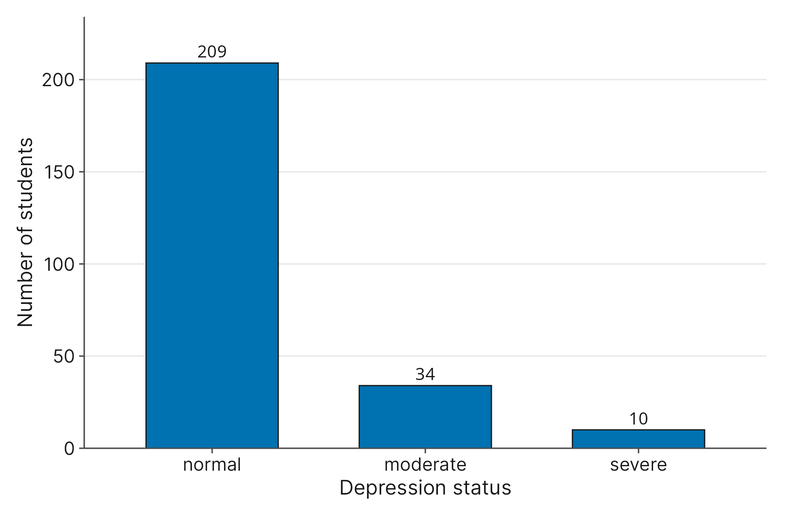{fig-alt="Bar chart of depression screening status for 253 students. The Normal bar is tallest at 209 students, Moderate is 34, and Severe is 10. Bars are ordered Normal, Moderate, Severe."}

When interpreting a bar plot, you are primarily looking for the most common and least common outcomes. The tallest bar represents the mode, or the most frequent category in your data. In a well-made bar plot, there are gaps between the bars. These gaps serve as a visual reminder that the categories are distinct, separate groups, rather than a continuous numerical measurement.

Notice that because `DepressionStatus` is an ordinal variable, we keep the bars in their natural progression (Normal $\rightarrow$ Moderate $\rightarrow$ Severe). Sorting them by height would scramble the meaning!

However, what if you are working with a nominal variable that has a massive number of categories? Imagine looking at data from a college's tutoring and STEM resource center, tracking the "reason for visit" across dozens of different subjects. A standard bar plot would be incredibly wide, cluttered, and hard to read.

To make sense of this, we use a variation called a **Pareto chart**. 

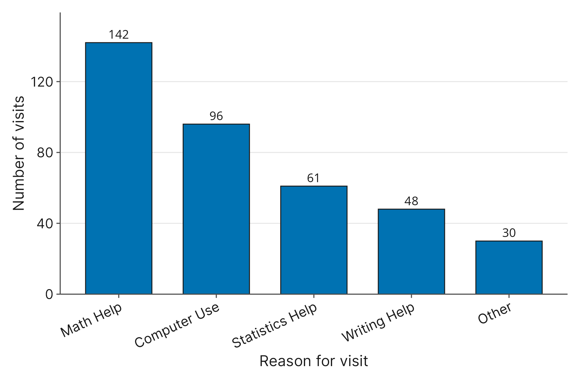{fig-alt="Pareto chart of illustrative tutoring and STEM center visits, sorted from most to least common. Math Help has the most visits, followed by Computer Use, Statistics Help, Writing Help, and Other, which combines the least common reasons."}

A Pareto chart is a bar chart for nominal data where the bars are sorted in descending order. The tallest bar is placed on the far left, and the shortest bar is on the far right. Often, to save space, the many rare categories at the tail end are combined into a single "Other" bar. This sorting forces the most common reasons to the front, making it effortless to see exactly where the majority of students are seeking help.

## 1.4 Visualizing Single Variables: Quantitative Data

Now that we can visualize categories, how do we handle numbers? Suppose we want to know how much sleep our 253 students get on average during the week. If we look at the `WeekdaySleep` variable, we see exact measurements like 6.5 hours, 7.2 hours, and 8.0 hours.

Because these are numerical measurements, we cannot just make a bar for every single unique number. Instead, we group the data into continuous ranges, or "bins," and count how many students fall into each bin. For instance, we might count how many students sleep between 6.0 and 6.9 hours, then between 7.0 and 7.9 hours, and so on.

We visualize this grouping using a **histogram**.

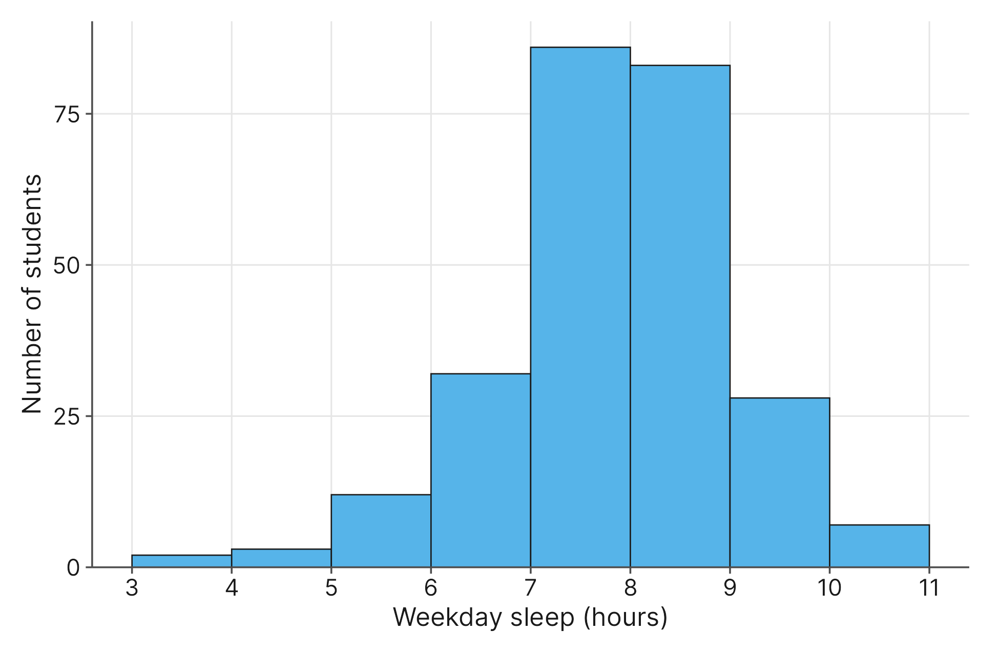{fig-alt="Histogram of weekday sleep hours in one-hour bins. The distribution is centered near 8 hours, with the tallest bins at 7 to 8 and 8 to 9 hours, and few students below 5 or above 10 hours."}

At first glance, a histogram looks a lot like a bar chart. But notice one major visual difference: there are no gaps between the bars. In a bar chart, the gaps remind us that categories are completely separate. In a histogram, the bars touch because they represent a continuous number line. Where one bin ends, the next bin immediately begins.

## 1.5 Distribution Shapes and The Normal Curve

When you look at a histogram, you are looking at the **distribution** of your data. The distribution tells you what values are common, what values are rare, and how the data is spread out from lowest to highest. We often describe distributions by their physical shape.

If you trace an imaginary line over the top of the histogram bars, you might see a single, distinct peak. We call this a **unimodal** shape. If there are two distinct peaks, it is **bimodal**. 

Often, that single peak sits right in the middle, and the left and right sides roughly mirror each other. This is a **symmetric** distribution. The most famous symmetric shape in statistics is the **normal curve**, often referred to as the "bell curve."

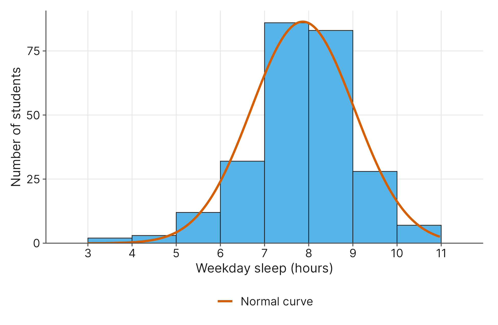{fig-alt="Histogram of weekday sleep hours with a smooth bell-shaped normal curve overlaid. The histogram is roughly symmetric, peaks at 7 to 9 hours, and the curve follows the same shape."}

When data follows a normal curve, it implies a very specific concentration: the vast majority of your data is clustered right around the center. As you move further away from the center in either direction, outcomes become increasingly rare. Many natural human traits, like height and baseline sleep needs, follow this predictable shape.

However, real-world data is often messy and leans heavily to one side. We call this **skewness**. 

Let's look at the `ClassesMissed` variable. In the histogram of this numerical data, we see a massive peak at zero, with a long "tail" stretching out to the right for the few students who missed 10 to 20 classes. Because the tail stretches to the right, we call this **right-skewed** (or positively skewed). The data has a strong **floor effect**, meaning it hits a hard lower limit (you cannot miss fewer than zero classes) and piles up there.

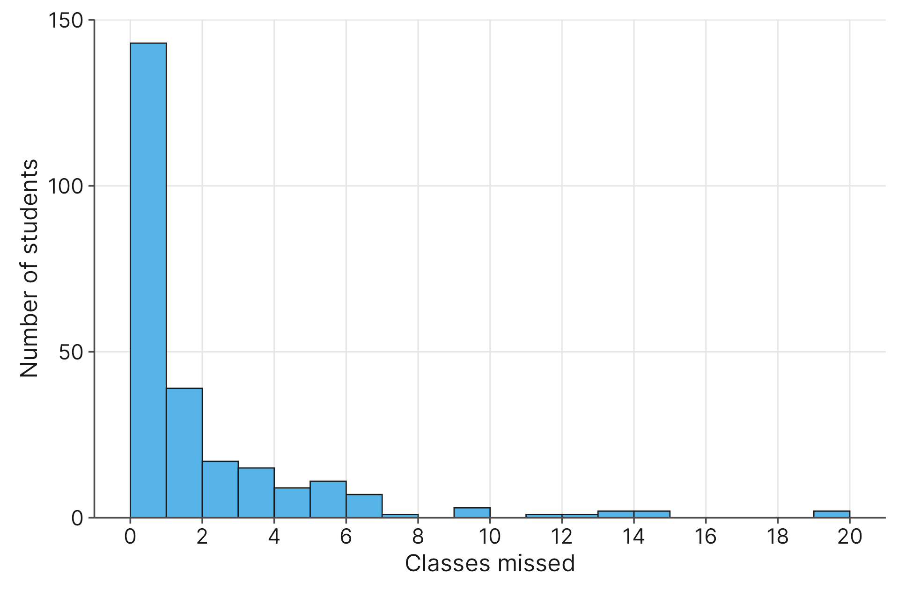{fig-alt="Right-skewed histogram of classes missed. The tallest bars are at 0 and 1 classes missed, with 94 and 49 students, and a long thin tail extends to the right toward 20."}

Conversely, if the tail stretches to the left, the data is **left-skewed** (or negatively skewed). This often happens when data hits an upper limit, in which case we would be observing a **ceiling effect**. This frequently occurs with exam scores, where students can't score higher than 100%.

While we typically use these shape terms for continuous numerical data, the concept of shape can also offer profound intuition for ordinal variables. Imagine asking your friends about the course grades in two different sections of a challenging history class. Grades are ordinal (A, B, C, D, F). If the distribution of grades in Professor Strict's class is strongly right-skewed, the "tail" stretches toward the higher grades (A and B), meaning the massive peak of the class is piled up at the lower end (D and F). If Professor Kuhlman's class is strongly left-skewed, the tail stretches toward the failing grades, but the vast majority of students are piled up at the A and B level. Which class would you rather take? Visualizing this shape instantly tells you the story of the classroom without needing a single calculation.

## 1.6 Visualizing Relationships: Two Numerical Variables

Up to this point, we have only looked at variables in isolation. We know how many students have severe depression, and we know the shape of the GPA distribution. But research is fundamentally about relationships. A single number can tell us what happened; a relationship helps explain why. Does missing class lead to lower grades?

We can ask a similar question about countries: does a country's wealth relate to how long its residents live? The `happy_planet_index_2024.csv` dataset records country-level measures, including `GDPperCapita` and `LifeExpectancy`. Because both of these are numbers, we can plot them on a standard two-dimensional grid using a **scatterplot**. In a scatterplot, each country is represented by a single dot. The dot's horizontal position (the x-axis) shows its GDP per capita, and its vertical position (the y-axis) shows its life expectancy.

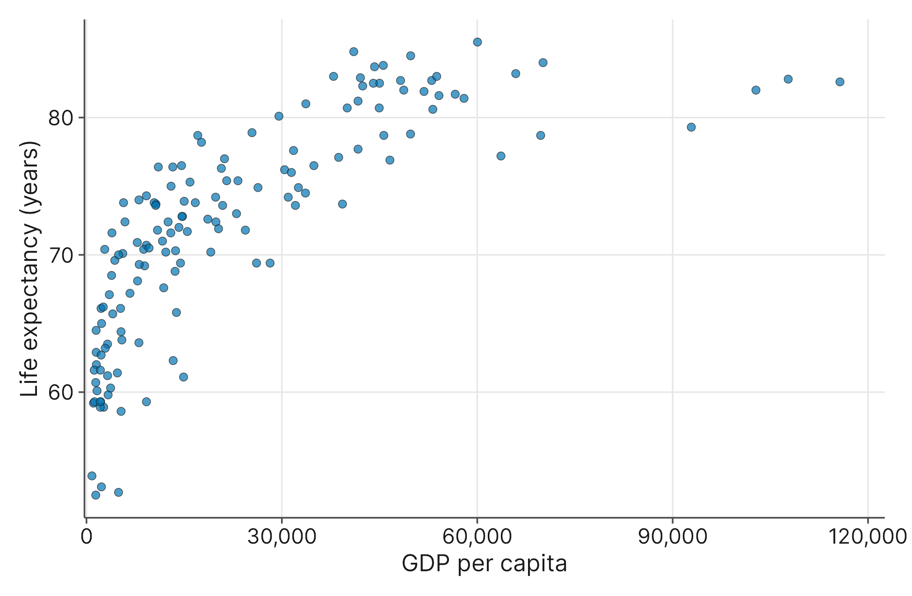{fig-alt="Scatterplot of GDP per capita versus life expectancy for 143 countries. Points rise steeply from the low 50s at the lowest incomes and then flatten near 80 years at higher incomes."}

When you look at a scatterplot, you are looking for a trend. Do the dots form a cloud that drifts upward? Downward? Or is it just a random, shotgun blast of dots with no discernible pattern? By simply mapping one number against another, we can instantly see if a relationship exists and how strong it appears to be.

The cloud here drifts upward: countries with higher GDP per capita tend to have higher life expectancy. If we look closely, we can see that life expectancy rises steeply at low GDP per capita, then levels off.  This "bend" in the relationship makes our analysis later in Chapter 4 slightly more complex, but the point here is that we can immediately recognize that shape of the relationship in the scatterplot. For now, just keep in mind that a trend does not have to be a straight line to be a trend.

## 1.7 Visualizing Relationships: Two Categorical Variables

What if the relationship we want to explore doesn't involve numbers at all? Suppose we want to see if there is a connection between a student's `Stress` level (Normal or High) and their `AlcoholUse` (Abstain, Light, Moderate, Heavy). 

To explore this, we need to compare how drinking habits differ between the two stress groups. A common tool you will see in research articles and news media is the **segmented bar chart** (often called a 100% stacked bar chart).

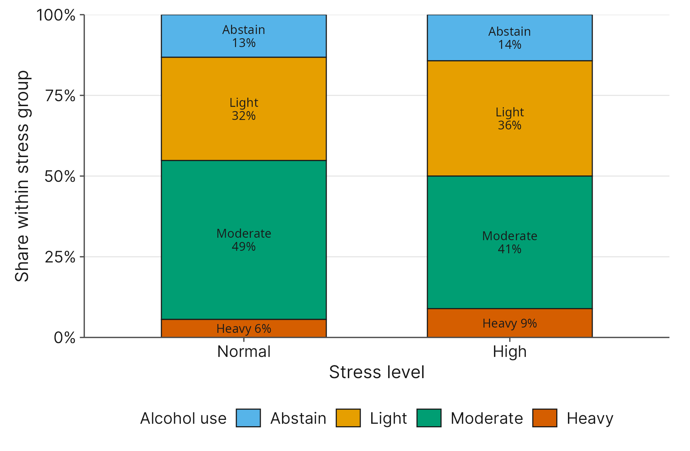{fig-alt="Segmented bar chart of alcohol use within stress groups. In the High stress group, Moderate drinkers are 41%, Light 36%, Abstain 14%, and Heavy 9%. In the Normal stress group, Moderate is 49%, Light 32%, Abstain 13%, and Heavy 6%."}

In a segmented bar chart, every group gets a single vertical bar that is stretched to be exactly the same height, representing 100% of the people in that group. We then slice the bar into segments based on our second variable. 

To interpret this chart, you simply compare the sizes of the segments across the different bars. For example, the "Heavy drinking" segment is taller inside the "High stress" bar than it is inside the "Normal stress" bar: 9% versus 6%. That difference is noticeable, and it suggests a relationship worth investigating further.

However, segmented bar charts have a major hidden drawback: they completely hide the actual size of the groups. Looking at the chart, the "Normal" and "High" stress bars take up the exact same amount of space. But in reality, one group might have 200 students while the other only has 53. By forcing both bars to an artificial 100%, we lose the context of how many people actually make up each group.

To solve this problem, we use a clearer visualization called a **mosaic plot**. A mosaic plot is essentially a segmented bar chart that adjusts itself to show you the true size of every group.

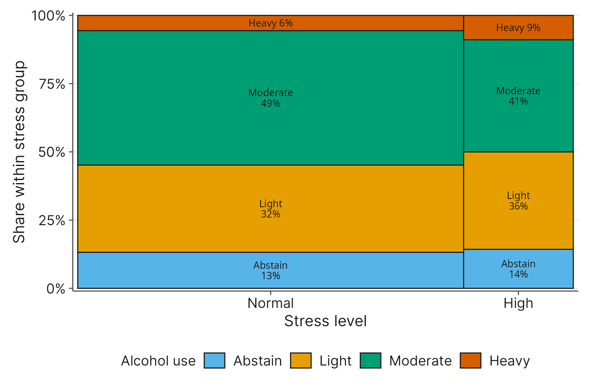{fig-alt="Mosaic plot of stress level and alcohol use. The Normal stress column is much wider, showing 197 students versus 56 under High stress. Within each column, Moderate drinkers form the largest block; the Heavy block is 6% under Normal stress and 9% under High stress."}

Because mosaic plots convey a lot of information at once, they can feel intimidating at first glance. The easiest way to read them is to break them down into two steps. Think of a mosaic plot like a large rectangular cake that represents all 253 students in our study.

First, look at the *width*. We slice the cake vertically based on `Stress`. The width of these columns tells you exactly how many people are in each group. If the "Normal" stress column is three times wider than the "High" stress column, you instantly know that normal stress is much more common in your overall sample. 

Second, look at the *height*. We slice those vertical columns horizontally based on `AlcoholUse`. The height of these new blocks tells you the rate of drinking within that specific stress group, exactly like the segments in our stacked bar chart. 

By combining width (group size) and height (group rate), the total *area* of each resulting block tells you the exact proportion of your total sample that falls into that specific combination. While mosaic plots take a little more time to read than a simple bar chart, they are incredibly powerful because they tell you the complete, unfiltered story without hiding any data.

## 1.8 Visualizing Relationships: Mixed and Complex Data

In reality, research questions are rarely confined to just two simple variables of the same type. You will often need to mix categorical and numerical data, or look at three variables at once, to uncover the true story in your dataset.

**Categorical vs. Numerical: Box Plots**

Suppose you want to know if mental health affects academic performance. You are comparing `DepressionStatus` (a categorical variable with three groups) against `GPA` (a numerical variable). You can't use a scatterplot, and a mosaic plot only works for categories. 

The best tool for this job is a **box plot** (sometimes called a box-and-whisker plot). 

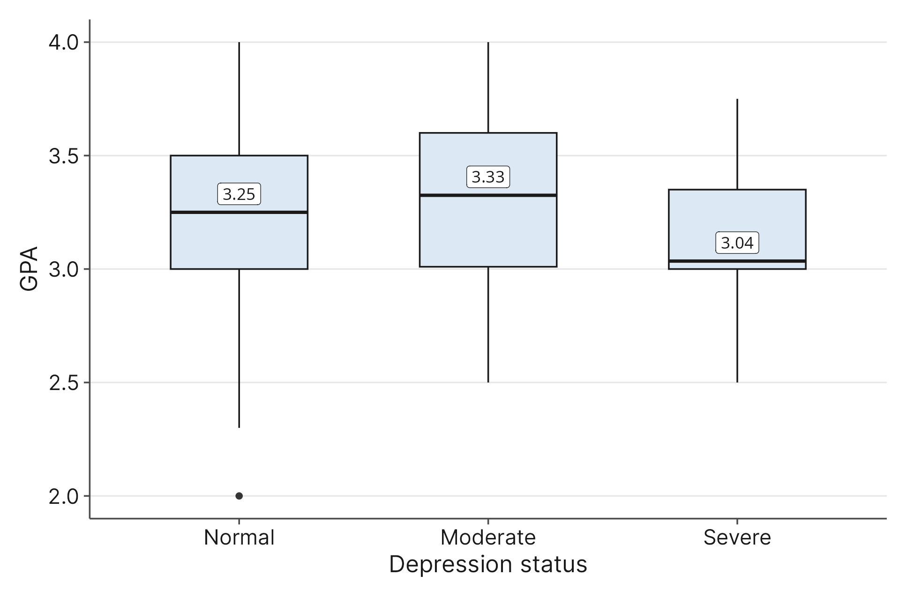{fig-alt="Side-by-side box plots of GPA for the Normal, Moderate, and Severe depression groups. Median GPA is 3.25 in the Normal group, 3.33 in the Moderate group, and 3.04 in the Severe group. The third quartile is 3.50, 3.60, and 3.35. The Moderate group has the widest middle 50%."}

A box plot takes a numerical distribution and boils it down to its most essential parts: a box that contains the middle 50% of the students, a line inside the box for the median (the exact center value when data is placed in numerical order), and lines (whiskers) reaching out to the extremes. By placing a box plot for "Normal," "Moderate," and "Severe" right next to each other, you can easily compare the typical GPA across different mental health statuses.

In this sample, the Severe group has the lowest median GPA (3.04, compared with 3.25 for Normal and 3.33 for Moderate), so there may be a relationship there worth investigating. The Moderate group's median is slightly above the Normal group's, so the pattern is not a steady decline from Normal to Moderate to Severe.

**Grouping Variables in Scatterplots**

Sometimes, a categorical variable quietly shapes a numerical relationship. Let's return to the scatterplot of `GDPperCapita` and `LifeExpectancy`. What if a country's region changes that relationship?

We can add a simplified `Region` variable as a **grouping variable** by changing the color and shape of the dots. Here, countries in Region 5 (Sub-Saharan Africa) are orange triangles, countries in Region 3 (Western Europe) are blue circles, and all other regions are green squares. 

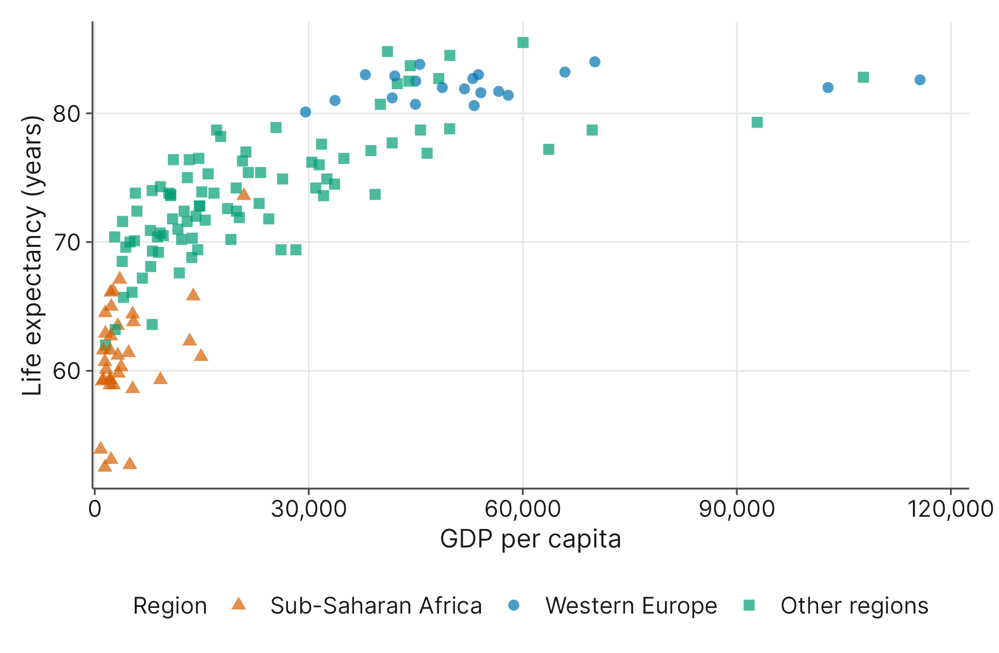{fig-alt="Scatterplot of GDP per capita versus life expectancy for 143 countries. Sub-Saharan Africa is shown as triangles at low GDP per capita and low life expectancy, Western Europe as circles at high values of both, and other regions as squares in between."}

By doing this, you are looking at three variables at once. The groups fall into distinct bands: Sub-Saharan Africa sits at low GDP per capita and low life expectancy, Western Europe sits at high values of both, and other regions span the range between. The grouping reveals a more granular look at the relationship than the original plot showed.

**Three Numerical Variables: Bubble Plots**

Finally, what if you have three numerical variables? We can return to the country data and look at `GDPperCapita` (x-axis), `LifeExpectancy` (y-axis), and `Footprint` (bubble size), the ecological footprint per person.

Because a piece of paper (or a computer screen) is flat, we can't easily add a 3D z-axis. Instead, we use a **bubble plot**. 

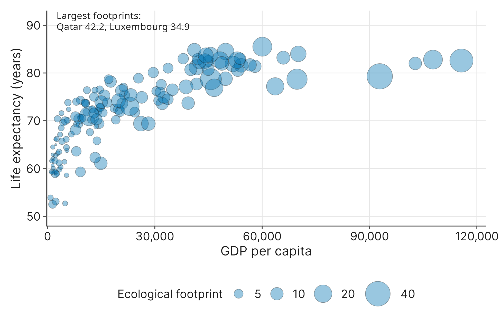{fig-alt="Bubble plot of GDP per capita versus life expectancy for 143 countries. Bubble size shows the ecological footprint. Most bubbles are small and cluster at low GDP per capita. The largest bubbles, including Qatar and Luxembourg, sit at higher GDP per capita."}

A bubble plot is just a scatterplot where the size of the dot changes based on a third numerical variable. A country with a footprint of 42.2, such as Qatar, is drawn as a large bubble, while a country with a footprint near 0.2, such as Ethiopia, is a tiny speck. This allows you to hunt for complex patterns, like checking whether the largest bubbles cluster at high GDP per capita and high life expectancy. In this figure, the largest bubbles sit at higher GDP per capita, but their life expectancies are not the highest in the dataset.

## 1.9 Describing Data Numerically: Measures of Center

Visualizing your data is fantastic for seeing the big picture. However, eventually, you need to report exact numbers in your research paper. We call these numerical summaries **descriptive statistics**. 

When researchers want to describe a typical student in their study, they use **measures of center**. The type of data you have dictates which measure of center you should use.

For categorical variables, you cannot calculate a mathematical average. Instead, we use a **proportion**, which is the fraction or percentage of the total group that falls into a specific category. A proportion is simply the "part" divided by the "whole." 

For example, suppose 38 out of the 253 students in our study screened for severe depression. You calculate the proportion like this:

$$\text{Proportion} = \frac{38}{253} = 0.15$$

This tells you that 15% of the sample experiences severe depression. Notice that a proportion will always be a number between 0 and 1 (or 0% and 100%). Why? Because the "part" can never be smaller than zero people, and it can never be larger than the entire group of 253 students!

If you simply want to state the single most common category, you report the **mode**. For categorical data, this can be a very useful metric for understanding what the most common outcome is, or what we can expect to see most often. In general, the mode is not as useful for numerical data, as it usually is just the value that happened to appear more than once in the data set.

For numerical variables, you have two primary choices: the median and the mean. The **median** is the exact middle value when you line up all your data from smallest to largest. Half the students scored above the median, and half scored below. The median is particularly useful in data sets with outliers or skew because those unusual values far from the typical values in the data don't really affect it. If we look at the `Drinks` variable, most students drank 5 or fewer drinks in a week, with some extreme outliers reporting triple that or more. A few students reporting 20 drinks a week will not affect the median. The median simply tells you what the perfectly middle-of-the-pack student is doing.

The **mean** is what most people think of when they hear the word "average." It is the exact same calculation you learned in grade school: you add up all the values and divide by the total number of observations. For instance, if you tracked a single student's `WeekdaySleep` over 5 weeknights and recorded 7, 6, 8, 7, and 7 hours, you calculate their mean sleep like this:

$$\text{Mean} = \frac{7 + 6 + 8 + 7 + 7}{5} = \frac{35}{5} = 7 \text{ hours}$$

You will often hear that the mean is "flawed" because it gets pulled in the direction of skew or outliers, making the median the better choice for skewed data. While this is true when trying to describe a "typical" individual, the mean is actually the superior choice when your goal is to understand the *total* impact of a group. 

Consider a town council looking at resident income to forecast tax revenue. Income is notoriously right-skewed, with a few massive outliers pulling the mean significantly higher than the median. If the council wants to know what a "typical" middle-class family earns, they should look at the median. 

But suppose the council knows the *mean* tax revenue is $2,000 per person. If 1,000 new people move to the town, the council can confidently plan for $2,000,000 in new revenue ($2,000 multiplied by 1,000 people). You cannot do this math with a median! The mean mathematically accounts for the total sum of the data. Those ultra-wealthy outliers who pay massive taxes provide real money that the town gets to spend. The mean's "smoothing out" effect spreads those extreme values across everyone. When you need to calculate totals or aggregates, its sensitivity to outliers is a feature, not a bug.

### Figure 1.12: Choosing the Right Measure of Center

| Measure        | Best For (Data Type)             | What it tells us                                             |
| :------------- | :------------------------------- | :----------------------------------------------------------- |
| **Mean**       | Numerical (Symmetric)            | The mathematical balancing point of the data. It is highly sensitive to extreme outliers, making it excellent for understanding the *total* impact or aggregate of a group, but sometimes misleading for describing a single "typical" individual. |
| **Median**     | Numerical (Skewed or Outliers)   | The exact middle position of the data. Half the values are higher, and half are lower. It is completely resistant to extreme outliers, making it the best choice for describing the "typical" everyday experience of an individual. |
| **Mode**       | Categorical (Nominal or Ordinal) | The single most frequent outcome or common category in your dataset. |
| **Proportion** | Categorical                      | The fraction or percentage of the total group that belongs to a specific category. It tells you the "part" compared to the "whole" and is always a value between 0 and 1 (or 0% and 100%). |

## 1.10 Measures of Spread and Position

Knowing the center of your data is only half the story. Imagine two students who both have a mean `WeekdaySleep` of 7 hours. Student A gets exactly 7 hours of sleep every single night. Student B gets 4 hours one night, 10 hours the next, and 7 hours the night after. 

They have the exact same center, but their sleep habits are completely different! We measure this inconsistency using **measures of spread**. 

If you chose to use the mean to describe your center, you should pair it with the **standard deviation**. The standard deviation measures the typical, everyday distance that your data points fall from the mean. 
* A *small* standard deviation means the data is tightly clustered around the mean (like Student A).
* A *large* standard deviation means the data is widely scattered (like Student B).

If you chose to use the median, you should describe your spread using **percentiles**. A percentile tells you the exact position of a value relative to the rest of the group. If a student's `GPA` is at the 90th percentile, it means they scored higher than 90% of the students in the sample. 

We often cut our data into quarters, called **quartiles**. 
* The First Quartile (Q1) is the 25th percentile.
* The Second Quartile is the 50th percentile (which is exactly the median!).
* The Third Quartile (Q3) is the 75th percentile. 

Because the first and third quartiles mark the boundaries of the middle 50% of your data, the distance between them gives us a powerful measure of spread called the **Interquartile Range** (or **IQR**). You calculate it simply by subtracting the first quartile from the third quartile:

$$\text{IQR} = Q3 - Q1$$

Just as the median is the resistant counterpart to the mean, the IQR is the resistant counterpart to the standard deviation. Because the IQR only measures the core middle of the data, it completely ignores any extreme outliers or heavy skewness out at the tails. 

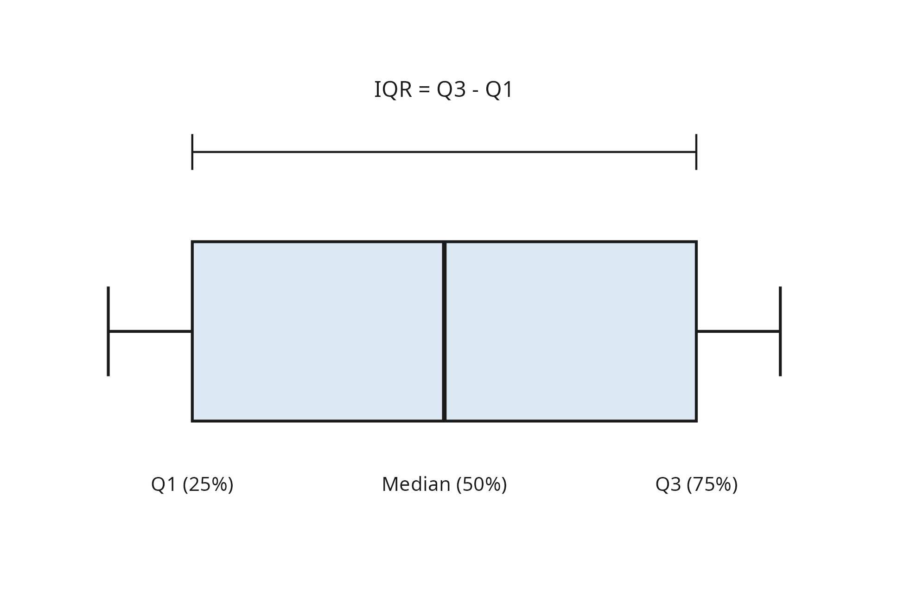{fig-alt="Diagram of a box plot. The left edge of the box is labeled Q1, the 25th percentile; the center line is the median, the 50th percentile; and the right edge is Q3, the 75th percentile. A bracket above the box spans Q1 to Q3 and is labeled IQR equals Q3 minus Q1."}

Do you remember the box plots we used to visualize the `GPA` of different depression groups? A box plot is just a visual drawing of these exact numbers. The physical box spans from Q1 to Q3, meaning the visible length of the box *is* the IQR! By reporting the median and the IQR, you give your reader a complete, reliable map of where the middle 50% of your data lives, ignoring the messy extremes.

## 1.11 Matching the Measure to the Shape

Now that you have a complete toolkit of numerical summaries, how do you know which ones to actually use in your research paper? You usually do not report all of them. Instead, the physical shape of your data dictates which measures are appropriate.

Because the mean and standard deviation mathematically use every single data point, they act like a physical balancing point. This makes them highly sensitive to extreme values. In our right-skewed `ClassesMissed` data, the few students who missed 15 classes will pull the mean significantly higher. Those extreme numbers will also artificially inflate the standard deviation. If you report the mean and standard deviation here, it will look like the "typical" student missed far more classes than they actually did!

Instead, we rely on our resistant measures: the median and the IQR. Because they only care about the position of the middle 50% of the data, they completely ignore the extreme values at the ends of the tails. 

To choose the right summary, simply look at your histogram and follow this golden rule:

* **If your data is strongly skewed or has extreme outliers:** The mean and standard deviation will be aggressively pulled toward the tail. You should pair the **median** with the **IQR** to accurately describe the everyday experience of the group.
* **If your data is roughly symmetric (like a bell curve):** The mean and median will be nearly identical. You should pair the **mean** with the **standard deviation** to describe the center and spread.

### The Reliability of the Mean

You might be wondering: if the median resists messy outliers so well, why don't we just use it all the time? Why ever risk using the highly sensitive mean? 

The answer comes down to **reliability** and how much information each measure uses. Think about how we find the median for `WeekdaySleep`. We line up all 253 students in order and find the person exactly in the middle. We completely ignore the actual sleep hours of the other 252 students. We don't care if the lowest value was 2 hours or 5 hours; the median only cares about their rank in line. By doing this, we are throwing away a massive amount of information.

The mean, on the other hand, uses every single drop of data. Every student's exact sleep hours are added into the total. Every single number gets a "vote" in determining the final center. 

In research, we are almost always taking a small sample (like our 253 students) to make an educated guess about a much larger population (like every student at the university). Because the mean uses all the available information, it is a "better," more **reliable estimator** than the median. 

If you took twenty different samples of 253 students, their sample means would all cluster very tightly around the true, real-world university average. The sample medians would also cluster around the true middle, but they would "wobble" and vary a bit more from sample to sample because they are built on less information. 

Because the mean is mathematically more stable and consistent, we always prefer to use the mean and standard deviation whenever our data is symmetric enough to allow it. We only switch to the median and IQR when extreme skew or outliers either force our hand, or if that true "exact middle" idea of the median is our main interest.

### Figure 1.14: Reporting Numerical Summaries

| Shape of Distribution                     | Report this Center | Report this Spread        |
| :---------------------------------------- | :----------------- | :------------------------ |
| **Roughly Symmetric** (like a bell curve) | Mean               | Standard Deviation        |
| **Strongly Skewed or has Outliers**       | Median             | Interquartile Range (IQR) |

## 1.12 Populations and Samples: The Source of Our Data

Let's look back at our `student_lifestyle_sleep.csv` dataset. Why did the researchers only study 253 students? If they want to understand how sleep affects college academic performance, wouldn't it be better to study *every* college student? Of course it would! But tracking down millions of students, securing their consent, and monitoring their sleep for two weeks is physically and financially impossible. 

This reality introduces the most fundamental division in statistics: the **population** versus the **sample**. The **population** is the entire, overarching group of individuals you actually want to learn about. Depending on the exact research question, the population for our study might be "all undergraduate college students in the United States." Because we cannot measure the entire population, we select a smaller, manageable subset to actually study. This smaller group is our **sample**. Our 253 students represent the sample. 

### Parameters vs. Statistics

When we calculate a numerical summary (like a mean or a standard deviation), we have to be very clear about who we are summarizing. 

If a number perfectly describes the entire population, we call it a **parameter**. For example, the true, exact average sleep time of every single college student in the country is a parameter. Because we can never measure everyone, parameters are almost always unknown values. 

If a number describes only the individuals in our sample, we call it a **statistic**. When we calculate the mean sleep time of our 253 students, that resulting number is a statistic. We know this number exactly because we have the data right in front of us.

A helpful memory trick is to match the first letters: **S**amples produce **S**tatistics, while **P**opulations have **P**arameters. 

The entire mathematical field of inferential statistics is built on this relationship. Researchers calculate a known statistic from a small sample, and they use that statistic to make a highly educated guess about the unknown parameter in the massive population.

### Notation for Samples and Populations

Because populations and samples are entirely different concepts, we use different mathematical symbols to keep them separate. In statistics, we generally use Greek letters for unknown population parameters, and standard English letters for known sample statistics.

| Symbol    | Read Aloud As | What It Represents                                           |
| :-------- | :------------ | :----------------------------------------------------------- |
| $N$       | -             | The total number of individuals in the **population**.       |
| $n$       | -             | The total number of individuals in the **sample** (e.g., $n = 253$). |
| $\mu$     | "mu" (mew)    | The mean of the **population** (a parameter).                |
| $\bar{x}$ | "x-bar"       | The mean of the **sample** (a statistic).                    |
| $\sigma$  | "sigma"       | The standard deviation of the **population** (a parameter).  |
| $s$       | -             | The standard deviation of the **sample** (a statistic).      |
| $\pi$     | "pi"          | A proportion of the **population** (a parameter).            |
| $p$       | -             | A proportion of the **sample** (a statistic).                |

## 1.13 Complications of Real-Life Data

When you read a polished research paper, the data often seems perfect and neatly organized. However, in the real world, data collection is messy. Human beings forget to answer questions, measuring tools hit their limits, and participants sometimes hide the truth. Before you can trust the numerical summaries or visualizations you just learned to create, you must triage your data. This means actively hunting for real-world complications that might distort your findings.

### Missing Data and Bias

Imagine opening `student_lifestyle_sleep.csv` and finding that several students have empty cells in the `GPA` column. Your first instinct might be to just delete those rows and analyze the rest. But before you do, you must ask: *why* is that data missing?

If a student simply skipped the question by accident, the missing data is random. Deleting it shrinks your sample size, but it probably won't ruin your study. However, what if the data is missing for a specific reason? Suppose students with failing grades felt embarrassed and intentionally left the GPA question blank. If you only calculate the mean for the students who *did* answer, your resulting average will be artificially high. 

This introduces **bias**, which occurs when your data systematically distorts the truth. We see this often with income surveys. Extremely wealthy individuals and individuals living in poverty are both less likely to report their income than middle-class earners. If you ignore *why* the data is missing, your sample statistic will completely misrepresent the true population parameter. 

### Floor and Ceiling Effects

Sometimes the numbers are accurately recorded, but they hit a hard physical or artificial boundary.

We already saw a **floor effect** with the `ClassesMissed` variable. A student cannot miss fewer than zero classes. When a large portion of your sample hits this absolute minimum, the data piles up on the left side of the histogram, creating a strongly right-skewed distribution. 

The opposite is a **ceiling effect**, which happens when data hits an absolute maximum limit. Look at the `GPA` variable. A student cannot score higher than a 4.0. If you give an incredibly easy exam where half the class scores 100%, the data piles up against the right wall of the graph, creating a left-skewed distribution. 

When you see these effects, remember that a resistant measure of center, like the median, is usually your best choice.

### Censored and Truncated Data

Sometimes our measuring tools simply give up. Suppose our lifestyle survey didn't ask students to type in their exact number of weekly drinks, but instead gave them multiple-choice checkboxes. The final box simply said "10 or more." If a student checks that box, we have **censored data**. We know the student drinks, and we know the minimum amount, but the exact number is hidden from us. We do not know if they had 10 drinks, 15 drinks, or 30 drinks. We only know they crossed a specific threshold. 

Similarly, we might face **truncated data**, where certain values are entirely cut off and excluded from the dataset before you even see them. For example, if our sleep study required students to sign a consent form during an early morning baseline test, students who sleep in until noon are completely missing from our sample. Our data is truncated because the "heavy sleeper" population was cut out by the study design itself.

Understanding these realities ensures you don't blindly trust a mean or a median without first considering the human element behind the numbers.

## 1.14 Common Mistakes and Misconceptions

As you begin working with real data, there are a few common traps that trip up almost every new researcher. Keep these in mind as you start your own analyses:

* **Averaging numerical labels:** Sometimes, categories are recorded using numbers just to make data entry easier. For example, suppose a study records a student's college major using arbitrary codes: $1$ for Biology, $2$ for English, $3$ for Psychology, and $4$ for Business. Because these look like numbers, statistical software will happily let you calculate a mean. But what happens if you average a Biology major ($1$) and a Psychology major ($3$)? You get a $2$. Does that mean they combine to form an English major? No! The result is complete nonsense. Always check your variable dictionary before calculating summaries. If the number is just a placeholder for a label, you must use proportions or a bar plot, not a mean.
* **Confusing bar plots with histograms:** They look incredibly similar, but they tell completely different stories. A bar plot is for *categorical* data, and the bars should have gaps between them to show that the categories are distinct buckets. A histogram is for *numerical* data, and the bars must touch to show that the numbers flow continuously along a number line.
* **Blindly trusting the mean:** It is tempting to calculate the mean and standard deviation for every numerical variable because they are the most famous statistics. However, if your data is heavily skewed (like `ClassesMissed`), the mean will not represent the "typical" student. Always look at the shape of your distribution in a histogram *before* you decide to report the mean or the median.

## 1.15 Key Concepts

1. **Variables come in two main types.** Categorical variables place individuals into descriptive groups (nominal or ordinal). Numerical variables record measurable quantities where math makes logical sense.
2. **Visualizations must match the data type.** Use bar plots and Pareto charts for single categorical variables. Use histograms to see the shape and spread of single numerical variables.
3. **Relationships require specific plots.** Use scatterplots to compare two numerical variables, mosaic plots to compare two categorical variables, and box plots to compare a numerical variable across different categories.
4. **The shape dictates the summary.** If a distribution is roughly symmetric (bell-shaped), report the mean and standard deviation. If it is skewed or has extreme outliers, report the median and the Interquartile Range (IQR). 
5. **Statistics estimate parameters.** We calculate known statistics (like a sample mean, $\bar{x}$) from our small, manageable sample to make educated guesses about the unknown parameters (like a population mean, $\mu$) of the massive population.
6. **Real data is messy.** Always check for missing data, bias, and physical limits (floor and ceiling effects) before you trust the story your numbers are telling you.

## 1.16 Guided Analysis: Putting It All Together

We have covered a lot of ground in this chapter. To see how these tools work together, let's walk through a complete, preliminary analysis using our dataset of 253 college students. 

### The Research Interest
Student well-being is a major focus for universities. We know that college can be highly stressful, and we want to understand how mental health impacts academic behavior. Specifically, we might wonder if students who are struggling with anxiety find it more difficult to attend their classes. Behind these numbers are real students facing challenging circumstances, so exploring this relationship could help universities better allocate support resources.

### The Research Question
Can we translate that broad interest into a specific question we can answer with our data? 
* **Question:** In our sample of 253 students, do those who screen for severe anxiety miss more classes on average than those with normal screening results?
* **The Variables:** We are comparing `AnxietyStatus` (a categorical variable) against `ClassesMissed` (a numerical variable).

### Data Triage and Exploratory Analysis
Before we calculate any averages, we must look at the shape of our data. If we were to plot a histogram of `ClassesMissed` for all 253 students, we would immediately see a massive **floor effect**. Most students miss zero, one, or two classes, causing the data to pile up on the left side of the graph. However, a long right tail stretches out for the few students who missed 10 or more classes. 

Because our numerical data is strongly right-skewed, we know immediately that the mean and standard deviation will be misleading. We must use the **median** and the **IQR**.

To visualize the relationship between a categorical variable and a numerical variable, we use side-by-side box plots.

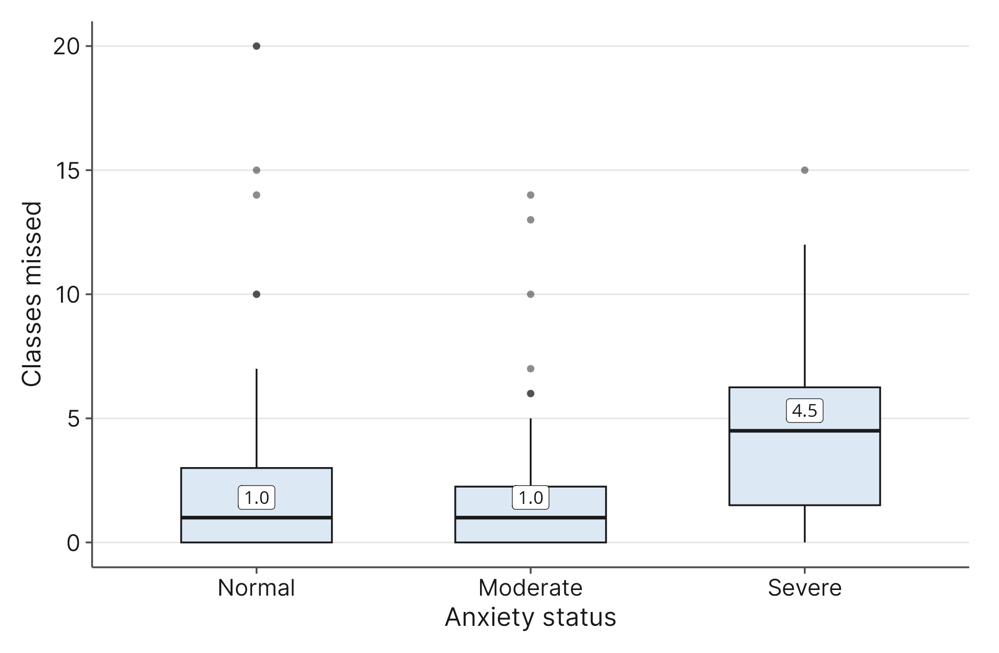{fig-alt="Side-by-side box plots of classes missed for the Normal, Moderate, and Severe anxiety groups. Median classes missed is 1 in the Normal group, 1 in the Moderate group, and 4.5 in the Severe group. The Severe group also has the widest middle 50%, from 1.5 to 6.25."}

The box plot shows where the groups differ: the Normal and Moderate groups both have a median of 1 class missed, and their boxes overlap heavily. The Severe group is different. Its median is 4.5 classes missed, and its middle 50% runs from 1.5 to 6.25, so both the center and the spread are larger. The Severe group has only 16 students, so this comparison describes our sample and is not a precise estimate for all students with severe anxiety.

### Numerical Summaries
| Anxiety Status | Median Classes Missed | Interquartile Range (IQR) |
| :------------- | :-------------------- | :------------------------ |
| **Normal**     | 1.0                   | 3.0                       |
| **Moderate**   | 1.0                   | 2.25                      |
| **Severe**     | 4.5                   | 4.75                      |

### Translating to APA Style
Before we write our final conclusion, we need to address a small quirk of the research world. In your statistics class, we use standard mathematical notation, like $\bar{x}$ for the sample mean and $s$ for the sample standard deviation. 

However, if you are reading research journals in psychology, sociology, or economics, those publications usually follow the formatting rules of the American Psychological Association (APA). APA style generally avoids mathematical symbols in written paragraphs and instead uses standard, italicized English letters. 

To read and write confidently in your field, you need to know this basic translation:
* **Mean:** $\bar{x}$ becomes *M*
* **Standard Deviation:** $s$ becomes *SD*
* **Median:** becomes *Mdn*
* **Interquartile Range:** becomes *IQR*

When researchers write their conclusions, they state their findings in plain English and place these statistical abbreviations in parentheses right next to the claim to provide the exact mathematical proof.

### **The Golden Rule: Center and Spread Together** 

Notice that in the translation guide above, we paired the Mean with the Standard Deviation, and the Median with the Interquartile Range.  In professional research, you must **never report a measure of center without its matching measure of spread.** A measure of center only tells half the story.  Imagine two students who both have a mean GPA of 3.0. The first student earns exactly a B in every single class. The second student earns A's in half their classes and C's in the rest. They have the exact same center, but their academic experiences are completely different! If you only report the center, you hide that reality.  When you write a conclusion, the center tells your reader what the typical experience was, and the spread tells them how closely the rest of the group actually matched that typical experience. You will see this pairing in every APA-formatted conclusion.

### Preliminary Conclusion
Now, we translate our statistical findings back into plain English (using APA formatting) to answer our research question. 

>  **Conclusion:** Within our sample, students with severe anxiety missed more classes (*Mdn* = 4.5, *IQR* = 4.75) than students with normal screenings (*Mdn* = 1.0, *IQR* = 3.0).

Notice two things about this conclusion. First, it uses the data to tell a clear, human story, supporting that story immediately with the exact numbers. Second, it strictly limits the claim to *our sample*. We have not proven that anxiety causes absenteeism for all college students everywhere. To make grand claims about the entire population, we need formal tools called hypothesis tests and confidence intervals, which we will begin building in the next chapter.

## 1.17 Exercises

### Interpretation

**1.** A university health center publishes a report stating that the mean number of alcoholic drinks consumed per week by undergraduate students is 4.2, with a median of 1.0. What does the large difference between the mean and the median tell you about the shape of this data? Why is the median so much lower?

**2.** You are reviewing a mosaic plot that compares student housing (On-Campus vs. Off-Campus) and anxiety levels (Normal, Moderate, Severe). The vertical block for "On-Campus" is twice as wide as the block for "Off-Campus". Within the "On-Campus" block, the segment for "Severe" anxiety is relatively small. What do the width of the blocks and the height of the segments tell you?

**3.** Two professors teach different sections of the same introductory psychology course. Professor A's final exam grades have a mean of 75 and a standard deviation of 4. Professor B's final exam grades have a mean of 75 and a standard deviation of 12. If a student wants a predictable, consistent classroom environment, which professor should they choose and why?

**4.** A researcher wants to know the average student loan debt for all seniors graduating from public universities in the United States. They survey 500 graduating seniors from a local state college and find an average debt of $28,500. Identify the population, the sample, the parameter, and the statistic in this scenario. 

### Choosing a Method

**5.** A sociologist is studying the starting salaries of recent graduates. They know that while most graduates start around $45,000, a few land highly lucrative tech jobs paying over $150,000. Which measure of center (mean or median) and which measure of spread (standard deviation or IQR) should they report to accurately describe the typical graduate's experience?

**6.** You have collected data on the number of hours students spend studying per week and their preferred study location (Library, Dorm, Coffee Shop). You want to see if study hours differ depending on the location. Which visualization tool is the most appropriate for this comparison?

**7.** A biology researcher is measuring the wingspans of a specific, common species of butterfly. They expect the wingspans to naturally cluster around a central size, with very large or very small butterflies being equally rare. What shape do they expect the distribution to have, and what measures of center and spread would be most appropriate?

**8.** You are working with a dataset of hospital patients and want to show the breakdown of their primary insurance types (Medicare, Medicaid, Private, Uninsured). The hospital administrator wants to quickly see which insurance type is the most and least common. Should you use a histogram, a scatterplot, or a Pareto chart?

### Communicating Results

**9.** You are writing a summary report for the dean of students regarding a recent campus survey on "Number of times utilizing the campus food pantry this semester." The data has a massive floor effect. In plain English, explain to the dean what a floor effect means in this specific context and why it happened. 

**10.** A local newspaper publishes an article claiming that "The average household in our county pays $4,500 in property taxes, but the typical family only pays $2,100." The reporter is confused by their own numbers. Write a short explanation to the reporter clarifying how both numbers can be true at the same time, using the concepts of mean, median, and skewness.

**11.** You are designing a survey to measure how much time students spend watching streaming services. If you ask students to select a box ("0-2 hours," "3-5 hours," "6-8 hours," "9+ hours"), you will create censored data. Explain the drawback of censored data to your research team and propose a better way to ask the question.

### Software Application

*For the following exercises, load the `student_lifestyle_sleep.csv` dataset into your statistical software.*

**12.** Create a histogram of the `WeekdaySleep` variable and a separate histogram for the `ClassesMissed` variable. Describe the physical shape of both distributions. Do you notice any floor or ceiling effects? 

**13.** Calculate the mean and the median for the `GPA` variable. Are the numbers similar or very different? Based on the golden rule of matching measures to shapes, does the relationship between this mean and median make sense for a variable capped at 4.0?

**14.** Generate side-by-side box plots to compare `GPA` across the different categories of `ClassYear` (1 = First Year, 2 = Sophomore, 3 = Junior, 4 = Senior). Which class year appears to have the highest median GPA? Which class year shows the widest spread (IQR) in their grades?

**15.** We want to know if missing class is associated with lower grades. Create a scatterplot placing `ClassesMissed` on the horizontal axis (x-axis) and `GPA` on the vertical axis (y-axis). Look at the pattern of the dots. In plain English, how would you describe the relationship between missing class and academic performance for this sample of students?
