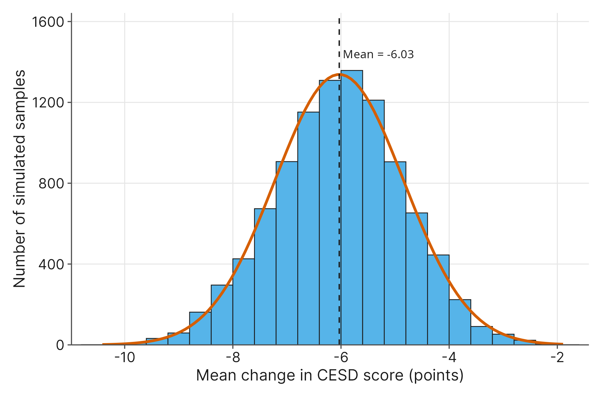

# Hypothesis Testing and Effect Sizes

## 3.1 Introduction

In recent years, psychologists and public health officials have grown increasingly interested in the connection between what we eat and how we feel. Imagine a team of researchers wants to know if a short-term, healthy diet intervention can genuinely reduce clinical depression symptoms in young adults. To investigate, they recruit 75 college students who report both elevated depression symptoms and poor dietary habits. They randomly assign half the students to receive healthy food packages and dietary guidance, while the control group maintains their usual eating habits. After three weeks, the researchers measure the change in everyone's depression scores.

Throughout this chapter, we will explore this exact scenario using the `depression_diet_treatment.csv` dataset. While the researchers collected a variety of physiological and psychological metrics, we will focus exclusively on four key variables:

- **`Group`**: A categorical variable indicating the experimental group assignment for the student (either **Control** or **Diet**).
- **`CESD1`**: A numerical variable representing the Center for Epidemiologic Studies Depression Scale (CESD) score measured at baseline on Day 1. High scores indicate greater depression severity.
- **`CESD21`**: A numerical variable representing the CESD score measured at the conclusion of the study on Day 21.
- **`CESDDiff`**: A numerical variable representing the change in the CESD depression score over the 21 days (calculated as Day 21 minus Day 1). A negative value indicates an improvement in symptoms.

In Chapter 1, we learned how to visualize this kind of data and calculate numerical summaries, like the mean change in depression scores for both groups. In Chapter 2, we learned how to translate the overarching research question into formal statistical hypotheses. We know how to set up our null hypothesis ($H_0$), which is the baseline assumption that the diet has absolutely no effect, and our alternative hypothesis ($H_1$), which is the claim that the diet intervention actually works.

But once we calculate our sample statistics, how do we make a definitive decision? If the diet group's depression scores drop by an average of a few points more than the control group, is that solid proof that the intervention was a success? Or could that difference just be a random fluke, a bit of natural variation in our specific sample of 75 students?

By the end of this chapter, you will learn how to formally test these hypotheses and make rigorous, data-driven decisions. We will explore how to separate a true signal from random statistical noise, how to avoid making critical errors when weighing evidence, and how to determine not just whether an effect is mathematically real, but whether it is large enough to practically matter in the real world.

## 3.2 The Core Concept & The Framework of Evidence

### Signal vs. Noise

When we look at the raw data from our dietary intervention study, we might see that the students in the healthy diet group experienced a larger drop in their depression scores than those in the control group. But how do we know if that difference is meaningful? In any experiment involving human beings, there will always be natural variation. Some students will organically feel better over a three-week period, some will feel worse, and hundreds of other factors, like academic stress or sleep, could influence those scores on any given day. This background variation is what statisticians call "noise."

**Hypothesis testing** is our formal procedure for separating the true effect of an intervention (the "signal") from the natural, random variation in the world (the "noise"). We want to know if the diet's effect is loud enough to be reliably heard over the background noise of everyday student life.

### Measuring the Evidence: The p-value

To figure out if we have a real signal, statistical tests use a bit of a logical trick: they ask us to temporarily assume that the null hypothesis ($H_0$) is absolutely true. For our study, that means we'll start by assuming that the healthy diet intervention has no impact on depression scores whatsoever, which is our null hypothesis.  (Recall that the null hypothesis represents the belief that there is no effect, while the alternative hypothesis represents the belief that there is an effect.)

Next, we look at the actual data we collected from our 75 students. We ask a central question: *If the diet truly does nothing, how likely is it that we would see a difference between our groups as large as the one we actually observed?*

This probability is called a **p-value**. The p-value measures the strength of the evidence in favor of our alternative hypothesis ($H_1$) by telling us how surprising our data would be if the null hypothesis were true.

- A **large $p$-value** means our results are not very surprising. If the diet does nothing, seeing this kind of difference between the groups is perfectly normal random noise. We do not have enough evidence to claim the diet works.
- A **small $p$-value** means our results are extremely surprising. If the diet truly does nothing, the chances of seeing such a massive difference in depression scores purely by random luck are incredibly tiny. Because the data is so unlikely under the null hypothesis, it gives us strong evidence that our alternative hypothesis (the diet actually works) is probably the better explanation.

### The Standard of Evidence: Significance Level ($\alpha$)

If a small $p$-value tells us we have evidence against the null hypothesis, exactly how small does it need to be before we are convinced? We need a clear threshold, a line in the sand, set before we ever analyze the data.

This threshold is called the **significance level**, denoted by the Greek letter alpha ($\alpha$). The significance level represents the required standard of evidence we demand before we are willing to change our minds about the null hypothesis being true.

In the social sciences, the standard convention is to set $\alpha = .05$. This means that in order to claim the diet intervention works, the probability of seeing our results purely by random chance must be less than 5%.

- If $p-value < \alpha$, the evidence is strong enough. We **reject the null hypothesis** and conclude that the diet does have an effect on depression.
- If $p-value \ge \alpha$, the evidence is too weak. We **fail to reject the null hypothesis**.

*Note on phrasing:* Notice that we say we "fail to reject" the null hypothesis, rather than saying we "accept" it. A large p-value does not prove that the diet intervention is completely useless; it only means our specific sample did not provide enough evidence to confidently prove that it works. It is the statistical equivalent of a jury returning a verdict of "not guilty" rather than "innocent."

Recall that we set up our competing hypotheses in such a way that rejecting the null hypothesis means the same thing as supporting the alternative hypothesis. In other words, if we reject the claim that the diet has no effect on depression (our null hypothesis), that is the same as supporting the claim that the diet has an effect on depression (our alternative hypothesis).

Whenever we make a decision about the null hypothesis, we can be wrong in one of two ways. A **Type I error** is a false alarm (a false positive): we reject the null hypothesis when it is actually true. The significance level sets this risk: at $\alpha = .05$, we accept a 5% chance of a false alarm. A **Type II error** is a missed signal (a false negative): we fail to reject the null hypothesis when a real effect exists. Section 3.9 covers statistical power, which is the tool for keeping this error rare.

## 3.3 Foundations of the *t* - Test

We understand that a p-value helps us weigh evidence. However, to calculate that p-value, we need a reliable mathematical tool. For comparing averages, our primary tool is the **t-test**.

### The Central Limit Theorem

To understand how a t-test works, look at Figure 3.1. This histogram shows what would happen if we repeated our diet intervention study thousands of times. Suppose we gathered thousands of different groups of 75 students, gave them the same healthy diet, and calculated the mean change in their depression scores (`CESDDiff`) every single time.

{fig-alt="Histogram of 10,000 simulated sample means of CESDDiff, each from 75 students drawn from the diet group. The bars form a symmetric bell shape centered near -6 points, with almost all sample means between about -8.4 and -3.8."}

As you can see in the graph, a fascinating pattern emerges. The most common results pile up in the middle around the true underlying average, and extreme flukes taper off symmetrically on both sides. This shape is the classic, symmetrical bell curve that we call a normal distribution in statistics.

This visual phenomenon is driven by the **Central Limit Theorem**. It is the engine that drives most of the statistical tests in this book. The theorem guarantees that if your sample size is sufficiently large, the distribution of your sample means will form a predictable bell curve. This mathematical predictability is exactly what allows the t-test to calculate how surprising our specific sample's result is, which in turn gives us our precise p-value.

### Checking the Tool's Requirements

Because the t-test relies on this predictable mathematical shape, we have to make sure our data actually fits the tool before we trust the resulting p-value. Using a t-test on data that violates its core rules is like trying to measure a curved road with a stiff wooden ruler; the tool simply will not give you an accurate number.

Before running a t-test, we always check two primary conditions:

- **Independence:** The data points must be independent of one another. In our study, one student's change in depression score should not directly cause a change in another student's score. Using a randomized experimental design is the best way to ensure this independence.
- **Normality:** The mathematics behind the t-test require your sample averages to form that predictable bell curve. If your original, raw data looks roughly bell-shaped and symmetric, this happens automatically. We check this by looking at a visual plot of the data.
- **The Sample Size Exception:** What if your raw data looks messy or skewed? This is where the Central Limit Theorem helps us. If your sample size is large enough, the theorem guarantees the t-test will still work properly. A common rule of thumb is a sample size ($n$) of at least 30. There is a catch, however. If the original data is severely skewed or has extreme outliers, an $n$ of 30 is not a magical fix. You might need a significantly larger sample size before you can safely trust the p-value.

If our data passes these visual checks, or if our sample size is large enough to override minor shape issues, we can confidently proceed to choosing the specific type of t-test that fits our research design.

## 3.4 Choosing the Right Tool

We now know that the t-test is our mathematical tool for comparing averages and calculating a p-value. However, there is not just one standard t-test. There is a small family of them, and choosing the correct one depends entirely on how we gathered our data.

In Chapter 2, we discussed how the structure of a research study dictates how we analyze the results. When we look at our diet intervention study, we can actually ask three distinctly different research questions. Each question requires a different variation of the t-test.

### Comparing to a Benchmark: The Single Sample t-Test

Sometimes, we only have one group of participants, and we want to compare their average to a known, static number. This number is often a national average, a historical baseline, or a clinical threshold. For this, we use a **Single Sample t-test**.

- **Data Gathering and Format:** You collect a single numerical measurement from one isolated group of participants. There is no control group or second measurement. You compare this single column of sample data against an external, predetermined value.
- **The Research Question:** At the very beginning of the study, were our 75 students experiencing severe depression compared to the general population?
- **The Application:** We take the baseline depression scores (`CESD1`) for all 75 students and calculate their average. We then run a Single Sample t-test to see if our sample's average is significantly different from a well-known clinical benchmark score (like a score of 16, which often indicates clinical depression).

### Tracking Changes Over Time: The Matched Pair t-Test

In many experimental designs, researchers measure the exact same people twice to see if an intervention had an effect. This is called a pre-test/post-test design. Because the two sets of measurements come from the exact same individuals, the data points are linked together. For this, we use a **Matched Pair t-test**.

- **Data Gathering and Format:** You measure the exact same participants twice, or you measure naturally paired subjects like twins. The data format usually features two columns of numbers side-by-side for each participant, allowing the software to calculate the direct difference between those two time points.
- **The Research Question:** Did the students who received the healthy food packages see a significant improvement in their depression scores over the three weeks?
- **The Application:** We only look at the students in the Diet group. We compare their Day 1 score (`CESD1`) to their Day 21 score (`CESD21`). Because we are tracking within-subject improvements, the software actually calculates the difference between the two scores for every single student (the `CESDDiff` variable) and tests to see if that average difference is significantly different from zero.

### Comparing Two Separate Groups: The Independent Sample t-Test

The most common scenario in a randomized controlled experiment is comparing two completely separate groups of people against each other. Because a participant can only be in one group or the other, the groups have no overlap. For this, we use an **Independent Sample t-test**.

- **Data Gathering and Format:** You collect data from two completely separate, unrelated groups. A participant can only belong to one group. The data format typically includes one column for the numerical measurement and a separate categorical column indicating which group the participant belongs to.
- **The Research Question:** Did the diet intervention group improve significantly more than the control group?
- **The Application:** This addresses the primary goal of our study. We take the change in depression scores (`CESDDiff`) and compare the average for the independent Diet group against the average for the independent Control group.

Once you understand how your data was gathered, choosing the right test becomes a simple process of elimination. In the next few sections, we will walk through exactly how to interpret the results for each of these three tests.

## 3.5 Single Sample *t*-tests

When we start a new research project, we often need to establish a baseline. Before we can evaluate whether our diet intervention improved the students' mental health, we first need to verify that our sample actually exhibited elevated depression symptoms to begin with.

To do this, we use a **Single Sample t-test**. This test compares the average of one single numerical variable from our sample against a known, fixed number. That fixed number is usually a national average, a historical baseline, or a specific clinical threshold.

For our study, the clinical benchmark for the Center for Epidemiologic Studies Depression Scale (CESD) is a score of 16. Anyone scoring 16 or higher is generally considered to be at risk for clinical depression. We want to test if the baseline Day 1 scores (`CESD1`) for our 75 students are significantly different from this clinical threshold of 16.

### The Hypotheses

In Chapter 2, we learned that the null hypothesis ($H_0$) represents the assumption of "no difference." For a Single Sample t-test, we formally state that the true average of the population our students represent is exactly equal to the benchmark.

To write this, we use the Greek letter $\mu$ (pronounced "mew"), which represents the true, overarching population mean.

- $H_0: \mu = 16$
- $H_1: \mu \neq 16$

Notice that our alternative hypothesis ($H_1$) simply states that the true average is *not equal* to 16. In rigorous research, we always use this two-sided approach as our default. We let the data speak for itself regarding whether the students are significantly above or significantly below the benchmark.

### The Mechanics: Calculating the *t*-statistic

When you run this test in your statistical software, the computer performs a few logical steps behind the scenes to calculate your p-value. At the heart of every statistical test in this chapter is one general, intuitive formula:

$$\text{Test Statistic} = \frac{\text{Sample Outcome} - \text{Hypothesized Outcome}}{\text{Standard Error}}$$

Let us break down what this fraction actually means. The top half (the numerator) represents our raw effect. It is the gap between the sample average we actually collected (which based on a calculation of the data, is 20.47) and the benchmark we are testing against (16). This gap of 4.47 points tells us how far off our data was from where we would expect it to be if the null hypothesis were true.

However, knowing the raw size of that gap is not enough. We have to weigh that gap against the background noise. The bottom half of the fraction (the denominator) is the **Standard Error**. This value represents how far off we would expect a typical sample average to wander just due to normal, random variability. By dividing our raw gap by the Standard Error, we "standardize" our finding.

The final result of this division is the **t-statistic**. You can think of the t-statistic as a signal-to-noise ratio. A large t-statistic (like our calculated 2.69) means the gap between our sample and the benchmark is much larger than the random noise we would typically expect. The software then uses this t-statistic to calculate our precise p-value.

### The Confidence Interval

While the p-value tells us *if* we have strong evidence of a difference, it does not tell us exactly what the true population average might be. For that, we use a **Confidence Interval**.

A confidence interval is a range of plausible values for the true population mean. It is like casting a net into a murky lake to catch a fish. You cannot see exactly where the fish (the true population average) is, but based on where you throw your net (your sample data), you are fairly certain you caught it.

When we report our results, we typically use a 95% confidence interval. But what does that 95% actually mean? It means that if we were to repeat our exact study thousands of times, drawing new samples of 75 students and calculating a new interval every single time, about 95% of those resulting nets would successfully capture the true, overarching population average.

You might wonder why we do not simply use a 100% confidence interval. The reason is practicality. To be 100% certain that you caught the fish, you would have to cast a net that covers the entire lake. In statistics, a 100% confidence interval would have to be infinitely wide. An interval telling us that the true average is "somewhere between negative infinity and positive infinity" is completely useless for making decisions. We willingly accept a 5% chance of missing the true average in exchange for a narrower, highly informative range of numbers.

For our students, our 95% confidence interval is [17.15, 23.78]. We are 95% confident that the true, overarching average depression score for this specific population of students falls somewhere between 17.15 and 23.78. Because our entire interval sits above the benchmark of 16 (and does not include it), that aligns perfectly with a significant p-value (i.e., where our p-value is less than .05).

### Reporting the Results

When researchers publish their findings, they follow a strict formatting standard created by the American Psychological Association (APA). This format ensures that anyone reading the paper gets all the necessary context.

When you write an APA conclusion for a t-test, you must include:

1. **A plain English summary:** State the finding clearly.
2. **Descriptive statistics:** Provide the sample mean (*M*) and standard deviation (*SD*) inside parentheses.
3. **The test statistic:** Write the letter *t* followed by the **degrees of freedom** in parentheses. Degrees of freedom (often written as df) are directly tied to your sample size; for a Single Sample t-test, it is simply your sample size minus one (n−1).
4. **The p-value:** The exact p-value (or p<.001 if the number is extremely small).
5. **The Confidence Interval:** The 95% confidence interval (CI) with the lower and upper bounds.

Here is how we would formally report the baseline findings for our students:

> "At the beginning of the study, the sample of students exhibited depression scores (*M* = 20.47, *SD* = 14.40) that were significantly higher than the clinical baseline of 16, *t*(74) = 2.69, *p* = .009, 95% CI [17.15, 23.78]."

### A Closer Look at the Conclusion

Before we move on, let's look closely at two important nuances in how we worded that final conclusion:

**1. The True Meaning of "Significant"**

In everyday English, calling something "significant" usually means it is huge or deeply important. However, in statistical reporting, "statistically *significant*" simply means our p-value was smaller than our *significance* level (like .05). It only means we found enough mathematical evidence to prove the difference is real, not necessarily that the difference is large. A "statistically significant" difference can actually be tiny and practically meaningless. This is exactly why we always report descriptive statistics and the confidence interval alongside the p-value. Those extra numbers allow the reader to see the actual size of the effect to decide if it truly matters.

**2. Determining the Direction**

Notice that we wrote the scores were significantly "higher" than 16. Remember that our alternative hypothesis ($H_1$) only stated that the true average was *not equal* to 16. The t-test and the resulting p-value only told us that a mathematical difference exists. The test itself is entirely blind to direction. To confidently state that the scores were *higher*, we had to look back at our sample mean (20.47) and our confidence interval (which sat entirely above 16). The p-value proves the difference is real, but you must always rely on your descriptive statistics to tell you which direction the difference actually goes.

## 3.6 Matched Pair *t*-tests

Now that we have established our students were experiencing elevated depression symptoms at the start of the study, we can move to our next research question. Did the students who received the healthy food packages see a significant improvement over the three weeks?

To answer this, we use a **Matched Pair t-test**. We use this test whenever our data is paired or linked. In our case, we measured the exact same students twice (once on Day 1, and again on Day 21). We do not want to just compare the Day 1 average to the Day 21 average; we want to see exactly how much each individual student changed.

By calculating the difference for every single student (which is already saved in our dataset as the `CESDDiff` variable), we compress those two timeframes into one single column of change scores. A negative `CESDDiff` score means a student's depression symptoms decreased, while a positive score means they got worse.

### The Hypotheses

For a Matched Pair t-test, our null hypothesis ($H_0$) represents the assumption that the diet did absolutely nothing. If the diet is useless, we would expect some students to get slightly better and some to get slightly worse due to random daily fluctuations. On average, those random changes should cancel each other out, leaving us with a true average change of exactly zero.

We use the notation $\mu_{\text{diff}}$ to represent the true, overarching population mean of those differences, leaving us with the following hypotheses:

$H_0: \mu_{\text{diff}} = 0$

$H_1: \mu_{\text{diff}} \neq 0$

Our alternative hypothesis ($H_1$) states that the true average change is not zero, meaning the diet actually had some sort of measurable impact.

### Calculating the Difference Score

When researchers calculate difference scores, there is a strict standard we will follow in this book: always subtract the initial baseline measurement from the final post-intervention measurement.

$$\text{Difference} = \text{Post-Treatment} - \text{Pre-Treatment}$$

Why do we do it this way? It keeps our real-world intuition perfectly aligned with the mathematics. If a student's depression score goes up over the three weeks, subtracting their Day 1 score from their Day 21 score will yield a positive number (an increase). If their depression score drops, the math yields a negative number (a decrease).

In the context of our study, we are hoping to see negative difference scores. A negative number means the healthy diet intervention successfully reduced clinical depression symptoms.

### The Mechanics and Confidence Interval

Following our rule, the software calculates the difference for every student in the diet group (Day 21 minus Day 1). It then calculates the t-statistic using our signal-to-noise ratio. It takes the average change for our 37 diet group students (a drop of 6.03 points, or -6.03) and subtracts our hypothesized baseline (0). It then standardizes that gap by dividing it by the standard error to calculate the exact p-value.

The software also gives us a 95% confidence interval for the mean difference. Based on our sample, we are 95% confident that the true average change in depression scores for this specific population falls somewhere between -9.54 points and -2.52 points.

Because this entire confidence interval sits below zero (and does not include zero), we can confidently say the diet group experienced a real reduction in symptoms. This aligns perfectly with our calculated p-value of .001.

### Reporting the Results

When we report a Matched Pair t-test in APA format, we use the exact same structure as before. We report the descriptive statistics for the difference scores, the t-statistic (with our sample size minus one for the degrees of freedom), the p-value, and the confidence interval. Notice how the negative values in our descriptive statistics instantly tell the reader that the scores went down.

Here is how we formally report the improvement for the diet group:

> "Over the 21-day intervention, students in the healthy diet group experienced a significant reduction in depression symptoms (*M* = -6.03, *SD* = 10.53), *t*(36) = -3.48, *p* = .001, 95% CI [-9.54, -2.52]."

### The Need for a Control Group

You might look at that conclusion and think the study is finished. The diet group saw a statistically significant improvement! However, we have to be careful. We know the students' depression scores went down over the three weeks, but we do not actually know *why* they went down.

Perhaps the end of the 21 days simply aligned with the end of midterm exams, meaning everyone on campus felt less depressed. To prove the healthy food packages were the reason behind the improvement, we have to compare the diet group against the control group. 

## 3.7 Independent Sample *t*-tests

At the end of the last section, we faced a critical issue. The diet group saw a significant improvement in their depression scores, but we could not be absolutely certain the healthy food changes *caused* that improvement. To definitively answer our primary research question, we must compare the improvement in the diet group against the improvement in the control group.

For this, we use the **Independent Sample t-test**. We use this test when we want to compare the averages of two completely separate, unrelated groups. Because a student can only be assigned to either the diet group or the control group, there is no overlap between them.

### The Hypotheses (Human vs. Software Formatting)

When we compare two separate groups, there are two common ways to write the null hypothesis. The most intuitive, "human" way is to state that the true average change for the diet population is exactly equal to the true average change for the control population.

- $H_0: \mu_{\text{Diet}} = \mu_{\text{Control}}$
- $H_1: \mu_{\text{Diet}} \neq \mu_{\text{Control}}$

However, the statistical software you use will likely report these hypotheses slightly differently. Software programs usually subtract one group from the other and test if that gap is equal to zero:

- $H_0: \mu_{\text{Diet}} - \mu_{\text{Control}} = 0$

We acknowledge this "software" formatting because it theoretically expands possibilities (like allowing researchers to test if the diet group improved by exactly 5 points more than the control, rather than just testing for any difference). But in the overwhelming majority of real-world cases, researchers just want to know if a difference exists at all. Therefore, we will continue to use the "human" formatting, as it is the clearest way to think about the problem.

### The Mechanics and Unequal Variances

When the software calculates the t-statistic for two independent groups, the general signal-to-noise fraction remains the same. The "signal" is the difference between the two sample averages.

Looking at our data, the diet group's average change was -6.03 points, while the control group's average change was a slight increase of 0.11 points. The raw gap between those two averages is roughly -6.13 points.

To find the standard error (the "noise"), the software has to combine the natural variability from *both* groups. This brings up an important assumption. Traditionally, this test assumed that both groups had the exact same amount of spread (or variance) in their data. In the real world, this is rarely true. For example, the control group might have wildly varying scores, while the diet group's scores might be tightly clustered together.

To solve this, modern software defaults to a specialized version of this tool called **Welch's t-test**. Welch's test automatically adjusts the degrees of freedom to account for unequal variances between the groups, making the resulting p-value much more reliable.

### Reporting the Results

When we run Welch's test on our dataset, the software calculates a t-statistic of -2.31 and a p-value of .024. It also provides a 95% confidence interval for the difference between the two groups, which is [-11.42, -0.85].

Because the entire confidence interval is negative (meaning the diet group's difference scores were significantly lower, or more improved, than the control group's scores), we finally have the evidence we need to answer our research question.

When reporting an independent test in APA format, you must provide the descriptive statistics for *both* groups so the reader can clearly see the comparison. Notice that because Welch's test dynamically adjusts the degrees of freedom, that number will often include a decimal.

> "A Welch's independent sample t-test was conducted to determine if a healthy diet intervention improved depression symptoms compared to a control group. The diet group experienced a significantly greater reduction in depression scores (*M* = -6.03, *SD* = 10.53) than the control group (*M* = 0.11, *SD* = 12.38), *t*(71.72) = -2.31, *p* = .024, 95% CI [-11.42, -0.85]."

### A Note on Statistical Language: "Prove" and "Cause"

With this conclusion, we have officially established that the diet intervention works. However, notice the specific words we are carefully choosing, and the words we are strictly avoiding. When you write statistical conclusions, your vocabulary matters immensely.

**Why we never say "Prove"**

You will notice we said the test "established" or "provided evidence" for the intervention's success, but we never said it "proved" the diet works. In mathematics, a proof guarantees 100% certainty. Statistics, on the other hand, is the science of probability and uncertainty. By setting our significance level ($\alpha$) at .05, we openly accepted a 5% risk of making a Type I error. Because there is always a tiny chance that our results are just an incredibly rare statistical fluke, we never claim to have mathematically proven anything. We simply state that the evidence is strong enough to confidently change our minds.

**When we can say "Caused"**

You have likely heard the phrase "correlation does not imply causation." Just because two things are connected does not mean one caused the other. So why are we allowed to conclude that the healthy food packages *caused* the drop in depression scores?

The secret lies in the study's design. If the researchers had simply handed out a survey asking students what they usually eat and how depressed they feel, we could only say that diet and depression are "linked" or "correlated." There could be dozens of invisible variables driving both factors.

However, this was not a survey. This was a randomized controlled experiment. By randomly assigning students to either the diet group or the control group, the researchers equally distributed all of those invisible variables (like sleep, stress, or academic workload) across both groups. Random assignment strips away the outside noise. Because the only systematic difference between the two groups was the healthy food packages, we earn the rare privilege of using the word "cause."

## 3.8 Beyond the p-value: Practical Significance and Effect Sizes

We have successfully used hypothesis testing to establish that the healthy diet intervention works. Our independent sample t-test gave us a p-value of .024, which is smaller than our .05 significance level. Because of this, we say our results are **statistically significant**.

However, "statistically significant" does not mean "practically important." This is one of the most common misconceptions in statistics.

### The Limitation of the p-value

A p-value only measures the amount of evidence we have against the null hypothesis. To fully grasp what this means, we have to look closely at how sample size influences that evidence.

Remember from Section 3.5 that our t-statistic is essentially a signal-to-noise ratio. The "signal" is the raw difference we measured, and the "noise" is the natural, random variability in our data (the standard error). When you increase your sample size, you are essentially buying better noise-canceling headphones. Gathering more data from thousands of participants does not magically make the intervention's actual effect any larger, but it dramatically reduces the random background noise in your math.

Imagine you run a study with 10,000 students and find that a new therapy reduces depression scores by an average of just 0.1 points. Because your sample is so massive, the statistical noise drops to almost zero. With the static gone, the software easily recognizes that this tiny 0.1-point drop is not just random fluctuation; it is a real, mathematically genuine signal. It will give you a remarkably small p-value, and you will declare the results "statistically significant."

But does a 0.1-point drop on a 60-point clinical depression scale actually change a student's life? Probably not. The mathematical evidence for the effect is massive (because we successfully canceled out all the statistical noise), but the practical effect itself is a mere whisper.

Hypothesis testing establishes *if* an effect exists. We need a different set of tools to establish the *strength* of that effect. This concept is called **practical significance**.

### Measuring the Impact: Effect Sizes

To understand the practical importance of an intervention, we calculate an **effect size**. An effect size is a standardized number that tells you how large the difference between two groups actually is, regardless of the sample size.

The most common way to measure this for a t-test is a metric called **Cohen's $d$**.

At a conceptual level, Cohen's $d$ takes the raw difference between our two groups and divides it by the standard deviation.

$$d = \frac{\text{Difference between Means}}{\text{Standard Deviation}}$$

Why do we divide by the standard deviation? Imagine I tell you that a new diet pill helps people lose 10. That number is useless unless you know the units. Is it 10 pounds, 10 ounces, or 10 kilograms? Cohen's $d$ solves this problem by using standard deviations as the unit of measurement. It allows researchers in psychology, economics, and medicine to compare the impact of their studies using one universal scale.

### Interpreting Cohen's $d$

When you look at the output from your statistical software, you generally look at the absolute value of Cohen's $d$ to judge the size of the effect. While context always matters, social scientists generally use these standard rules of thumb:

- $d \approx 0.2$: A small effect.
- $d \approx 0.5$: A medium effect.
- $d \approx 0.8$: A large effect.

Let us look at our diet intervention. The diet group's scores dropped by roughly 6.13 points more than the control group's scores. When our software divides that raw gap by the combined standard deviation for the students (which is roughly 11.50), it calculates a Cohen's $d$ of 0.53.

A Cohen's $d$ of 0.53 represents a medium, practically significant effect. We can now tell our readers that the healthy food packages not only caused a statistically real change, but that the change was large enough to noticeably improve the students' depression symptoms.

### Other Effect Sizes You Might See

While Cohen's $d$ is the standard, your software might offer a few other variations:

- **Hedges' $g$:** This is essentially Cohen's $d$ with a slight mathematical correction for smaller sample sizes (usually when your total group is under 20 people). It is very common and interpreted exactly the same way.
- **Glass's Delta:** This is used when the standard deviations of your two groups are incredibly different. Instead of combining the spread of both groups, it only divides the difference by the control group's standard deviation.

Regardless of which specific letter your software uses, the goal remains the same. You always want to pair your p-value (to show the effect is real) with an effect size (to show the effect actually matters).

### Best Practices: When to Emphasize Which Measure

The American Psychological Association strongly recommends reporting both a confidence interval and an effect size for all hypothesis tests. Providing both ensures that future researchers have all the mathematical pieces they need. However, when you are actually interpreting your findings for a general audience, you will usually want to emphasize one measure over the other. The deciding factor is usually the interpretability of your units.

**When to Focus on the Confidence Interval**

If your variable is measured in concrete, everyday units (like dollars, pounds, or minutes), the confidence interval is usually the most powerful way to explain your practical significance.

For example, imagine we tested the diet intervention's impact on body weight. People intuitively understand what a drop of 10 pounds means. If our confidence interval tells us that the diet causes a reliable drop of between 5 and 10 pounds, the reader instantly understands the real-world impact. In cases with tangible units, a confidence interval provides a highly intuitive, practical range.

**When to Focus on Effect Sizes**

If your variable is measured in abstract units, the confidence interval loses much of its communicative power.

In our study, the confidence interval for the difference between the two groups' depression scores was [-11.42, -0.85]. To a clinical psychologist who uses the CESD scale every day, a potential 11-point drop might be deeply meaningful. But to the average reader, or even a researcher from a different field, abstract survey points mean very little. Is a 5-point drop a massive life change, or barely noticeable?

When your units are not directly or easily interpretable, **Cohen's $d$** becomes the star of the show. By translating those abstract points into standard deviations, it gives everyone a universal measuring stick. Telling an audience that the diet had a "medium effect" ($d = 0.53$) instantly communicates the practical value of the intervention, even if they have no idea how the CESD scale is scored.

### The Complete APA Conclusion

When we put all of these pieces together, we get a final conclusion that answers every level of the research question.

1. **The p-value** proves the signal is mathematically real.
2. **The descriptive statistics** show the direction of the change.
3. **The confidence interval** provides a plausible range for the true difference.
4. **The effect size** confirms the difference is large enough to matter.

Here is what the fully polished, professional conclusion looks like for our independent sample t-test:

> "A Welch's independent sample t-test was conducted to determine if a healthy diet intervention improved depression symptoms compared to a control group. The diet group experienced a significantly greater reduction in depression scores (*M* = -6.03, *SD* = 10.53) than the control group (*M* = 0.11, *SD* = 12.38), *t*(71.72) = -2.31, *p* = .024, 95% CI [-11.42, -0.85], *d* = 0.53."

## 3.9 Power Analysis

Throughout this chapter, we have analyzed data that was already collected. But what happens before a study begins? How did the researchers in our diet intervention study know they needed exactly 75 students? They did not just guess, and they did not simply recruit as many people as possible. They calculated their required sample size using a process called **Power Analysis**.

### The Concept of Statistical Power

To understand power, we have to revisit the Type II error. A Type II error occurs when an intervention actually works in the real world, but your specific study fails to find enough mathematical evidence to prove it. In other words, you missed a true signal.

**Statistical Power** is the exact opposite of a Type II error. Power is the probability that your study will successfully detect a true effect if one genuinely exists. If a study has 80% power, it means that if the diet intervention truly reduces depression, the study has an 80% chance of successfully calculating a p-value below .05, and a 20% chance of missing the effect entirely. In the social sciences, researchers generally aim for a minimum power of 80% when planning their experiments.

### The Balancing Act

Power is not an isolated number. It is part of a delicate balancing act involving three other elements of your study:

1. **Significance Level ($\alpha$):** The threshold of evidence you require (almost always fixed at .05).
2. **Sample Size ($n$):** The number of participants in your study.
3. **Effect Size:** The actual, practical size of the difference you expect to find (like Cohen's *d*, or a raw expected difference in averages).

These four elements are mathematically locked together. If you know three of them, you can always calculate the fourth. Because $\alpha$ is usually locked at .05, and we generally want our Power locked at 80%, the planning process usually becomes a balancing act strictly between Sample Size and Effect Size.

### Visualizing Power Curves

To see how these elements interact, researchers often look at visualizations called **power curves**.

{fig-alt="Line chart of statistical power against total sample size for three effect sizes. The large-effect line reaches 80% power near 52 participants, the medium-effect line near 128, and the small-effect line near 788. A dashed horizontal line marks 80% power."}

When you look at a power curve, you will notice two universal rules:

- **Larger sample sizes yield higher power.** As you move to the right along the horizontal axis, the curve goes up. More participants mean less statistical noise, which makes it much easier to detect a true signal.
- **Larger effect sizes are easier to detect.** If a diet pill causes a massive 50-pound weight loss, you only need a few people to notice it works. If the pill only causes a 1-pound weight loss, you need hundreds of participants to separate that tiny signal from natural weight fluctuations. On the graph, the curve for a "large effect" will reach the 80% power mark much faster than the curve for a "small effect."

### Finding the Minimum Sample Size

The most common use of power analysis is figuring out how many participants to recruit. To do this, researchers plug their desired power (80%) and their $\alpha$ (.05) into statistical software. The software then asks for one final ingredient: what effect size are you expecting to find?

This is where the math meets the real world. How can a researcher know the effect size before they run the study? There are generally two ways to answer this:

**1. Relying on Past Research**

Researchers will often look at previous, similar studies to see what kind of effect sizes were reported. If three previous studies on dietary interventions all found a Cohen's *d* of roughly 0.50, the researcher will plug 0.50 into their software to find out how many students they need to reliably detect that same medium effect.

**2. Defining the "Minimal Practical Outcome"**

Sometimes, researchers set their sample size based entirely on practical significance. They ask themselves, "What is the smallest difference that would actually matter in the real world?"

For our depression study, researchers might consult with clinicians and decide that a drop of at least 4 points on the CESD scale is required for a patient to feel noticeably better. Anything smaller than 4 points is practically useless. Therefore, they tell their software to calculate the exact sample size needed to detect a 4-point difference. If the true effect is smaller than 4 points, the study will fail to detect it, but the researchers do not mind because an effect that small was not practically meaningful anyway.

### Planning for Precision (Margin of Error)

Finally, researchers sometimes plan their sample size around their confidence interval rather than a p-value. Remember that a confidence interval acts like a net. The width of that net is called the **Margin of Error**.

If a researcher needs highly precise results, they want a very narrow net. Because larger sample sizes reduce statistical noise, recruiting more participants shrinks the margin of error. A researcher can tell their software, "I want to be 95% confident in my results, and I want my margin of error to be no wider than 2 points." The software will then calculate the exact sample size needed to guarantee that level of precision.

## 3.10 Key Concepts

1. **Hypothesis testing separates signal from noise.** It is a formal procedure used to determine if an observed effect in your sample is real (the signal) or just random natural variation (the noise).
2. **The p-value weighs the evidence.** It tells you how surprising your data would be if the null hypothesis were absolutely true. A remarkably small p-value provides strong evidence that the null hypothesis is false.
3. **The significance level ($\alpha$) sets the boundary.** It is the predetermined standard of evidence required to reject the null hypothesis, universally set at .05 in the social sciences.
4. **Decisions carry the risk of error.** A Type I error occurs when you falsely claim an effect exists (a false positive), while a Type II error occurs when your study misses a real, genuine effect (a false negative).
5. **The Central Limit Theorem provides flexibility.** Because large sample sizes naturally produce a predictable bell curve of sample averages, a t-test can still produce valid results even if your original data is skewed, provided your sample size is sufficiently large (typically $n \ge 30$).
6. **Data collection dictates your tools.** Use a Single Sample t-test to compare one group against a known baseline, a Matched Pair t-test to track changes within the exact same people over time, and an Independent Sample t-test to compare two entirely separate groups.
7. **Statistical significance does not equal practical importance.** A p-value only proves that an effect mathematically exists. You must calculate an effect size (like Cohen's $d$) or look at the confidence interval to determine if the effect is actually large enough to matter in the real world.
8. **Power Analysis prevents wasted effort.** Researchers use power curves before a study begins to calculate the exact sample size needed to reliably detect a meaningful effect and avoid Type II errors.

## 3.11 New Notation

| **Symbol** | **How it is read aloud**            | **What it represents in plain words**                        |
| ---------- | ----------------------------------- | ------------------------------------------------------------ |
| $H_0$      | "H-naught" or "Null Hypothesis"     | The baseline assumption that there is no relationship, no difference, or no effect. |
| $H_1$      | "H-one" or "Alternative Hypothesis" | The research claim that a meaningful relationship, difference, or effect truly exists. |
| $\alpha$   | "Alpha" or "Significance Level"     | The strict threshold of evidence required to reject the null hypothesis (usually set to .05). |
| $\mu$      | "Mu"                                | The true, overarching average of an entire population.       |
| *t*        | "t" or "t-statistic"                | The standardized signal-to-noise ratio comparing your observed effect against expected random variation. |
| *df*       | "Degrees of freedom"                | A mathematical value directly tied to your sample size that software uses to accurately calculate the p-value. |
| *d*        | "Cohen's d"                         | A standardized measure of effect size that describes the difference between groups using standard deviations instead of raw units. |
| *p*        | "p" or "p-value"                    | The probability of seeing our results by random chance if the null hypothesis is true. **Note: Context is key!** In formal hypothesis testing conclusions, this denotes the p-value. In other contexts (like in Chapter 2), it can denote a sample proportion. |

: Table 3.1: Notation used in this chapter, with how each symbol is read aloud.

## 3.12 Exercises

### Interpretation

**1.** A researcher conducts a massive study with 50,000 participants to see if a new study method improves test scores. The software reports a p-value of .001, but the average test score only improved by 0.2 points on a 100-point exam. Explain the difference between statistical significance and practical significance in this context.

**2.** You read a published paper that reports a 95% confidence interval of [2.1, 5.4] for the difference in sleep hours between two groups. A classmate says, "This means we are 95% sure that the true difference is exactly 3.7 hours." Correct your classmate's misconception about how confidence intervals work.

**3.** Imagine a school district is deciding whether to implement an expensive new reading program. State what a Type I error and a Type II error would look like in this specific real-world scenario. Which error do you think would be worse for the school district, and why?

**4.** Explain the "noise-canceling headphone" metaphor. Why does increasing your sample size usually lead to a smaller p-value, even if the actual size of the effect remains exactly the same?

### Choosing a Method

*For questions 5 through 8, identify which of the three t-tests (Single Sample, Matched Pair, or Independent Sample) is the most appropriate tool for the research scenario.*

**5.** A psychologist wants to know if mindfulness meditation lowers resting heart rate. They measure the resting heart rate of 40 volunteers, lead them through a 10-minute meditation, and then measure their heart rates again.

**6.** An economist is studying the gender pay gap. They collect salary data from 200 men and 200 women working in the same industry to see if there is a significant difference in their average earnings.

**7.** A sociologist reads a national report stating that the average American commutes 27 minutes to work. They survey 150 residents in their specific city to see if their local average commute differs from the national benchmark.

**8.** A physical therapist recruits 30 pairs of identical twins. One twin is randomly assigned to do yoga, and the other twin is assigned to lift weights. After six months, the therapist compares their flexibility scores to see which routine worked better. (Pay close attention to how the data is linked).

### Communicating Results

**9.** Identify the missing or incorrect elements in this poorly formatted APA conclusion: "The scores were significantly different, *t* = 4.12, *p* = .02. The CI was [1.2, 3.4]."

**10.** You run an independent sample t-test and the software provides a 95% confidence interval of [-8.5, -2.1] for the difference between Group A and Group B. Based solely on this interval, how do you know the finding is statistically significant?

**11.** Translate the following formal APA conclusion into a plain English sentence that a non-statistician could easily understand: "Employees in the four-day workweek pilot reported significantly lower burnout scores (*M* = 12.4, *SD* = 3.1) than employees on the standard five-day schedule (*M* = 18.7, *SD* = 4.2), *t*(88.4) = -5.33, *p* < .001, *d* = 1.15."

**12.** You are writing a conclusion for a matched pair t-test where you subtracted the pre-test from the post-test (Post - Pre). The p-value is .04 and the sample mean difference is positive 6.2. Did the scores significantly increase or significantly decrease over time?

### Software Application

*For the following exercises, use statistical software to analyze the* `depression_diet_treatment.csv` *dataset. Do not perform any calculations by hand.*

**13. Testing a New Baseline:** The researchers want to know if the students' baseline anxiety levels were significantly different from a clinical benchmark. The DASS anxiety subscale (which is similar to the `DASS1` depression subscale in your dataset) has a clinical benchmark score of 10.

**a)** Write the formal null and alternative hypotheses for this test using the correct notation.

**b)** Generate a histogram for the `DASS1` variable. Does the data appear roughly normal, or is it heavily skewed? Based on your sample size, is it safe to proceed with a t-test?

**c)** Run the appropriate t-test to compare `DASS1` against the benchmark of 10. Record the t-statistic, degrees of freedom, p-value, and confidence interval.

**d)** Write a complete APA-formatted conclusion reporting your results.

**14. Analyzing the Control Group:** We know the diet group's depression scores improved over the 21 days. But what happened to the control group over that exact same time period? Did their DASS depression scores naturally change?

**a)** Filter or split your dataset so you are only analyzing the students assigned to the **Control** group.

**b)** Run the appropriate t-test to determine if the control group's `DASSDiff` scores were significantly different from zero.

**c)** Look at the resulting 95% confidence interval. Does it include zero? How does this align with your calculated p-value?

**d)** Write a complete APA-formatted conclusion reporting your results. Be sure to note the direction of the change (or lack thereof) based on the sample mean.

**15. Comparing Physical Changes:** The researchers also tracked the students' Body Mass Index (BMI). Did the diet intervention cause a significantly different change in BMI compared to the control group?

**a)** Generate comparative box plots showing `BMIDiff` separated by `Group`. Visually, does one group appear to have lost more weight than the other?

**b)** Run a Welch's independent sample t-test comparing the `BMIDiff` scores between the Diet and Control groups.

**c)** Calculate Cohen's *d* for the difference between the two groups.

**d)** Write a complete APA-formatted conclusion. Include a plain English summary, specifically addressing the practical significance of the physical change using your calculated effect size.

**16. The Reality of Research:** Look back at the results you generated for Exercise 15.

**a)** Based on the p-value, did the diet group experience a statistically significant difference in BMI change compared to the control group?

**b)** Look at the sample means for both groups. In real-world terms, how much of a difference did the 21-day diet actually make on the students' BMI?

**c)** Write a short paragraph explaining why evaluating both the p-value and the raw descriptive statistics is essential for preventing researchers from making exaggerated claims about their studies.

**17. Planning a Follow-Up Study:** The researchers are applying for a grant to run a massive follow-up study across multiple universities to see if their diet intervention works on a national scale. The grant committee requires them to mathematically justify exactly how many students they need to recruit.

**a)** Based on the standard conventions discussed in this chapter, what significance level ($\alpha$) and statistical power should the researchers plug into their planning software?
**b)** In the main text of this chapter, we calculated a Cohen's *d* of 0.53 for the difference in `CESDDiff` scores between the diet and control groups. If the researchers expect to see this exact same medium effect in their new national study, use your statistical software to calculate the minimum total sample size required for an independent sample t-test.
**c)** The grant committee pushes back. They argue that a Cohen's *d* of 0.53 is overly optimistic for a nationwide study, and they want to know the required sample size if the diet's effect is actually much smaller (a Cohen's *d* of 0.20). Use your software to calculate the new required sample size using this smaller expected effect.
**d)** Compare the two sample sizes you just calculated. In your own words, explain why detecting a smaller effect requires significantly more participants. (Hint: Think back to the noise-canceling headphone metaphor).
