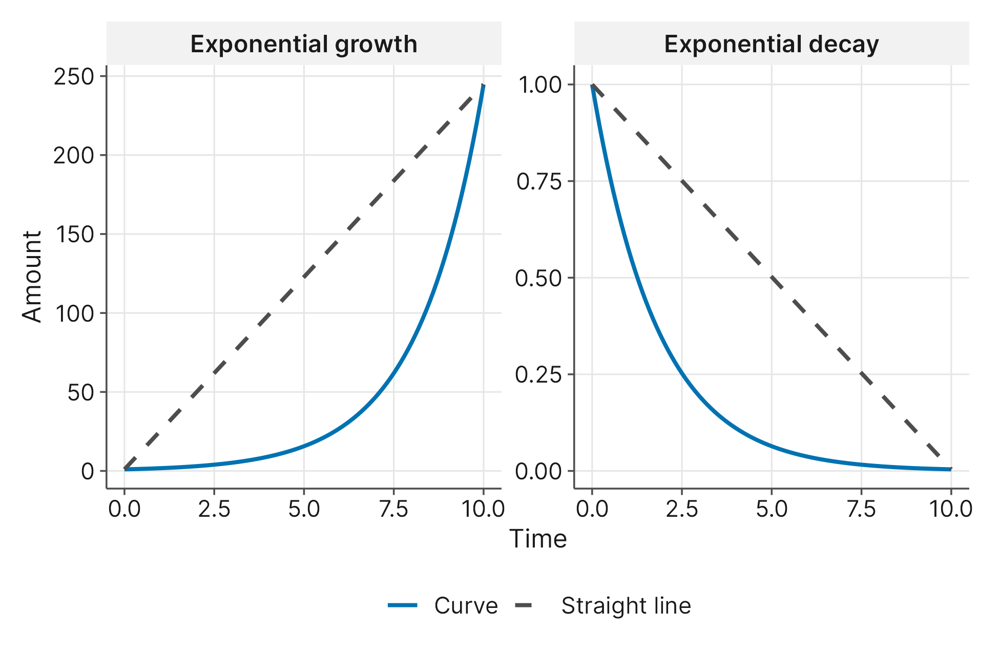
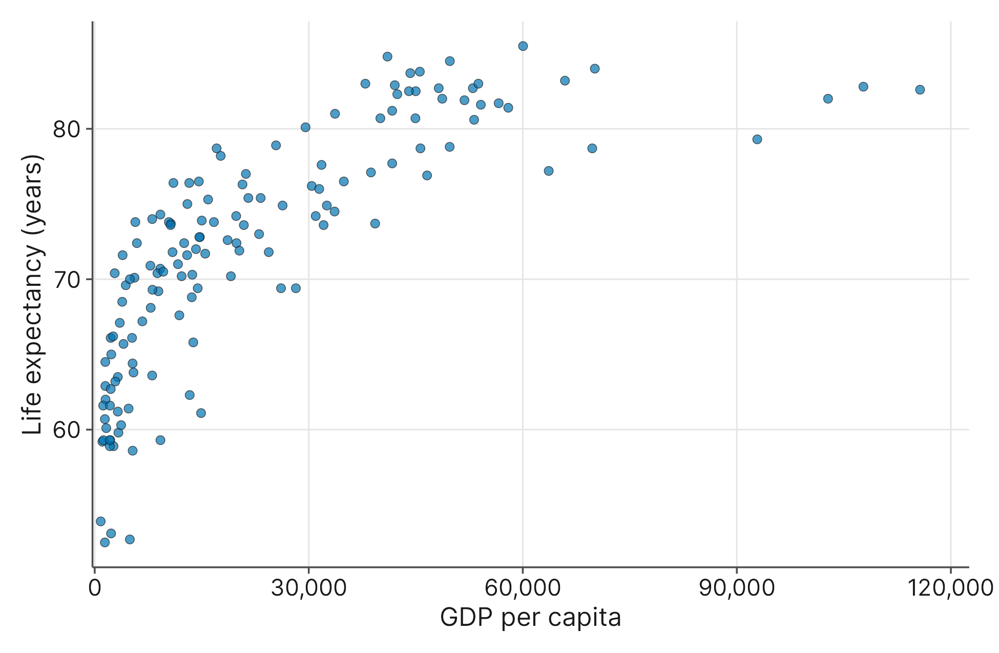

# Correlation and Simple Linear Regression

## 4.1 Introduction

Imagine you are a sociologist trying to understand what makes a society genuinely thrive. Does having a large economy automatically guarantee that citizens will live long, happy lives? Or does the environmental cost of that economic engine drag down well-being?

To explore these broad global questions, we will investigate data from the Happy Planet Index project, which evaluates how efficiently nations use their ecological resources to support long, high-quality lives for their residents. This dataset tracks 147 different countries across a variety of demographic and ecological metrics.

Before we begin asking questions, we must understand the data we are working with. Here is a dictionary of the specific variables from the dataset that we will analyze in this chapter:

- **Country**: A categorical variable identifying the name of the nation.
- **Region**: A categorical variable grouping the country into one of eight distinct geographic areas.
- **LifeExpectancy**: A numerical variable recording the average life expectancy of a resident in years.
- **Footprint**: A numerical variable measuring the ecological footprint per capita, which represents the biological surface area required to support a country's consumption and absorb its waste.
- **LOL**: A numerical variable representing the Ladder of Life score on a 0 to 10 scale, where residents subjectively rate their own overall well-being and life satisfaction.
- **GDPperCapita**: A numerical variable representing the Gross Domestic Product per person, adjusted for purchasing power.

In Unit I, we learned how to visualize relationships between two numerical variables using scatterplots. We also learned how to use hypothesis tests to determine if groups were significantly different from one another. But what if we want to move beyond simply spotting a relationship? What if we want to mathematically measure exactly how strong the connection is between a country's economic baseline and its health outcomes? Even more powerfully, what if we want to use a country's ecological footprint to predict its citizens' happiness scores?

By the end of this chapter, you will learn how to measure the exact strength of these relationships using linear correlation. You will learn a formal four-step modeling process for building simple linear regression models to make real-world predictions. Finally, you will learn how to check your models for errors, identify extreme country-level outliers, and safely transform heavily skewed social science data so that your mathematical tools remain reliable.

## 4.2 First Things First: Linear Correlation and the Coefficient of Determination

In our initial explorations of data, we learned that scatterplots are the perfect visual tool for exploring the relationship between two numerical variables. For our current analysis, we want to map the raw connection between a country's economic baseline and its physical strain on the environment. To do this, we will look at `GDPperCapita` alongside `Footprint`.

If you were to plot these two variables on a scatterplot, you might expect to see a noticeable upward trend. In general, as a nation's wealth increases, its ecological footprint also tends to increase. But before we start calculating mathematical summaries, we must issue a firm warning: **always look at your scatterplot first**.

Before you run any calculations, you must visually verify two things: first, that a relationship appears to exist, and second, that the relationship is plausibly linear (meaning the dots follow a roughly straight line). The tools in this chapter only measure straight-line relationships. If your scatterplot shows a clear curve (like a U-shape), you cannot use linear correlation. For curved relationships, researchers use specialized non-parametric tools like Spearman's rho, which we will cover in Chapter 10.

Assuming our scatterplot reveals a straight-line pattern, we can move forward. "Tends to increase" is a vague observation. To make rigorous claims, we need to mathematically measure exactly how tight and predictable this relationship is.

### Measuring Strength and Direction: Linear Correlation ($r$)

To put a precise number on the strength of a relationship, statisticians calculate the **linear correlation**, which is universally represented by the letter $r$. Linear correlation measures the exact strength and direction of a straight-line relationship between two numerical variables.

Mathematically, $r$ is scaled so that it is always between **-1** and **1**.

- **The Sign Tells You the Direction:** A positive $r$ means the variables move together (as one goes up, the other goes up, like wealth and lifespan). A negative $r$ means they move in opposite directions (as one goes up, the other goes down, like hours spent watching TV and exam scores).
- **The Number Tells You the Strength:** The closer the number is to the extremes (**1** or **-1**), the stronger the relationship. An $r$ of exactly **1** means every single data point forms a mathematically perfect straight line. The closer the number gets to **0**, the weaker the relationship becomes, until it resembles a random, unorganized cloud of dots.

If we calculate the linear correlation for our dataset, we will find a strong, positive $r$ value. This tells us that higher economic output is reliably associated with longer lifespans in our sample.

**Interpreting the Strength of $r$**

Just like we used Cohen’s $d$ in Chapter 3 to judge the practical size of a difference, researchers use standard rules of thumb created by Jacob Cohen to judge the size of a linear correlation. As a general guide, researchers in the social sciences interpret the absolute value of $r$ (ignoring the positive/negative sign) as follows:

- **$r \approx 0.10$**: A small relationship.
- **$r \approx 0.30$**: A medium relationship.
- **$r \approx 0.50$ or higher**: A large, strong relationship.

Remember that these specific cutoffs are designed strictly for the behavioral and social sciences. Why? Because the predictability of human behavior, biological growth, and social structures contains large amounts of inherent, natural variability. We rarely see perfectly tight straight lines when studying people.

However, these same cutoffs would not apply in the physical sciences. The predictability of a cannonball's trajectory is governed by strict mathematical laws of physics. Because a cannonball has virtually no "free will" or unseen emotional factors influencing its flight, a physicist would expect a correlation incredibly close to 1.0. You must always judge the strength of your correlation based on the natural variability of the field you are studying.

### Testing for Correlation: Population vs. Sample ($\rho$)

Just because we calculate a strong $r$ value for our specific sample of 143 countries with a recorded GDP per capita does not automatically guarantee that this relationship holds true for the entire, unmeasured globe. In Unit I, we learned the difference between English letters (which describe our known sample statistics) and Greek letters (which describe the true, unknown population parameters).

The sample statistic we just calculated is $r$. Its overarching population parameter is represented by the Greek letter rho ($\rho$). Before we can confidently rely on this relationship to build models, we must establish that a real linear relationship exists in the broader population. To do this, we run a hypothesis test for linear correlation.

Our null hypothesis acts as the skeptic, claiming there is absolutely no linear relationship in the real world:

- $H_0: \rho = 0$

Our alternative hypothesis claims a real linear relationship does exist:

- $H_1: \rho \neq 0$

If our statistical software gives us a $p$-value smaller than our significance level (typically .05), we can safely reject the null hypothesis. We must firmly establish that there is a non-zero linear correlation before we attempt to build a linear model.

### Measuring Real-World Impact: The Coefficient of Determination ($R^2$)

While knowing that two variables are connected is helpful, researchers usually want to know how much one variable explains the other. To find this, we use the **coefficient of determination**, more commonly known as R-squared (written mathematically as $R^2$).

The math behind this tool is simple: to find $R^2$, you simply take your correlation value ($r$) and square it by multiplying it by itself. But what does this new number mean in plain English?

The coefficient of determination tells you the exact percentage of variability in one variable that can be mathematically explained by the other variable. Notice that we are not assigning "cause" or "effect" here; correlation does not care which variable comes first. We are simply measuring how much the two variables overlap in their real-world fluctuations.

Let's ground this in our research scenario. A country's ecological footprint naturally varies from nation to nation. Why does one society require a large biological surface area to support its consumption, while another requires very little? There are dozens of reasons for this variation: local climate, agricultural efficiency, environmental regulations, cultural consumption habits, and the overall economy.

If we calculate an $R^2$ of **65.12%** for our economic and environmental data, it means that **65.12%** of all the differences in global ecological footprints can be explained by just knowing a country's GDP per capita. The remaining **34.88%** of the variation is due to all those other outside factors we haven't measured yet.

> **A Note on Notation: Why the Capital R?**
>
> You might be wondering why we suddenly switched from a lowercase $r$ to an uppercase $R$. In statistics, a lowercase $r$ specifically describes the simple relationship between exactly *two* variables. If you square that specific number, you mathematically get $r^2$.
>
> However, statisticians universally use the uppercase R-squared because it is a "future-proof" symbol. In the next chapter, we will build complex models that use several different variables at the same time. The uppercase R-squared is the overarching symbol used to represent the explained variation for those larger models. To keep things consistent, we get into the habit of using the uppercase letter right from the start. For our simple two-variable data, squaring your lowercase $r$ will always get you exactly R-squared.

**What is a "Good" R-Squared?**

As a new researcher, you might calculate an $R^2$ of 25% and feel disappointed. You might think, "My model leaves 75% of the variation unexplained; it must be a failure!"

Context is everything. In physical sciences, where gravity and chemicals behave with strict mathematical precision, researchers expect $R^2$ values well over 90%. But human beings are messy, unpredictable, and influenced by a web of competing factors. If a single economic variable can accurately explain 25% of the variation in global life expectancy, that is a big, valuable finding. While an $R^2$ of 25% might not be strong enough to perfectly *predict* the exact lifespan of one specific person, it is powerful for *explaining* broad, systemic trends in human behavior.

By pairing $r$ and $R^2$, you give your readers a complete picture. The linear correlation ($r$) proves the relationship exists and tells you which direction it moves, while the coefficient of determination ($R^2$) tells you how much that relationship practically matters in the real world.

## 4.3 Foundations of Modeling: The Four-Step Process

Knowing that a strong correlation exists between two variables is a good starting point. However, researchers usually want to do more than point out a connection; they want to build a mathematical tool that can make actual predictions. We call this tool a statistical model.

Building a reliable model requires discipline. To ensure our predictions are trustworthy, we will follow a strict, four-step modeling process:

1. **Choose a form:** First, we look at a scatterplot of our data to decide if a straight mathematical line makes logical sense for the shape we see.
2. **Fit to data:** Next, we rely on our statistical software to calculate the exact mathematical line that best cuts through the center of our data points.
3. **Assess accuracy:** We then perform diagnostic checks to see how much our data deviates from that perfect line, ensuring our tool does not have any hidden, systematic errors.
4. **Use for inference:** Finally, if the model passes our checks, we use it to make real-world predictions and draw conclusions about our population.

### A Warning on Ordinal Variables

In linear regression, the variable you are trying to predict is called the **response variable** (traditionally plotted on the y-axis). The math behind linear regression requires this response variable to be a true numerical measurement.

You cannot use a single, isolated ordinal category as your response variable. For example, if you ask a single survey question where participants rate their happiness as "Low," "Medium," or "High," you cannot build a linear regression model to predict those words. Even if you code those answers as the numbers 1, 2, and 3, they are still just descriptive buckets, not true mathematical quantities.

However, in the social sciences, researchers often combine many ordinal questions together to create a large composite score. In our dataset, the Ladder of Life (LOL) variable is a subjective well-being score measured on a 0 to 10 scale. Because it spans 11 distinct levels and acts as a broad numerical index, researchers generally treat it as a continuous numerical variable.

But tread carefully: a broad 10-point scale is not a statistical "get out of jail free" card. As we learned in Chapter 2, before you can safely treat any composite ordinal score as a true numerical variable, you must rigorously establish its **reliability** and **validity**. You must prove that your survey consistently yields the same results under the same conditions (reliability) and that it genuinely measures the abstract concept you claim it measures (validity). Only after those foundational design checks are passed can we safely use a variable like the Ladder of Life as the response variable in our modeling process.

## 4.4 Fitting the Model: The Regression Line

Now that we understand the four-step process, let us put it into action. For our primary application, we want to know if the wealth of a society can predict its environmental impact. We will build a model using a country's GDP per capita (our predictor variable, or $x$) to predict its ecological footprint (our response variable, or $y$).

When you ask your statistical software to fit a simple linear regression model, it will calculate a line of best fit. This line is mathematically positioned to sit as close to every single data point in your scatterplot as physically possible. The software will output a formula for this line that looks something like this:

$$\text{Predicted Footprint} = \text{Intercept} + (\text{Slope} \times \text{GDPperCapita})$$

This equation might look intimidating, but it only contains two essential pieces of information that you need to interpret: the intercept and the slope. By translating these two numbers into plain English, you connect the abstract mathematics directly to real-world outcomes.

### Interpreting the Intercept

The **y-intercept** is your baseline prediction. It tells you exactly what value your model predicts for the response variable ($y$) when your predictor variable ($x$) is exactly zero.

Suppose our software calculates an intercept of **1.672**. In plain English, this means: *If a country had a GDP per capita of exactly zero dollars, we would predict an average ecological footprint of 1.672.*

As a researcher, you must always pause and ask if the intercept makes logical sense in the real world. Can a functioning nation have an economic output of exactly zero dollars? No. In many models, the intercept is just a mathematical anchor for the line and does not represent a realistic, observable scenario.

### Interpreting the Slope

The **slope** is the most important number in your entire model. It represents the rate of change. Specifically, it tells you exactly how much your predicted response variable ($y$) is expected to change for every single one-unit increase in your predictor variable ($x$).

Suppose our software calculates a slope of **0.000247**. Because this is a positive number, it means the line is pointing upward. In plain English, we interpret it like this: *For every one-dollar increase in a country's GDP per capita, we expect their average ecological footprint to increase by 0.000247 units.*

At first glance, a slope of 0.000247 looks weak. However, you must always remember your units! GDP is measured in individual dollars. A single, one-dollar raise in national wealth is practically invisible. But what if a country's GDP per capita increases by $\$10,000$? We would simply multiply our slope ($0.000247$) by $10,000$ to see that the country's footprint would increase by a noticeable $2.47$ units. This slope directly answers our research question: it tells us that, on average across the globe, heavier economic output is indeed associated with a larger environmental footprint.

This brings us to a key rule for statistical modeling: **never confuse the size of a slope with the strength of a relationship**. A tiny slope decimal does not automatically mean a weak connection; it usually just means your predictor variable is measured in extremely small units, like individual dollars.

If you want to know how strong the relationship is, you must look at your linear correlation ($r$). If you want to know how reliable your predictions will be, you must look at your R-squared ($R^2$).

## 4.5 Model Diagnostics: Checking Our Work

We have chosen a linear form, and our software has calculated the exact mathematical line that best fits the relationship between a country's wealth and its ecological footprint. It is tempting to take our slope and intercept, declare victory, and immediately start making predictions. However, we are only on the third step of our four-step modeling process.

Before we can trust our model, we must assess its accuracy. Just because statistical software *can* draw a straight line through a scatterplot does not mean that line is actually a reliable tool. To check for hidden errors, statisticians analyze what the model gets wrong.

### The Anatomy of an Error: What is a Residual?

No model is perfect. In our dataset, there are undoubtedly countries whose actual ecological footprints are much higher or lower than what our GDP-based line predicts.

The mathematical difference between a country's *actual* data point and the model's *predicted* value on the line is called a **residual**. You can think of a residual as the model's error for that specific observation.

- If a country's actual footprint is higher than the line predicts, it has a **positive residual** (the model underestimated the impact).
- If a country's actual footprint is lower than the line predicts, it has a **negative residual** (the model overestimated the impact).
- If a country lands exactly on the regression line, its residual is exactly **zero**.

To run diagnostic checks, statistical software will calculate the residual for every single country in the dataset and generate a **residual plot**. This plot places your predictor variable (GDP per capita) on the horizontal axis and the model's errors (the residuals) on the vertical axis, with a horizontal line drawn at zero to represent perfect predictions.

When you look at a residual plot, you are hoping to see a boring, unorganized cloud of dots. Random "static" means the model's errors are just natural, unpredictable background noise. If you see clear patterns in the errors, it means your model is systematically failing.

### The Three Diagnostic Checks

When evaluating a residual plot, researchers look for three specific conditions to ensure their model is mathematically reliable:

**1. Linearity (No Curves)** Even if your initial scatterplot looked somewhat straight, the residual plot acts as a magnifying glass for curves. If the dots in your residual plot form a distinct "U-shape" or a rainbow arch, it means the true relationship is curved, and your straight-line model is consistently predicting too high in the middle and too low on the edges (or vice-versa). If you fail this check, you cannot use a simple linear model.

**2. Equal Variance (Homoscedasticity)** This intimidating statistical word simply means "same scatter" or "same spread." As you move from left to right across the residual plot, the vertical spread of the dots should remain relatively constant, forming an even band of noise.

If the dots start tightly clustered on the left but fan out into a wide megaphone or cone shape on the right, you have a violation called *heteroscedasticity* (unequal spread). In the context of our data, this would mean our model is accurate at predicting the footprints of poorer nations, but its predictions become wildly unreliable and scattered for the wealthiest nations.

**3. Independence (No Structural Patterns)** The model assumes that every data point is an independent event, and that one error doesn't systematically predict another. While independence is usually ensured by good study design, we can use residual plots to check for structural biases we might have missed.

Let's apply this to our dataset. What if we took our residual plot and color-coded all the dots by their geographic `Region`?

Suppose we notice that almost all the dots representing Western European countries are clustered tightly together *above* the zero line (positive residuals), while all the dots representing Sub-Saharan African countries are clustered together *below* the zero line (negative residuals).

This is a major red flag. It tells us that our model is structurally biased: it systematically underestimates the environmental impact of Europe and systematically overestimates the impact of Africa. A single, global economic line is too simplistic. This finding reveals that geography and local culture play a distinct structural role in environmental impact that a nation's wealth alone cannot capture.

When a model fails this kind of diagnostic check, researchers don't throw the data away; instead, it is a signal that they need to build a more complex model that includes multiple variables at the same time, a technique we will master in Chapter 5.

**4. Normality (A Bell Curve of Errors)**

The first three checks ensure that your regression line is structurally sound and unbiased. However, as we outlined in our four-step process, drawing the line is usually not the final goal; researchers ultimately want to use that line to make real-world predictions. To do that safely, we must pass one final check: the residuals must be roughly normally distributed.

We need to be precise about what we are actually checking here. We are **not** requiring your predictor variable ($x$) or your response variable ($y$) to form a perfect bell curve. We are only requiring the *errors* (the residuals) to form a bell curve.

What does this mean in plain English? It means that most of the time, our model should only make small, routine errors (landing near the center of the bell curve). It should only rarely make catastrophic errors (landing in the extreme tails of the curve).

If a model's errors follow this predictable, normal pattern, statisticians can rely on the probability rules from Unit I to build mathematically sound "error bars" (like confidence intervals) around their future predictions. If the errors are wildly skewed (meaning the model routinely makes large overestimations but never makes large underestimations), we can still use the line as a basic summary of the data, but we lose the mathematical right to use it as a reliable tool for forecasting the future.

> **The L.I.N.E. Checklist**
>
> To remember these four diagnostic checks, researchers often use the simple acronym **L.I.N.E.**:
>
> - **L**inearity (No curves in the residual plot)
> - **I**ndependence (No structural patterns or groupings)
> - **N**ormality (The errors form a rough bell curve)
> - **E**qual Variance (The vertical spread of the dots remains constant)

## 4.6 The Anomalies: Outliers and Influential Points

When we first introduced the concept of outliers in Chapter 1, we defined them simply as data points that were unusually high or low compared to the rest of a single variable. But in linear regression, the definition of an anomaly becomes a bit more complex.

In a regression model, an **outlier** is a data point that strays far away from the regression line. It doesn't necessarily have an extreme raw value; rather, it breaks the *pattern* established by the rest of the data. For example, a country with an average GDP but a high ecological footprint would have a large residual, making it an outlier for our specific model.

However, not all outliers are equally disruptive. Statisticians are specifically worried about a dangerous sub-category of anomalies known as **influential points**.

### The Seesaw Metaphor: Leverage and Influence

To understand how a single data point can manipulate an entire model, imagine your regression line as a long seesaw balanced on a playground.

If a child sits perfectly in the middle of the seesaw, their weight doesn't tilt the board much at all. In our model, the "middle" represents the average GDP per capita. If a country with an average economy has a weirdly high footprint, it will sit far above the line, but it lacks the physical "leverage" to tilt the line upward. It simply exists as a regular outlier with a large error.

Now, imagine a heavy adult sits on the extreme far edge of the seesaw. Their position gives them immense leverage, and the entire board aggressively tilts toward them.

In linear regression, if a data point sits at the extreme far edge of the x-axis (meaning it has an exceptionally rare, large predictor value), it has high statistical **leverage**. If that point also strays away from the overall pattern, it will act like a magnet, physically dragging the entire regression line toward itself. When a point has enough leverage to significantly alter the model's slope or intercept, we call it an **influential point**.

### Finding the Magnets in Our Data

Let's look for these anomalies in our global dataset. When modeling ecological footprint based on national wealth, most countries cluster together smoothly. However, if we look at the far right edge of our scatterplot, we might spot a few extreme economic anomalies, such as wealthy micro-states or oil-rich nations like Qatar or Luxembourg.

Because these specific nations have high GDP per capita (giving them substantial leverage) and unique consumption patterns, they can single-handedly pull the global regression line steeper or flatter than it rightfully should be for the rest of the world.

### Measuring the Magnet: Cook's Distance

You might be wondering, "How much leverage is *too much* leverage?" Fortunately, statisticians have built a specific tool to answer exactly that question: **Cook's Distance** (often abbreviated as Cook's D).

Cook's Distance is a metric that essentially automates the "what if?" scenario. Behind the scenes, your statistical software calculates the regression line with a suspicious point included, then recalculates the entire line with that point removed, and measures exactly how drastically the line shifted. It runs this simulation for every single data point in your dataset.

As a general rule of thumb in the social sciences, if a single data point has a Cook's Distance greater than **1.0**, it is universally considered a highly influential point. It is a magnet that is tilting the seesaw so severely that it is warping the mathematical reality for the rest of the population.

### The Ethics of Anomalies

When a researcher spots an influential point ruining their perfectly straight line, the immediate temptation is to highlight the row and hit the "Delete" key. After all, removing the anomaly will instantly make the $R^2$ look better!

You must resist the temptation to delete data simply because it makes your model look messy. Extreme data points often hold the most valuable scientific insights. A micro-state with great wealth and a uniquely small footprint isn't "bad data"; it is a real-world exception that might teach us how to build more sustainable economies.

However, if you check your diagnostics and find that this micro-state has a Cook's Distance well over 1.0, you finally have mathematical justification to remove it from your primary model. Doing so will create a much more accurate prediction tool for the other 99% of the world.

If you make this choice, you must do so with perfect ethical transparency. Standard practice is to run the model twice: once *with* the influential point, and once *without* it. In your final report, you must clearly tell your readers that you removed the point, explicitly cite its high Cook's Distance to justify your decision mathematically, and briefly discuss the anomaly so its unique story is not lost to history.

## 4.7 Handling Curves: Logarithmic Transformations

Throughout this chapter, we have firmly established that linear regression requires a straight-line relationship. Our first and most important diagnostic check is to verify that the pattern in our scatterplot does not curve.

But what happens when you have two variables that are closely related, but their relationship is curved? In the social sciences, researchers frequently encounter two specific types of curved relationships:

**1. Exponential Growth and Decay**

Some variables compound over time or scale. For example, population sizes tend to grow exponentially, curving sharply upward like a hockey stick. Conversely, things like memory retention tend to decay exponentially, dropping sharply at first and then slowly leveling out.

{fig-alt="Two side-by-side line charts. The left panel shows a curve that rises slowly and then steeply, labeled exponential growth, below a dashed straight line illustrating a linear trend. The right panel shows a curve that drops steeply and then flattens, labeled exponential decay, also below the dashed straight line showing a linear trend."}

**2. The Law of Diminishing Returns**

Other relationships rise quickly but eventually hit a natural ceiling. A classic example of this is comparing a country's wealth (`GDPperCapita`) to the average lifespan of its citizens (`LifeExpectancy`).

{fig-alt="Scatterplot of GDP per capita versus life expectancy for 143 countries. Points rise steeply from the mid-50s at the lowest incomes and then flatten near 80 years at higher incomes."}

This specific curve illustrates a concept known as the **law of diminishing returns**. Think about it in plain English: if a poor nation increases its GDP per capita by $\$5,000$, that money can build rudimentary hospitals, secure clean water sources, and provide basic vaccines. That single $\$5,000$ increase will cause a dramatic spike in the nation's average life expectancy.

However, if an already wealthy nation (like Switzerland or Norway) increases its GDP per capita by that same $\$5,000$, the impact on health is practically invisible. They already have clean water and modern hospitals.

A linear regression model assumes a constant rate of change; it assumes $\$5,000$ buys the same amount of health everywhere in the world. Because human health does not work that way, a straight-line model will systematically fail.

### "Squishing" the Scale: The Log Transformation

When researchers encounter a fundamentally curved relationship, they do not throw the data away. Furthermore, they do not need to invent a brand new, complex type of curved regression. Instead, they use a mathematical trick to **linearize** the data. This means they mathematically filter the data so that the severe curve straightens out, allowing them to safely use the same straight-line linear regression tools we have already learned.

The most common tool for linearizing data is a **logarithmic transformation** (often called a log transform). You do not need to memorize the complex algebra behind logarithms. Conceptually, taking the logarithm of a variable simply "squishes" its scale. It pulls the extreme numbers on the right side of the graph tightly inward, while gently stretching out the smaller numbers on the left.

If we ask our statistical software to calculate the logarithm for every country's `GDPperCapita`, and then we plot those *new* transformed values against `LifeExpectancy`, something magical happens: the severe curve disappears, and the dots fall into a beautiful straight line. We have successfully leveled the playing field, and our model now passes its linearity check.

### Interpreting a Transformed Model

Once you transform your predictor variable, your statistical software will give you a new slope, a new intercept, and a new $R^2$. You evaluate the four-step modeling cycle exactly the same way you normally would.

Let's look at the actual output when we apply a **Base-10 logarithm** (written as `log10`) to our global health data. By squishing the wealth scale, our model's accuracy jumps. We achieve an $R^2$ of **77.22%**, meaning over three-quarters of the global variation in lifespan can be explained by our new, linearized economic curve.

Our software also hands us a new regression equation:

$$\text{Predicted LifeExpectancy} = 16.28 + 13.54 \times \log_{10}(\text{GDPperCapita})$$

Because we mathematically altered the data, we can no longer interpret the slope in simple, one-dollar steps. A one-dollar increase doesn't mean the same thing everywhere anymore. Instead, because we used a Base-10 log, our slope now represents the expected change in life expectancy every time a country's wealth **multiplies by 10**.

Let's translate our new slope (**13.54**) into plain English using concrete numbers:

- **Scenario A:** Imagine a poor developing nation grows its economy from **$\$1,000$** per person to **$\$10,000$** per person. Because their wealth just multiplied by 10, our model predicts their average life expectancy will increase by **13.54 years**.
- **Scenario B:** Now, imagine an already comfortable, developed nation grows its economy from **$\$10,000$** per person to **$\$100,000$** per person. Even though this requires an influx of $\$90,000$ per person, they have still only multiplied their wealth by 10. Therefore, our model predicts their average life expectancy will *also* increase by exactly **13.54 years**.

These scenarios capture the law of diminishing returns: In Scenario A, it only cost $\$9,000$ to buy 13.5 years of life. In Scenario B, it cost $\$90,000$ to buy that same 13.5 years of life.

By applying a log transformation to linearize the data, you allow your mathematical tools to understand that wealth operates on a sliding scale of impact. This is one of the most powerful and frequently used techniques in a researcher's toolkit for handling the natural, curved realities of human societies.

## 4.8 Inference and Predictions

If your model has successfully passed the L.I.N.E. diagnostic checks, you are finally ready for the fourth and final step of the modeling process: using the line to make real-world inferences.

In Chapter 3, we learned that sample statistics are just estimates of the true population parameter. Because every sample naturally varies, we used Confidence Intervals to create a mathematical net that we hope captures the true population average. That same logic applies to linear regression. Our software calculated a specific slope and intercept for our sample of 143 countries with a recorded GDP per capita, but our ultimate goal is to understand the true relationship in the broader world.

### Confidence Intervals for the Slope

The single most important number in our model is the slope, as it tells us the rate of change between wealth and environmental impact. For our economic model, the software calculated a sample slope of **0.000247**.

To infer what the true population slope might be, we generate a 95% Confidence Interval. For the relationship between `GDPperCapita` and `Footprint`, our software calculates a 95% interval for the slope of **(0.000217, 0.000277)**.

Because this entire interval is positive (it does not cross zero), we have strong evidence that the true relationship is positive. We can confidently report: *We are 95% confident that in the real world, for every one-dollar increase in a country's GDP per capita, the true average ecological footprint increases by between 0.000217 and 0.000277 units.* 

Simple scaling is mathematically valid here, so if we wanted to look at a more meaningful $10,000 change in GDP per capita, we simply multiply the confidence interval values by 10,000 as well: *We are 95% confident that in the real world, for every $10,000 increase in a country's GDP per capita, the true average ecological footprint increases by between 2.17 and 2.77 units.*

### Point Estimates: Predicting the Mean

When you plug a specific predictor value ($x$) into your regression equation, the math spits out a single predicted number ($\hat{y}$). This is called a **point estimate**.

However, there is a common misconception about what this point estimate actually represents. If we plug a GDP of **$70,000** into our equation, the model does not predict exactly what one specific, individual country will do. Instead, it predicts the **mean** (the average) footprint for *all* countries that have a GDP of $70,000.

### Predicting the Average vs. Predicting the Individual

Just like we built an interval around our slope, we can build intervals around our predictions. But because regression allows us to predict both group averages and individual outcomes, we have two different types of intervals to choose from: Confidence Intervals and Prediction Intervals.

To see the difference, let's evaluate a GDP of **$70,000** (roughly the wealth level of the United States).

**1. The Confidence Interval (CI) for the Mean**

If your research question is, "What is the *average* footprint for all countries with a $70,000 GDP?", you use a Confidence Interval.

- **The 95% CI is (17.38, 20.52).**

- **Interpretation:** We are 95% confident that the true *average* ecological footprint for the entire group of nations with a $70,000 GDP falls between 17.38 and 20.52.

  

**2. The Prediction Interval (PI) for an Individual**

If your research question is, "What will the footprint be for *one specific, newly observed country* that has a $70,000 GDP?", you use a Prediction Interval.

- **The 95% PI is (10.59, 27.31).**
- **Interpretation:** We are 95% confident that the ecological footprint for a *single* nation with a $70,000 GDP will fall between 10.59 and 27.31.

{fig-alt="Scatterplot of ecological footprint against GDP per capita for 143 countries, with a rising regression line. A narrow shaded band hugs the line and a much wider shaded band surrounds it, widening at higher incomes."}

Notice how much wider the Prediction Interval is than the Confidence Interval! This illustrates a core truth of the social sciences: **groups are predictable, but individuals are wildly erratic.**

It is relatively easy for a model to predict the steady, reliable average of a large group of countries. It is mathematically much harder to predict the behavior of one single, unique country with its own distinct culture, politics, and geography. Because predicting an individual carries far more uncertainty, the Prediction Interval must cast a much wider net to maintain that 95% level of confidence.

## 4.9 Common Mistakes and Misconceptions

As you begin applying regression analysis to your own research, keep these common pitfalls in mind:

- **The "$r = 0$" Trap:** If your software tells you that $r = 0$, do not assume there is *no* relationship between your variables. An $r$ of 0 only means there is no *linear* (straight-line) relationship. Your variables might still be strongly connected, but in a curved or complex way that a straight line cannot capture. Always look at your scatterplot!
- **Assuming Causation:** Correlation proves that variables move in a predictable, synchronized way. It never proves that one variable *causes* the other. Unless you are running a strictly controlled, randomized experiment, always use language like "predicts" or "is associated with" rather than "causes."
- **The "Bigger Slope is Better" Fallacy:** New researchers often see a large slope coefficient and assume it represents a stronger influence than a smaller slope. This is incorrect. Slope represents the rate of change based on the units of measurement (e.g., dollars vs. thousands of dollars). To judge the strength of the relationship, look at the correlation ($r$).
- **Extrapolation:** A regression line is only valid within the boundaries of the data you collected. Using that line to predict values far outside your observed range (like predicting the life expectancy of a hypothetical nation with one billion dollars of GDP) is a gamble, not science.

## 4.10 Key Concepts

1. **Linear Correlation ($r$):** Measures the direction and strength of a straight-line relationship between two numerical variables (range: -1 to 1).
2. **Coefficient of Determination ($R^2$):** Tells you the percentage of variation in the response variable explained by the predictor variable.
3. **Four-Step Modeling:** 1) Choose a form, 2) Fit the line, 3) Assess accuracy (diagnostics), 4) Use for inference.
4. **Residuals:** The error in your model, the vertical distance between an actual data point and the regression line.
5. **Diagnostic Checklist (L.I.N.E.):** **L**inearity, **I**ndependence, **N**ormality of errors, and **E**qual variance.
6. **Influential Points:** Anomalies that have enough leverage (typically at the extreme edges of the x-axis) to "drag" the regression line toward themselves. Cook's Distance ($>1.0$) helps identify these.
7. **Log Transformation:** A method to "linearize" curved (fundamentally exponential) relationships so they can be analyzed using standard linear regression tools.
8. Confidence and Prediction Intervals: When making predictions at a particular $x$ value, a Confidence Interval will tell you where you can expect to find the average, and the Prediction Interval will tell you where you can expect to find an new, unobserved individual value.

## 4.11 New Notation

| **Symbol** | **Read Aloud** | **Represents in Plain English**                              |
| ---------- | -------------- | ------------------------------------------------------------ |
| $r$        | "r"            | The sample linear correlation coefficient.                   |
| $\rho$     | "rho"          | The true, unknown population linear correlation.             |
| $R^2$      | "R-squared"    | The coefficient of determination; proportion of variance explained. |
| $y$        | "y"            | The response variable (the outcome we are predicting).       |
| $x$        | "x"            | The predictor variable (the information we use to predict).  |
| $\hat{y}$  | "y-hat"        | The value of $y$ predicted by our regression model.          |

: Table 4.1: Notation used in this chapter, with how each symbol is read aloud.

## 4.12 Exercises

### Interpretation

1. A researcher studying urbanization and biodiversity calculates an $r$ of -0.85 between the square mileage of paved roads and the number of native bird species per square mile. How would you describe the strength and direction of this relationship in plain English?
2. A sociologist builds a model predicting a person's adult income based on the number of books in their childhood home, calculating an $R^2$ of 12%. A colleague tells her the model is "useless" because it leaves 88% of the variation unexplained. Based on the expectations for social science research, is her colleague right? Why or why not?
3. You build a model to predict a college student's final exam score based on the number of hours they spent studying. Student A has a negative residual, while Student B has a positive residual. In plain English, what does this mean about the model's predictions for each individual student?

### Choosing a Method

4. A political scientist wants to predict voter turnout in a county using a single survey question where residents ranked their trust in local government as "Low," "Medium," or "High." Is it mathematically appropriate to use this isolated category as the response variable ($y$) in a linear regression model? Explain.
5. An agricultural researcher is studying the relationship between the amount of fertilizer applied to a field and the total crop yield. The scatterplot shows a clear curve: crop yield goes up steadily with moderate fertilizer, but drops drastically when too much fertilizer poisons the soil. Should the researcher proceed with building a standard linear regression equation? Why or why not?
6. A psychologist measures the correlation between the number of cups of coffee consumed and scores on a memory test for 30 participants. Before attempting to construct a regression equation to predict memory scores, they run a hypothesis test with $H_0: \rho = 0$. Why is this step necessary before building the model?

### Communicating Results

7. A popular health blog publishes an article titled, "New Study Proves That Eating Organic Blueberries Causes Higher Standardized Test Scores!" The study they cite found a strong linear correlation ($r = 0.72$) between a school district's average organic food purchases and their average SAT scores. Based on your knowledge of regression and confounding variables, what is the fundamental flaw in the blog's claim?
8. While modeling the relationship between city population and crime rates, you discover a highly influential point: a tiny resort town that hosts a multi-million-person festival one week a year. The software shows its Cook's Distance is 2.4. You decide to remove it to better represent normal municipal crime rates. What ethical obligation do you have to your readers when reporting your final results?
9. An economist uses data from 1990 to 2010 to build a regression model predicting housing prices based on inflation rates. Next year, they plug in an unprecedented, record-breaking inflation rate (one that is twice as high as anything seen in their dataset) to predict the future housing market. What statistical error are they committing, and why is it dangerous?

### Software Application

*Load the `happy_planet_index_2024.csv` dataset into statistical software to complete these exercises:*

10. **Visualizing the Relationship:** Use a scatterplot to visually check the direction and shape of the relationship before we attempt to calculate any mathematical models.
a) Create a scatterplot of `GDPperCapita` (predictor variable on the x-axis) and `LOL` (response variable on the y-axis).
b) Describe the visual relationship. Does it appear plausibly linear, or is there a severe curve?
c) Does the visual trend suggest a positive or negative linear correlation?

11. **Quantifying the Connection:** Use the linear correlation and coefficient of determination to measure exactly how strong the relationship is and how much real-world variation our predictor explains.
a) Find the linear correlation ($r$) for `GDPperCapita` and `LOL`. Based on standard social science guidelines, is this a small, medium, or large effect?
b) Find the coefficient of determination ($R^2$).
c) Interpret the $R^2$ value in a single, plain-English sentence, being sure to name the specific variables involved.

12. **Modeling and Diagnostics:** Generate the actual regression equation so we can make point estimates, and to check our residual plot to ensure our model isn't hiding any structural errors.
a) Use your software to fit a simple linear regression model predicting `LOL` based on `GDPperCapita`. Report the sample slope and y-intercept.
b) Interpret the slope in the context of the data (Remember your units! What happens if GDP goes up by $\$10,000$?).
c) Generate a residual plot for this model. Look at the spread of the dots; does it pass the "Equal Variance" (Homoscedasticity) check, or does it fan out into a megaphone shape? What does this tell you about the model's accuracy for wealthier nations?

13. **Transformation:** Investigate the effect of a log transformation on this non-linear relationship.
a) Plot the log transformation of `GDPPerCapita` as the predictor against `LOL` as the response. How did the linearity of the plot change?
b) Re-run the regression model using the log-transformed variable. Did the $R^2$ improve? Why might that be the case?
