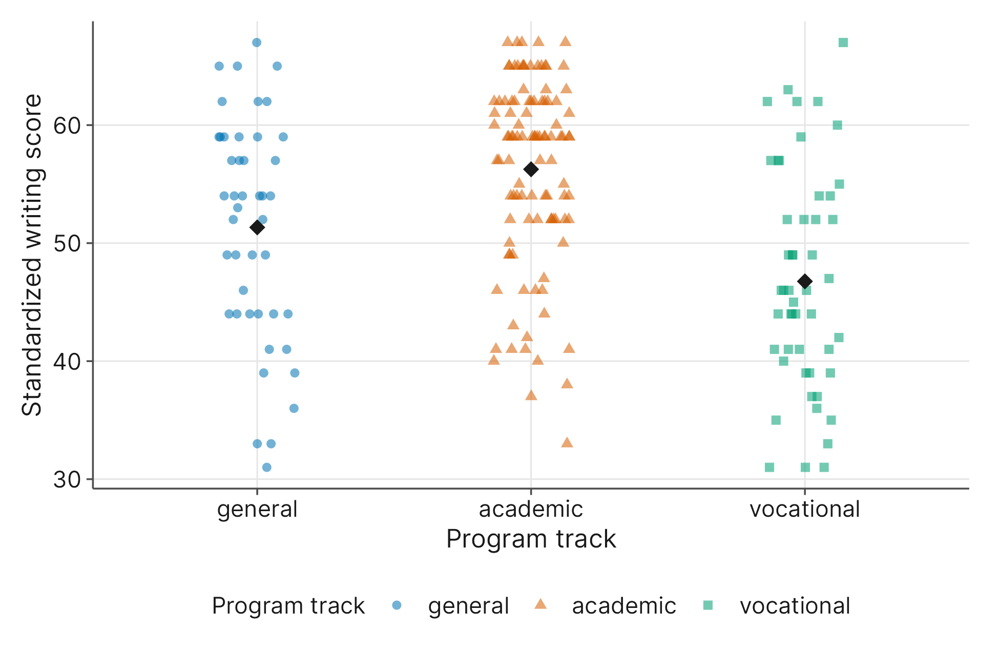
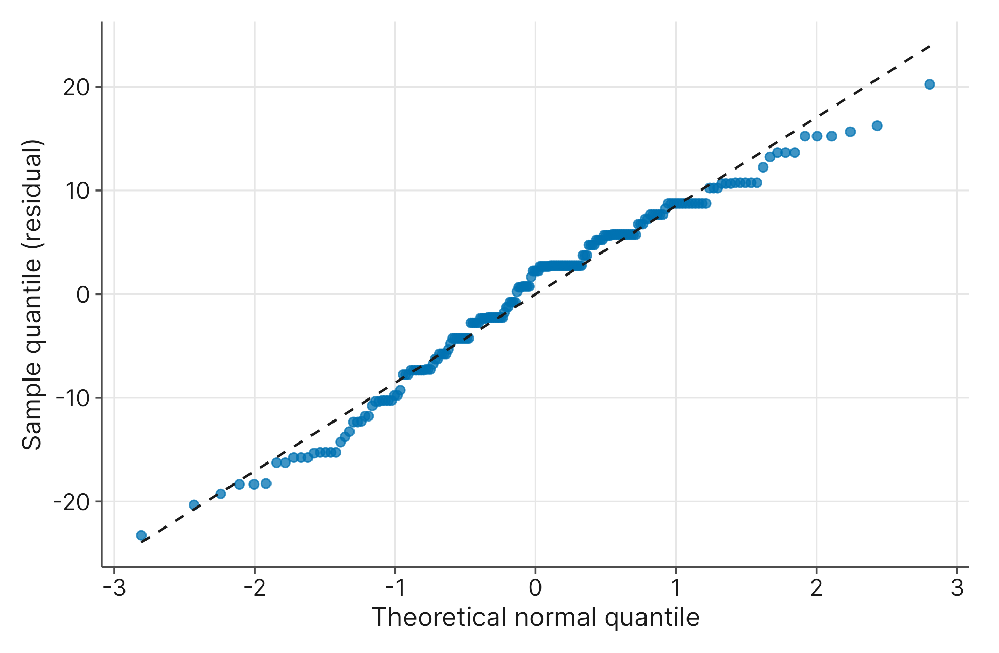

# The One-Way ANOVA

## 6.1 Introduction

In our previous chapters, we spent a lot of time exploring how to compare groups. For instance, in Chapter 3, you learned how to use an independent sample $t$-test to determine if a numerical variable's average differed significantly between two distinct groups, such as a diet intervention group and a control group. But the social world is rarely limited to simple either-or comparisons. What happens when we want to compare outcomes across three, four, or even more groups at the same time?

Consider the structure of the American high school system. Many schools use "academic tracking," placing students into distinct educational programs based on their perceived abilities or career goals. A researcher might ask: Does the choice of program track have a measurable effect on a student's academic performance? 

To explore this, we will use the `hsb.csv` dataset, which contains a random sample of 200 high school seniors from the High School and Beyond study, a major national longitudinal study managed by the National Center for Education Statistics.

- **`prog`**: A categorical variable indicating the academic program track the student is enrolled in (general, academic, or vocational).
- **`write`**: A numerical variable representing the student's standardized writing score (scaled to a standardized metric with a mean around 50 and a standard deviation of 10).

*(Note: The original dataset contains several other demographic and academic variables, but we are explicitly omitting them here to focus solely on the relationship between program track and writing performance).*

By the end of this chapter, you will learn how to partition the variation in a dataset to see if it stems from the program track or just random individual differences. You will also learn how to validate the underlying assumptions of the ANOVA model, and, if a significant difference is found, how to responsibly pinpoint exactly which groups differ from one another using post hoc tests without compromising your standards of evidence.

## 6.2 What Do We Mean by Experimental Design?

When you hear the phrase "experimental design," you might picture scientists in white coats mixing chemicals in a sterile laboratory. But in the social sciences, economics, and psychology, experimental design is rarely about test tubes. Instead, it is about how we structure our observations to compare different conditions, interventions, or pre-existing groups.

To work through these designs, we need to establish a shared vocabulary. When we set up a study to compare groups, we use very specific terms to describe our variables:

- **Response variable**: This is the numerical outcome we are ultimately trying to measure or predict. In our high school dataset (`hsb.csv`), the response variable is the student's standardized writing score (`write`).
- **Factor** (or **treatment variable**): This is the categorical variable that divides our sample into the distinct groups we want to compare. In our running example, the factor is the academic program track (`prog`).
- **Factor levels** (or **treatment levels**): These are the specific, individual categories that make up the factor. Our program track factor has three distinct levels: general, academic, and vocational.
- **Treatment groups**: These are the actual subsets of participants who fall into each level. For instance, all the students in our sample who are enrolled in the academic track make up one treatment group.

Notice how we use the word treatment here. In everyday language, a "treatment" implies a medical intervention, like giving a patient a new diet plan or a specific medication. But in a strict statistical sense, a **treatment** is simply the specific condition or category that distinguishes our groups.

Sometimes, researchers actively *apply* a treatment. For example, a psychologist might randomly assign patients to receive either cognitive behavioral therapy, group counseling, or a placebo to measure changes in anxiety. This is a classic, active experimental design.

Other times, we simply observe pre-existing subgroups. In our high school dataset, we did not force students into different program tracks as an experiment; they were already grouped that way based on their choices or school policies. A sociologist might compare income levels across different geographical regions, or a political scientist might compare voter turnout across different age brackets. These are technically observational designs because we are just comparing existing subgroups.

Here is the beautiful part about the framework we'll develop in this chapter: the mathematical machinery behind the scenes does not care whether you actively applied a clinical treatment or simply divided your dataset into naturally occurring subgroups. Whether you are testing an active intervention (like a diet plan) or observing a built-in category (like an academic track), statisticians treat them as the same idea: we are simply comparing means across different categories.

## 6.3 What is an ANOVA?

Now that we have our vocabulary, we can introduce the tool we use to analyze this data: the **ANOVA**.

At its core, an **ANOVA** (which stands for Analysis of Variance) is a statistical test that compares the averages of three or more independent groups to determine if there is a statistically significant difference between them. Think of it as the natural upgrade to the independent sample $t$-test you learned in Chapter 3. While the $t$-test is strictly limited to comparing exactly two groups, an ANOVA can handle three, four, or even fifty groups simultaneously. You will use an ANOVA whenever your research question involves a categorical factor with at least three distinct levels and a numerical response variable. For example, determining if mean numerical writing scores differ across the three distinct categorical program tracks (general, academic, and vocational) is a perfect job for an ANOVA.

If you are paying close attention, that name might sound a bit strange. Why are we talking about "variance" when our goal is to compare *averages* across different groups? In Chapter 1, we learned that the standard deviation is our primary measure of how spread out, or variable, our data is. **Variance** is simply another mathematical way to measure that same concept of variability. As we will see in the next section, the secret to comparing group averages lies in analyzing how the data's variability is spread out.

So, what kinds of research designs lead to an ANOVA? It depends slightly on who you ask:

- **The Statistician's Perspective:** Statisticians typically view an ANOVA as a tool for comparing numerical means across different subgroups. Looking at our dataset, a statistician would ask: *Is the mean writing score the same in each of the three program tracks?*
- **The Researcher's Perspective:** Social science researchers often think of an ANOVA as a way to look for a broader relationship between a categorical variable and a numerical variable. A researcher would ask: *Does a student's choice of program track have a significant effect on their writing scores?*

Both perspectives are perfectly valid, and both are answered using the same ANOVA framework. If the choice of program track truly affects writing performance, then the mean writing scores across those treatment groups will be significantly different from one another.

## 6.4 Partitioning Variation

If we want to know whether the academic program track affects a student's writing score, we have to look closely at how the writing scores differ from one another. Imagine taking all 200 standardized writing scores from our dataset and throwing them into one giant pile. Naturally, you would see a lot of spread. Some students scored very high, some scored very low, and many scored somewhere in the middle. We call this massive pile of differences the **total variation**.

But where exactly does all that variation come from? Is it because the school's program tracks are fundamentally different, or is it just because human beings naturally perform differently on tests?

To answer this, an ANOVA does something quite clever: it splits that giant pile of variation into two distinct, manageable pieces. In statistics, this process is called **partitioning variation**. We partition, or divide, the total variation into two categories:

**1. Between-Groups Variation**

This piece of the pie measures how much the *averages* of our three treatment groups (general, academic, and vocational) differ from one another. Imagine calculating the average writing score for the academic track, the average for the general track, and the average for the vocational track, and then looking at the gaps between those three numbers.

If the program track truly has a major impact on writing performance, these three averages should be pulled far apart from each other. Therefore, we can think of the between-groups variation as our **signal**. It represents the actual effect of the treatment factor we are trying to study.

**2. Within-Groups Variation**

Now, pretend we zoom in and look *only* at the students in the academic track. Do all of these students have the same writing score? Of course not. Even though they are in the same program, their scores will still bounce around. Some had a good night's sleep, others have test anxiety, and others simply have a natural talent for writing.

This is the within-groups variation. It measures the natural, random differences among individuals who are in the same treatment group. Because this variation is caused by background factors we are not explicitly studying, we can think of it as our **noise**.

### The Core Logic of ANOVA

Once the ANOVA has successfully partitioned the data into these two pieces, it simply compares them.

Think back to Chapter 3, where we first discussed the idea of separating signal from noise. The ANOVA asks a very intuitive question: Is the signal loud enough to be heard over the noise?

- **If the between-groups variation is much larger than the within-groups variation**, the differences between the program tracks are large enough to drown out the natural, random differences between individual students. In this case, the ANOVA will produce a very small $p$-value, providing strong evidence that the program track genuinely affects writing scores.
- **If the within-groups variation is larger than the between-groups variation**, the noise drowns out the signal. The students' scores are bouncing around so randomly that any minor differences we see between the group averages are likely just due to random chance. In this case, we will fail to reject the null hypothesis.

By simply asking "how much of the spread is caused by the groups versus how much is just random human nature," the ANOVA gives us a powerful, mathematically rigorous way to evaluate our research question.

## 6.5 Why Not Independent Sample $t$-Tests?

We briefly touched on this in the introduction, but it is a question worth exploring deeply: if we just want to compare group averages, why not use the Welch's independent sample $t$-test we covered in Chapter 3?

In our high school dataset, we want to look at writing scores across three distinct program tracks (general, academic, and vocational). It might seem perfectly logical to just run three separate independent sample $t$-tests:

1. General versus Academic
2. General versus Vocational
3. Academic versus Vocational

This approach is a statistical trap because it severely inflates our risk of making a Type I error. Recall from Chapter 3 that a Type I error happens when our test produces a false positive, claiming a significant difference exists when it actually does not. We actively control this risk by setting a strict standard of evidence, known as our significance level ($\alpha$), which is typically set at $0.05$ (or a 5% risk).

If we run a single Welch's $t$-test, we safely cap our chance of a false positive at 5%. But if we run multiple tests on the same dataset, that risk compounds. It is like rolling a 20-sided die; rolling a "1" might be rare on a single toss, but if you roll it three times, your chances of seeing that "1" go up. By running three separate tests to compare our program tracks, our overall risk of a false positive jumps significantly higher than our acceptable 5% threshold.

An ANOVA solves this problem by acting as a single, overarching umbrella test. It assesses the differences between multiple categorical treatment groups simultaneously in one mathematical step. Because it only runs a single test, our Type I error rate stays locked safely at 5%.

## 6.6 Fitting the One-Way Model

Now that we know the ANOVA is the right tool to avoid inflated error rates, let's set up the formal statistical framework to assess the structural variation in standardized writing performance scores (`write`) across our three student tracking programs. When we fit a One-Way ANOVA model, we are essentially building a formal hypothesis test to see if the between-groups variation is significantly larger than the within-groups variation.

### Formalizing the Hypotheses

Just like the tests in previous chapters, we start with a skeptical baseline. The null hypothesis ($H_0$) assumes that the categorical factor has zero effect on the numerical response. It claims that any differences we see in our sample are just random noise.

- $H_0$: The true mean writing score is exactly the same across all three program tracks ($\mu_{\text{general}} = \mu_{\text{academic}} = \mu_{\text{vocational}}$).

The alternative hypothesis ($H_1$) carries the burden of proof, claiming that an effect exists. Because we are looking at three groups simultaneously, getting this wording right matters, and it is the source of a very common pitfall.

- $H_1$: At least one pair of program tracks shows a significant difference in their true mean writing scores.

### A Common Pitfall: "Different from the Others"

If you look at older textbooks or search online, you will frequently see the alternative hypothesis written as: *"At least one mean is different from the others."* This is misleading and can lead to a misunderstanding of what the ANOVA actually shows.

Why is that phrasing wrong? Imagine our academic track scores very high, our vocational track scores very low, and our general track sits perfectly in the middle. It is entirely possible for an ANOVA to find a significant difference between the academic track and the vocational track, while the general track's middle-ground score is not statistically different from either of them.

In this scenario, the academic track is *not* different from "the others" (plural), because it is not different from the general track. It is only different from the vocational track. The ANOVA only requires **one pair** of factor levels to show a significant difference for the entire test to be significant.

If your statistical software produces a $p$-value that is smaller than your significance level (typically $\alpha = 0.05$), you have enough evidence to reject the null hypothesis. You can confidently conclude that the choice of program track does indeed have a significant effect on a student's writing score.

However, notice how vague that alternative hypothesis is. A significant ANOVA tells you that a difference exists between at least one pair of groups, but it does not tell you *which* pair. Is the academic track scoring higher than the general track? Is the vocational track scoring lower than the academic track? The initial ANOVA model cannot answer those questions directly. Before we can pinpoint exactly which pairs differ (a process called post hoc analysis), we first have to pause and make sure our ANOVA model is mathematically valid.

## 6.7 Model Diagnostics

Before we can confidently use an ANOVA to draw conclusions from our data, we have to make sure the data fits the tool. Just as we learned in Chapter 3, statistical tests are built on mathematical foundations that require certain conditions to be met. If we apply a test to data that violates these core rules, our $p$-values become unreliable and our conclusions fall apart.

We check these underlying assumptions through a process called **model diagnostics**. For a One-Way ANOVA, there are four primary assumptions we must validate before moving forward.

### Independence

The first requirement is that our samples must be independent of one another. This means the numerical score of one participant should have absolutely no influence on, or mathematical connection to, the score of another participant. This is primarily a design issue rather than something we check with a mathematical formula; a well-designed, randomized study usually ensures independence.

**When Independence Fails:** This assumption typically collapses when researchers collect **longitudinal data**, which means they measure the same participants multiple times. For example, imagine a researcher wants to evaluate a new writing curriculum. Instead of comparing three different groups of students, they measure the *same* class of students in September, again in December, and a final time in May.

Those three sets of writing scores are not independent because they belong to the same individuals. A student who is naturally a strong writer in September will likely still be a strong writer in May. If your research involves repeated measures like this over time, the standard One-Way ANOVA will not provide valid results. You cannot fix this with a data transformation. Instead, you must use a different statistical tool, such as a Repeated Measures ANOVA (which we will introduce in Chapter 7).

### Mutually Exclusive Factor Levels

The second structural requirement for an ANOVA is that our factor levels must be **mutually exclusive**. This simply means that every observation (or participant) in our dataset must fall into one, and only one, treatment group. There can be no overlap between our categories.

In our `hsb.csv` dataset, the educational program tracks are mutually exclusive; a student is classified strictly into either the general, academic, or vocational track, with no blending between them.

**When Mutual Exclusivity Fails:** Imagine a university researcher wants to use an ANOVA to see if a student's choice of college major affects their starting salary after graduation. They set up three factor levels: "Biology," "English," and "Business." However, they quickly realize several students in their sample are double majors in Biology and Business.

Because those specific students now belong to two treatment groups simultaneously, the mutually exclusive assumption is violated. Unlike other statistical assumptions where we might have a clever mathematical workaround, there is no simple "fix" for this issue. When this structural check fails, it almost always requires a redesign of the data gathering method or how the categories are defined before any analysis can begin.

### Normality

The third assumption focuses on the shape of our distribution, but there is a very common misconception here. You will often hear people say, or read in older textbooks, that "the data must follow a normal distribution" or "the data must form a perfect bell curve." This is technically a much stricter requirement than we actually need. In reality, the ANOVA only strictly requires that the **residuals** are roughly normal.

In this context, a residual is simply the difference between an individual student's score and their specific group's average. Because we calculate these differences relative to the group's own average, the residuals for each group naturally center around zero. Once the software calculates all those individual residuals, it pools them together into one big, zero-centered group. We then check that combined pool of residuals for normality.

How do we check this? This is where many researchers get stuck because the tools we use are notoriously imperfect. Instead of trying to mathematically prove your residuals are perfectly normal, you should ask a simpler question: *Is it plausible that these residuals come from a normal distribution?* A good rule of thumb is this: **Assume the residuals are normal unless the diagnostics thoroughly convince you that they are not**. Because the ANOVA is forgiving, it can handle mild skewness or slight deviations from a perfect bell shape without breaking.

To build our case for or against normality, we evaluate three distinct pieces of evidence. Because these tools can sometimes give conflicting results, **you should go with the majority opinion of the three.**

**1. Histograms**

In Chapter 1, we learned how to build histograms to visualize shape.

{fig-alt="Histogram of the pooled ANOVA residuals, centered near zero with a roughly bell-shaped distribution and a mild left tail. A smooth normal curve is overlaid, and a dashed vertical line marks zero."}

Histograms give us a quick, intuitive look at the residuals' shape. However, be careful: changing the software's bin width (the number of bars) can alter how a histogram looks. For this reason, never rely on a histogram as your only piece of evidence.

**2. Normal Probability Plots**

This is arguably your best diagnostic tool, though it takes a little practice to read. A normal probability plot provides the same visual insights as a closely related mathematical cousin called a **Q-Q plot** (Quantile-Quantile plot). While their underlying formulas are slightly different, they are functionally equivalent for our purposes, and you will often see software and researchers use the terms interchangeably.

These plots line your actual residuals up against a theoretically perfect normal distribution. If your residuals are reasonably normal, the dots will tightly hug the straight diagonal reference line. If the residuals are not normal, the dots will pull away from the line. To prevent over-analyzing minor bumps, researchers use a simple visual rule of thumb based on how many "bends" the dots make:

- **One Bend (A sharp hook or J-shape):** This indicates your residuals are severely skewed. This is a problem, and the normality assumption is violated.
- **Two Bends (An S-curve):** This indicates your residuals have heavy tails (lots of extreme outliers) or very light tails. This is also a problem that violates the assumption.
- **Three or More Bends (A wiggly snake):** Believe it or not, a line that wiggles back and forth across the diagonal three or more times is usually perfectly fine! Human brains are incredibly good at finding patterns in random noise. A wiggly line that generally tracks the diagonal is just natural variation, not a structural normality failure.

{fig-alt="Three side-by-side normal probability plots with a dashed diagonal line. The normal panel shows points hugging the line. The skewed panel shows points curving upward at the top. The heavy-tails panel shows points below the line at the low end and above it at the high end, forming an S-shape."}

**3. Normality Hypothesis Tests (Anderson-Darling or Shapiro-Wilk)**

Most statistical software packages will allow you to run a quick, automated hypothesis test specifically designed to check for normality, such as the Anderson-Darling or Shapiro-Wilk test. These tests provide a simple binary result based on a $p$-value. A very low $p$-value suggests the residuals are strongly non-normal. However, a high $p$-value does *not* prove the residuals are perfectly normal; it simply means there isn't enough evidence to confidently call them non-normal.

In general, running a hypothesis test to see if we're able to run another hypothesis test is something you should avoid doing. It compounds errors in testing in an unquantifiable and unpredictable way, and it is only included here as a possible tiebreaker if your probability plot and histogram do not make the same conclusion.

**When Diagnostics Fail:** If the majority of your checks convince you that the residuals are severely skewed or non-normal (like a one-bend or two-bend probability plot), you should not run a standard ANOVA. Instead, you will transition to a non-parametric alternative like the Kruskal-Wallis test (which we will cover in Chapter 10).

Sometimes, you can anticipate a normality failure before you even look at a graph. In Chapter 1, we learned about the **floor effect** and the **ceiling effect**. Imagine a researcher uses an ANOVA to compare the number of classes skipped (`ClassesMissed`) across different class years. We already know this data has a hard minimum of zero, and most students will miss zero or one class. This causes the data to pile up on the left side, creating a severe right-skew. Because of this built-in floor effect, the model's residuals will also be heavily skewed, violating our normality assumption before we even run the math.

### Equal Variances

The fourth and final structural assumption for our model focuses on how spread out the data within our groups are. For an ANOVA to work properly, the amount of natural, random noise should be relatively similar across all of our treatment groups. We call this the assumption of **equal variances**.

If one program track has writing scores that are tightly clustered together, but another program track has scores that are wildly spread out from top to bottom, the mathematical machinery of the ANOVA begins to break down.

#### The "Hypothesis Test" Trap

If you search the internet or look through statistical software menus, you will likely find formal hypothesis tests designed specifically to check for equal variances. It is recommended that you avoid using them.

Why? Using a hypothesis test to see if you are allowed to run a hypothesis test is deeply problematic. It creates a frustrating logical loop, and these preliminary tests are often overly sensitive. Instead of relying on a rigid p-value to check this assumption, statisticians rely on a mix of visual intuition and a simple mathematical rule of thumb.

#### The Visual Check: Jitter Plots

To visually check for equal variances, your best tool is a **jitter plot**. A jitter plot is similar to a scatterplot, but it randomly nudges the data points slightly to the left and right so they do not overlap. This allows you to see every single individual data point in your sample.

{fig-alt="Jitter plot of writing scores for the general, academic, and vocational tracks. Each dot is a student, and black diamonds mark the group means. The academic track sits higher, but the vertical spread of dots is similar across all three columns."}

While you might be tempted to use a boxplot here, boxplots can be misleading for this specific diagnostic. Because a boxplot focuses on the middle 50% of the data (the Interquartile Range), it can obscure the true top-to-bottom spread of the group. A jitter plot shows you the entire picture. You are simply looking for the vertical spread of the dots to be roughly similar across all your groups.

#### The Mathematical Check: The 2X Rule of Thumb

Because visual checks can sometimes feel a bit subjective, we pair our jitter plot with a very simple mathematical safety check.

In Chapter 1, we learned that standard deviation is our primary measure of how spread out our data is. The ANOVA is a very forgiving tool, meaning it can tolerate some differences in spread without failing. To ensure we are safely within that tolerance, we use the following rule: **Find the standard deviation for each of your groups. If the largest standard deviation is no more than double (2X) the smallest standard deviation, there is likely no cause for concern**.

For example, if the vocational track has a standard deviation of 8 points, and the academic track has a standard deviation of 12 points, we are perfectly safe. The largest (12) is not more than double the smallest (8).

**When Equal Variances Fail:** Just like with normality, you can sometimes predict a failure of this assumption before you even look at a graph by thinking about how your groups were formed. Unequal variances frequently occur when we observe pre-existing groups that have inherent differences in variability, or when an experiment lacks strict randomization.

For example, imagine a researcher comparing the reading scores of students in a selective magnet program against a general-admissions public school program. Because the magnet program uses strict entrance exams, its students are academically very similar, resulting in tightly clustered scores (low variance). The general program, which accepts everyone, will naturally have a much wider mix of abilities (high variance). Whenever one group is restricted or controlled while another is open, the equal variances assumption is highly likely to fail before the math even begins.

If your conceptual intuition is confirmed by your diagnostics (meaning your jitter plot shows drastically different vertical spreads, and your largest standard deviation is more than double your smallest standard deviation) you cannot trust the $p$-value from a standard ANOVA. Instead, you will need to use a sturdier alternative specifically designed to handle unequal spread, such as **Mood's Median test**.

### Circling Back

We have just covered a lot of ground checking the mathematical foundation of our ANOVA. Before we look at our final results, let's quickly review what these checks mean for our research.

First, these four structural requirements (independence, mutually exclusive factor levels, normally distributed residuals, and equal variances) are not optional suggestions. If even one of these requirements is not met, you cannot trust the $p$-value generated by a standard One-Way ANOVA. When an assumption fails, you must pivot. You will either need to redesign how you gather and categorize your data, or switch to an alternative statistical tool, like a Kruskal-Wallis or Mood's Median test.

But let's assume your data passed all the diagnostic checks with flying colors. Your model is mathematically valid, you run the test, and your software produces a significant $p$-value. What exactly can you conclude?

As we discussed when setting up our alternative hypothesis, a significant ANOVA only tells you that at least one pair of factor levels shows a significant difference in means. That is a remarkably vague conclusion!

If we find a significant result in our `hsb.csv` dataset, we know the choice of program track matters, but we are left with two major blind spots:

1. We do not know *which* specific groups are different from one another. Does the academic track score significantly higher than the general track, or is the major difference only between the academic and vocational tracks?
2. We do not know *by how much* the scores differ. We may be observing a statistically significant difference that is of no importance in a practical, real-world application, so it's important to find and report the magnitude of the differences as well.

An ANOVA is an excellent tool for detecting if a signal exists anywhere in your data, but it is blind to the details. To identify exactly which pairs of factor levels show a difference, and to measure the size of those differences, we have to conduct a second round of testing called **post hoc analysis**.

## 6.8 Post Hoc Analysis

If your ANOVA produces a significant $p$-value, you know that at least one pair of program tracks has a statistically different mean writing score. To find out exactly which groups differ, we must run a follow-up analysis called a **post hoc test** (Latin for "after this").

### Why Are We Allowed to Do This?

Before we look at the specific tests, we need to resolve an apparent contradiction. In Section 6.5, we explicitly warned you that running multiple independent $t$-tests to compare our groups was a statistical trap. We stated that doing so inflates your risk of a Type I error (a false positive).

So, why are we suddenly allowed to run pairwise tests now?

The difference lies in the mathematical machinery. Standard $t$-tests are blind to the broader experiment; they assume they are the only test being run. Post hoc tests, however, are specifically engineered to wear "mathematical armor." They actively monitor and control the **family-wise error rate**, which is the overall risk of making a Type I error across *all* the comparisons combined. By adjusting the math behind the scenes, post hoc tests allow us to safely compare our groups while strictly keeping our overall false positive risk capped at our 5% significance level.

### A Brief Warning: The Bonferroni Correction

If you read published research in economics, psychology, or sociology, you will inevitably see researchers use a post hoc method called the **Bonferroni correction**. It is very common because it has historically been the default setting in many statistical software packages.

While you do not need to know how to calculate it, you should understand its reputation. Bonferroni is considered an incredibly conservative test. It is so aggressive at preventing Type I errors (false positives) that it severely inflates your risk of a Type II error, meaning it frequently misses real, meaningful differences. Because it requires an unreasonably high burden of proof, modern researchers generally prefer more balanced tools.

### Tukey's HSD (Honestly Significant Difference)

For most observational research where you want to compare every single group against every other group, the gold standard is **Tukey's HSD**.

If we apply Tukey's test to our high school dataset, the software will simultaneously run three safe, adjusted comparisons:

1. General versus Academic
2. General versus Vocational
3. Academic versus Vocational

The software will generate a specific $p$-value for each pair. If the $p$-value for the General versus Academic comparison is less than $0.05$, you can conclude those two specific program tracks have significantly different mean writing scores. If the $p$-value for General versus Vocational is $0.40$, you fail to reject the null hypothesis for that specific pair; you do not have evidence that their writing scores differ.

### Dunnett's Test: Comparing to a Control

Sometimes, your research question does not require you to compare every single group to each other. Instead, you might have one designated baseline group, and you only care how the other groups compare to that specific baseline. In these scenarios, you should use **Dunnett's test**.

Let's consider the "general" academic track to be our standard baseline. We only want to know if the specialized tracks (academic and vocational) perform differently than the baseline. Dunnett's test will only run two comparisons:

1. General (Baseline) versus Academic
2. General (Baseline) versus Vocational

By intentionally skipping the comparison between the academic and vocational tracks, Dunnett's test saves statistical power (our ability to find differences when they exist). It is efficient and is the preferred post hoc test whenever your experimental design includes a clear control group.

### The Post Hoc to the Post Hoc: Practical Significance

There is one final step to a complete analysis. A significant Tukey's or Dunnett's test only provides a $p$-value. Just as we learned in Chapter 3, a $p$-value is only a measure of evidence; it tells us that a difference exists, but it tells us absolutely nothing about the *size* of that difference.

To be a responsible researcher, you must move beyond statistical significance and establish practical significance. Once your post hoc test identifies which pairs differ, you must report:

- **Confidence Intervals:** Look at the confidence interval for the difference between the two means. If the academic track scores higher than the general track, the confidence interval will tell you exactly how many points higher you can expect the population average to be.
- **Effect Sizes:** Calculate **Cohen's $d$** for the specific pair of groups to determine if the difference is small, medium, or large.

A statistically significant difference is only useful if it represents a meaningful, real-world impact.

## 6.9 Guided Analysis

### The Research Interest

Educational tracking has been a foundational part of the American high school experience for decades. By dividing students into specialized programs based on their perceived academic abilities or career goals, schools hope to provide tailored instruction. However, fundamental skills like clear written communication are essential for everyone, whether they are heading to a university, entering a skilled trade, or joining the workforce immediately. Educational researchers, policymakers, and sociologists are deeply interested in evaluating these tracking systems. We want to ensure that categorizing students into specific educational paths does not inadvertently create severe disparities in core, foundational competencies.

### The Research Question

To translate our broad interest into a formal analysis, we will rely on the step-by-step framework we established in Chapter 2. We must refine our general curiosity into a specific, data-driven framework.

**Step 1: The Research Goal** We start with our overarching, real-world objective: *We want to understand if a high school's academic tracking system creates disparities in core educational competencies.* 

**Step 2: The Research Question** Next, we narrow that goal into a specific, measurable relationship using our dataset: *Does a student's choice of academic program track have a significant effect on their standardized writing performance?*

**Step 3: The Statistical Question** Finally, we must define the exact statistical parameters we will test. Because we have a categorical grouping variable and a numerical outcome, an ANOVA is the right tool. Therefore, our statistical question is: *Are the true mean standardized writing scores significantly different across the three academic program tracks?*

#### Defining Our Variables: Intuition and Structure

To answer this statistical question, we have to formally assign our variables from the High School and Beyond (`hsb.csv`) dataset. When setting up an ANOVA, think about the relationship as cause and effect, or grouping and outcome.

- **The Response Variable (`write`):** This is our numerical outcome. It is the "response" we are measuring to see if the grouping had any effect. Here, it is the student's standardized writing score.
- **The Factor Variable (`prog`):** This is our categorical "cause" or grouping mechanism. It is the overarching category we suspect is driving the differences in the response. Here, the factor is the academic program track.

We need to be able to distinguish between the factor itself, the factor levels, and the treatment groups.

- **The Factor Variable** is what we're using to split our population of students into groups, which is the academic program.
- **The Factor Levels** are the specific, mutually exclusive categories that exist within that column: general, academic, and vocational.
- **The Treatment Groups** are the actual, living students who fall into those categories. For example, the 105 specific students in our sample who are enrolled in the academic track make up one treatment group.

#### A Warning on Observational Groups

Understanding exactly who makes up our treatment groups gives us a strong hint about how our data might behave.

Think about how these students ended up in their respective program tracks. The researchers did not randomly assign them like a clinical trial. The students were placed in these tracks based on past academic performance, personal choice, or counselor recommendations. Because this is an **observational study** with pre-existing groups, we should immediately suspect that these groups might have inherent structural differences beyond just their averages.

For example, the academic track often acts as a filtered, selective program. Because of this restriction, we might expect those students to perform very similarly to one another, resulting in tightly clustered scores. Conversely, the general track acts as a catch-all for a wide variety of students, meaning their scores might be wildly spread out. Because the students were not randomly assigned, we are at a much higher risk of violating the **equal variances** assumption, making our upcoming data triage and diagnostic checks absolutely critical.

### Data Triage and Exploratory Analysis

Before we rush to calculate $p$-values, we must explore our data to ensure a standard One-Way ANOVA is appropriate.

We begin by looking at the basic structure of our treatment groups. Our sample of 200 students is split across the three program tracks: academic ($n = 105$), general ($n = 45$), and vocational ($n = 50$). Notice that the groups are not perfectly equal in size. In controlled lab experiments, researchers try to keep group sizes perfectly balanced, but in observational real-world data, uneven groups are normal and perfectly acceptable for an ANOVA.

Next, we generate a side-by-side boxplot to get a preliminary visual feel for the data.

{fig-alt="Side-by-side boxplots of writing scores for the general, academic, and vocational tracks. The academic box sits higher and is shorter than the other two, and a single low outlier appears below its lower whisker. The general and vocational boxes overlap."}

This boxplot gives us three immediate insights before we ever run a mathematical test. First, the academic track has a low outlier and appears slightly negatively skewed. Standardized tests often suffer from a mild **ceiling effect** (students can only score so high before they hit the maximum limit), which tends to compress the top of the data and stretch the bottom. 

Second, the "box" for the academic track is noticeably shorter than the others. Because the box represents the Interquartile Range (the middle 50% of the data), this visual difference in spread strongly suggests we need to be careful about our equal variances assumption.

Finally, look at where the boxes sit vertically. The general and vocational boxes overlap significantly, suggesting their middle 50% of students perform quite similarly. However, the academic box sits noticeably higher and barely overlaps with the vocational box. This builds our visual intuition: if our overarching ANOVA *does* find a significant difference, we can make an educated guess that the gap between the academic and vocational tracks will be the primary driver of that result.

#### Diagnostic Checks

To finalize our data triage, we evaluate the four structural assumptions of the ANOVA model:

**1. Independence:** Because this is an observational study where each student was only tested once, there are no repeated measures or longitudinal overlaps. This assumption is safely met.

**2. Mutually Exclusive Levels:** Every student in our sample is enrolled in one, and only one, program track. There is no overlap between the categories. This assumption is met.

**3. Normality:** We pool the residuals from all three groups and look at their distribution.

{fig-alt="Histogram of the pooled ANOVA residuals, mostly bell-shaped and centered near zero, with a mild left tail. A smooth normal curve is overlaid, and a dashed vertical line marks zero."}

Our histogram is mostly bell-shaped, but it exhibits that slight left-skew we anticipated from the ceiling effect. In a rigid mathematical sense, this is not a *perfect* bell curve. However, remember this rule for diagnostics: we are not looking for perfection; we are looking for plausibility. If someone handed you this histogram, it is entirely plausible that it came from a normal distribution.

{fig-alt="Normal Q-Q plot of the pooled residuals. Most points hug the dashed diagonal reference line, with a small dip below the line at the lower end. There is no sharp hook or S-curve."}

To confirm, we check our Q-Q plot. The dots track our diagonal reference line closely. The small dip in the lower tail comes from the same low outlier, but the rest of the points follow the line. That is a minor wiggle, not a structural failure like a sharp hook or S-curve. The normality assumption is safely met.

**4. Equal Variances:** Because our boxplot showed different sized boxes, we use a jitter plot to look at the true top-to-bottom spread of every single student.

{fig-alt="Jitter plot of writing scores for the three program tracks. The academic column sits higher overall, but the total vertical spread of the dots is similar across all three columns. Black diamonds mark the group means."}

The jitter plot reveals that the overall vertical spread of the scores is quite even across all three tracks. We confirm this visually with our mathematical rule of thumb. The largest standard deviation belongs to the general track ($SD = 9.40$), and the smallest belongs to the academic track ($SD = 7.94$). Because 9.40 is nowhere near double 7.94, we are well within the model's tolerance limits. The equal variances assumption is safely met.

**Triage Decision:** The data is clean, independent, and passes all mathematical checks for normality and variance. We are cleared to run the formal One-Way ANOVA.

### Formal Analysis: The Global ANOVA

With our data triage complete and all structural assumptions met, we can confidently run our primary mathematical test: the One-Way ANOVA.

Before looking at the software output, we ground ourselves by formally stating what we are testing. We start with the skeptical baseline that the program track has absolutely no effect on a student's writing performance.

- **Null Hypothesis ($H_0$):** The true mean writing score is exactly the same across all three program tracks ($\mu_{\text{general}} = \mu_{\text{academic}} = \mu_{\text{vocational}}$).
- **Alternative Hypothesis ($H_1$):** At least one pair of program tracks shows a significant difference in their true mean writing scores.

When we instruct our statistical software to run the ANOVA on the `hsb.csv` dataset, it calculates the variation between the groups (the signal) and the variation within the groups (the noise). The software then produces a summary table. While the exact layout varies depending on the program you use, you are always looking for two specific numbers: the **$F$-statistic** and the **$p$-value**.

Here are the formal results from our software:

- **$F$-statistic:** $21.27$
- **Degrees of Freedom:** 2 (Between-Groups) and 197 (Within-Groups / Residuals)
- **$p$-value:** $< .001$

#### Interpreting the Output

How do we make sense of these numbers?

The **$F$-statistic** ($21.27$) represents the mathematical ratio of our between-groups variation (our signal) to our within-groups variation (our noise). However, here is a warning: you should generally avoid trying to interpret a raw $F$-statistic using your visual intuition.

With simpler tools, like the independent sample $t$-test in Chapter 3, you could generally assume that a larger number meant a stronger effect. The $F$-statistic is much more complex. A raw score of $21.27$ might represent a massive, undeniable signal in one study, but it could be mathematically insignificant in a different study.

Why? Because an $F$-statistic's meaning is entirely tethered to its **Degrees of Freedom**. The degrees of freedom reflect the structural design of your study; specifically, how many treatment groups you are comparing (2 degrees of freedom) and how many total students are in your sample (197 degrees of freedom).

Since the raw $F$-statistic is so dependent on the study's design, we rely entirely on the **$p$-value** to interpret it. The $p$-value takes that raw $F$-statistic, judges it against our specific degrees of freedom, and translates it into a probability we can understand.

Our $p$-value is extremely small ($p < .001$), which tells us that if the null hypothesis were true (i.e., if program tracks truly had zero effect on writing scores) the probability of seeing a signal this large purely by random chance is less than one in a thousand.

Because our $p$-value is far below our standard 5% significance level ($\alpha = 0.05$), we have overwhelming evidence to **reject the null hypothesis**. We can confidently state that a student's enrolled program track has a statistically significant effect on their standardized writing score.

**The Next Step:** Our global ANOVA is significant, but remember its limitation: it is blind to the details. We know that at least one pair of program tracks is different, but the $F$-statistic cannot tell us *which* ones, nor can it tell us *how large* those differences are in real-world terms. To finish our analysis and answer our research question completely, we must run our post hoc tests and calculate our effect sizes.

### Conclusion

Because our overarching ANOVA produced a significant $p$-value, we must now look closer and find exactly where the differences lie. To do this safely without inflating our risk of a Type I error (a false positive), we rely on **Tukey's HSD**.

When we command our software to run Tukey's test, it simultaneously compares all three possible pairs of program tracks and generates an adjusted $p$-value for each comparison. It also calculates Cohen’s $d$ to give us the practical effect size for each difference.

Here is what the post hoc output reveals:

- **Academic vs. Vocational:** Our visual intuition from the boxplot was correct! The software confirms a statistically significant difference here ($p < .001$). The practical significance is exceptionally large ($d = 1.10$), meaning the average academic student scores more than a full standard deviation higher than the average vocational student.
- **Academic vs. General:** The academic track also significantly outperforms the general track ($p = .005$). This difference represents a moderate practical effect ($d = 0.57$).
- **General vs. Vocational:** When we looked at the initial boxplot, these two groups overlapped quite a bit, making it hard to guess if a difference truly existed. This is exactly why we rely on mathematical testing rather than just our eyes. Tukey's HSD confirms that the general track does score significantly higher than the vocational track ($p = .029$), though the practical difference between them is moderate ($d = 0.49$).

In a rare and statistically neat outcome, every single program track is significantly different from all the others!

#### The Final APA Write-Up

To complete our research cycle, we must summarize our findings in a formal, professional format that incorporates our descriptive statistics, our global ANOVA results, and our post hoc conclusions.

> A One-Way ANOVA was conducted to determine if a high school student's enrolled academic program track has a significant effect on their standardized writing score. The overall model revealed a statistically significant difference in writing scores across the three program tracks, *F*(2, 197) = 21.27, *p* < .001.
>
> 
>
> Post hoc comparisons using Tukey's HSD test indicated that students in the academic track scored significantly higher (*M* = 56.3, *SD* = 7.94) than both students in the general track (*M* = 51.3, *SD* = 9.40), *p* = .005, *d* = 0.57, and students in the vocational track (*M* = 46.8, *SD* = 9.32), *p* < .001, *d* = 1.10. Furthermore, students in the general track scored significantly higher than those in the vocational track, *p* = .029, *d* = 0.49.
>
> 
>
> Ultimately, these findings provide strong evidence that educational tracking is significantly associated with disparities in core writing competencies, with the academic track exhibiting the highest proficiency and the vocational track exhibiting the lowest.

Congratulations! You have just completed a full, mathematically rigorous analysis of variance, from the initial exploratory graphs to the final APA-formatted conclusion.

## 6.10 Common Mistakes and Misconceptions

As you learn to use the One-Way ANOVA, you will likely encounter a few common conceptual hurdles. Avoiding these traps will make you a much more confident data analyst.

### The "Significant vs. Non-Significant" Trap

When reading your post hoc results, it is very tempting to use flawed, everyday logic to compare your groups.

Imagine you are testing two new clinical treatments (Treatment A and Treatment B) against a standard placebo control. Your post hoc analysis reveals that Treatment A is significantly better than the placebo ($p = .048$), but Treatment B is not quite significantly better than the placebo ($p = .052$). A very common mistake is to look at these two results and confidently conclude, "Therefore, Treatment A is significantly better than Treatment B."

This is a serious statistical fallacy. Think about how close those two $p$-values are. Treatment A just barely scraped past the arbitrary 5% finish line, while Treatment B just barely missed it. In reality, the actual physical effects of Treatment A and Treatment B might be virtually indistinguishable from one another.

To quote a famous statistical maxim: *The difference between "significant" and "not significant" is not itself statistically significant.* 

**The Takeaway:** You can never draw a conclusion about the relationship between two groups by comparing their individual relationships to a third group. If you want to know if Treatment A is better than Treatment B, you cannot use the placebo as a middleman. You must look at the specific $p$-value for the direct, head-to-head comparison between Treatment A and Treatment B.

### Mixing Up Measures: Boxplots vs. The Math

This is perhaps the most understandable source of confusion when learning the ANOVA because it stems from the very tools we use to visualize our data.

During our data triage, we used a side-by-side boxplot to get a feel for our treatment groups. As we learned in Chapter 1, a boxplot is built using the **median** (the solid line inside the box) and the **Interquartile Range** (the box itself, representing the middle 50% of the data). However, remember what ANOVA stands for: Analysis of Variance. The mathematical engine of the ANOVA ignores the median and the IQR. Instead, it tests for differences between the group **means**, and it measures noise using **variances** (standard deviations).

This creates a mismatch between what your eyes see on the graph and what the software calculates behind the scenes. Because the mean is sensitive to outliers and the median is not, a boxplot might look perfectly symmetrical while the underlying mean is being pulled by an extreme score.

Why do researchers still use boxplots for ANOVAs? Because they are incredibly efficient at spotting severe skewness, floor/ceiling effects, and extreme outliers all at a single glance. They are fantastic for a quick data health check. However, you must remember that the visual "box" does not perfectly align with the mathematical "engine" of the test.

**The Takeaway:** Never rely solely on how the boxes overlap to guess your final results. Treat the boxplot as a preliminary clue, but always trust the final $p$-value from your ANOVA and post hoc tests to make your actual conclusion.

### The Myth that "The Data Must Be Normal"

As we discussed in Section 6.7, this is perhaps the most ubiquitous myth in introductory statistics. You will frequently hear peers, or even see older textbooks, claim that you can only run an ANOVA if your raw dataset forms a perfect bell curve.

This is simply not true. The mathematical requirement is that the model's **residuals** (the individual differences between each observation and its specific group average) are roughly normal. Do not abandon your ANOVA just because the overall raw dataset looks a bit skewed or has multiple peaks. Pool your zero-centered residuals, look at your Normal Q-Q plot, and remember to ask yourself: *Is it plausible that these residuals come from a normal distribution?*

### Viewing Unequal Variances Solely as a "Failure"

In Section 6.7, we checked to make sure our treatment groups had a roughly equal spread, warning that unequal variances break the mathematical machinery of a standard ANOVA. It is incredibly common for students to view this as a frustrating failure, a roadblock that forces them to use a less familiar alternative tool.

However, failing the equal variances requirement might actually be the most fascinating outcome of your entire study!

Think back to the intuition we built regarding our observational high school data. If a selective academic track has a very small variance (everyone scores similarly), and an open-enrollment general track has a massive variance (scores are all over the place), that difference in spread is not just a statistical nuisance. It is a profound, real-world finding about how educational systems function. Sometimes, discovering that a treatment dramatically alters the *consistency* of an outcome is much more important than discovering it alters the average.

When the difference in spread is your actual research interest, you can use a tool called **Levene’s test**. Earlier, we strongly advised against using formal hypothesis tests just to see if you are allowed to run an ANOVA. But if your actual research question is, *"Does the variation in writing scores differ significantly between program tracks?"*, Levene's test is the perfect tool. In this scenario, Levene's test isn't being used as a diagnostic hurdle. It is the primary analysis answering your question. A significant $p$-value from Levene's test can be a meaningful, publishable result in its own right, proving that a categorical factor significantly affects the variability of a population.

## 6.11 Key Concepts

1. **Vocabulary of Experimental Design:** When comparing groups, the numerical outcome you measure is the **response variable**, and the categorical grouping mechanism is the **factor** (or treatment variable). The specific categories are the **factor levels**, and the actual participants in those categories make up the **treatment groups**.
2. **The Purpose of ANOVA:** An Analysis of Variance (ANOVA) is used to compare the means of a numerical variable across three or more categorical groups. We use a single overarching ANOVA rather than multiple independent $t$-tests to prevent inflating our risk of a Type I error (a false positive).
3. **Partitioning Variation:** An ANOVA works by splitting the total spread of the data into two pieces. It compares the **Between-Groups variation** (the "signal" caused by the treatment) to the **Within-Groups variation** (the natural "noise" of individual differences). If the signal is significantly louder than the noise, the test produces a small $p$-value.
4. **The Hypotheses:** The null hypothesis ($H_0$) assumes all group means are exactly equal. The alternative hypothesis ($H_1$) claims that at least *one pair* of groups has a significant difference. It does not require every group to be different from all the others.
5. **Structural Assumptions:** A standard One-Way ANOVA requires independent samples, mutually exclusive factor levels, normally distributed residuals, and equal variances across the treatment groups.
6. **Diagnostics over Perfection:** When checking assumptions, we look for plausibility rather than perfect mathematical proof. We assume residuals are normal unless a Q-Q plot or histogram convinces us otherwise. We assume equal variances if our jitter plot looks relatively even and our largest standard deviation is no more than double our smallest.
7. **The Global ANOVA is Blind:** A significant $F$-statistic and $p$-value from an ANOVA only tell you that a difference exists somewhere in the data. It cannot tell you which specific groups are different, nor can it tell you the size of the effect.
8. **Post Hoc Analysis:** To find out exactly which groups differ, we run post hoc tests that safely control our overall error rate. **Tukey's HSD** is the standard for comparing every group to every other group. **Dunnett's test** is used when comparing multiple groups against a single control baseline.
9. **Practical Significance:** Just like a $t$-test, a significant ANOVA and post hoc test must be followed up with Confidence Intervals or an effect size like Cohen's $d$ to determine if the statistical difference matters in the real world.

## 6.12 New Notation

| **Symbol**  | **How it is read aloud**                                     | **What it represents in plain words**                        |
| ----------- | ------------------------------------------------------------ | ------------------------------------------------------------ |
| ANOVA       | "A-no-va" or "Analysis of Variance"                          | The overarching statistical framework used to compare the means of a numerical response variable across three or more categorical treatment groups. |
| $F$         | "F-statistic" or just "F"                                    | The mathematical ratio of the between-groups variation (the signal) to the within-groups variation (the noise). |
| Tukey's HSD | "Tukey's H-S-D" or "Tukey's Honestly Significant Difference" | The standard post hoc test used to safely determine which specific pairs of groups differ after a significant global ANOVA, without inflating the overall risk of a Type I error. |

: Table 6.1: Notation introduced in this chapter.

---

## 6.13 Exercises

### Interpretation

1. A sports physiologist is studying the effect of three different recovery drinks on muscle soreness. Instead of running an ANOVA, the researcher decides to run three separate independent samples $t$-tests to compare the drinks against each other (Drink A vs. B, Drink A vs. C, and Drink B vs. C). Explain the mathematical danger of this approach and how it affects the researcher's Type I error rate.
2. A sociologist runs a One-Way ANOVA comparing the annual income of residents across four different city neighborhoods. The software reports a $p$-value of $.01$. The sociologist writes in their report, "The results prove that the mean income of all four neighborhoods are different from one another." Explain why this interpretation of the alternative hypothesis is incorrect, and provide the accurate interpretation.
3. A clinical psychologist is preparing to run an ANOVA to compare anxiety reduction scores across three different therapy types. Before running the model, they check their descriptive statistics. The standard deviations for the three therapy groups are 4, 7, and 11. Apply the mathematical rule of thumb for equal variances to this data. Does this data pass the assumption? If not, what specific alternative test should the psychologist use?
4. A marketing analyst finds a significant global ANOVA when comparing customer satisfaction scores across three store locations (North, South, and East). They follow up with a Tukey's HSD test and receive the following $p$-values: North vs. South ($p = .02$), North vs. East ($p = .45$), and South vs. East ($p = .04$). Interpret exactly which store locations have significantly different satisfaction scores based on this output.

### Choosing a Method

5. A nutritionist is designing a study to see if a patient's assigned diet impacts their resting heart rate. The study tracks 150 patients who are randomly assigned to one of three diets: Vegan, Keto, or Mediterranean. Identify the response variable, the factor, the factor levels, and the treatment groups in this specific study design.
6. A university administrator wants to know if the type of high school a student attended (Public, Private, or Homeschool) affects their first-year college GPA. Should the administrator use an independent samples $t$-test, a multiple regression, or a One-Way ANOVA? Justify your choice based on the types and number of variables involved.
7. A pharmaceutical company is testing three brand-new experimental pain medications. To see if they work, the researchers want to compare the pain reduction scores of the three experimental drugs against a single, standard baseline group that received an over-the-counter aspirin. Which specific post hoc test should the researchers use to maximize their statistical power, and why?

### Communicating Results

8. A fellow student is presenting their research on the physical endurance of athletes playing different sports. They used an ANOVA to compare the stamina scores of runners, swimmers, and cyclists. The student points to a massive $F$-statistic of 42.5 on their slide and concludes, "Because the $F$-statistic is 42.5, we know the actual stamina scores between these groups differ by over 40 points." Explain the fatal flaw in this communication.
9. A journalist reads a published ANOVA study comparing the reading comprehension scores of thousands of elementary students using three different phonics programs. The study reports a highly significant $p$-value ($p < .001$), but the Cohen's $d$ effect sizes for the differences between the programs are all around 0.05. The journalist publishes an article with the headline: "Revolutionary Phonics Program Creates Massive Advantage for Students." Explain why this headline is flawed.
10. You are reviewing a research paper draft written by a colleague. They explain that they threw away their plan to run an ANOVA because they created a histogram of their entire response variable, and it had three distinct peaks instead of a single perfect bell curve. Explain the "myth of raw data normality" to your colleague and tell them exactly what they should have checked instead.

### Software Application

For this section, you will use statistical software to analyze the High School and Beyond dataset (`hsb.csv`). While we explored writing scores and program tracks in the chapter, you will now investigate a different dynamic: does a student's socioeconomic status (`ses`) have a significant effect on their standardized math scores (`math`)? The `ses` variable divides students into three categorical levels: low, middle, and high.

11. **Data Triage and Assumptions:** Before trusting a mathematical model, you must check the structural health of your data.
a) Generate a side-by-side boxplot predicting `math` by `ses`. Do you notice any severe skewness or extreme outliers that might cause concern?
b) Calculate the standard deviations for the math scores within each of the three `ses` groups. Apply the 2X rule of thumb. Is the assumption of equal variances met?
c) Run the global ANOVA model in your software and generate a Normal Q-Q plot of the model's residuals. Do the residuals appear reasonably normal, or do they severely pull away from the reference line with sharp hooks?
12. **The Global ANOVA:** With your diagnostic checks complete, evaluate the overarching mathematical model.
a) Locate and report the $F$-statistic, the degrees of freedom (Between and Within), and the overall $p$-value for the ANOVA.
b) Based on the $p$-value, what is your formal decision regarding the null hypothesis?
c) State your conclusion to the global ANOVA in plain English. What does this result tell you about socioeconomic status and math scores, and what does it *not* tell you?
13. **Post Hoc Testing:** Because your global ANOVA was significant, you have permission to investigate the specific pairwise differences.
a) Run a Tukey's HSD test on your model. Report the adjusted $p$-values for the three specific comparisons: low vs. middle, low vs. high, and middle vs. high.
b) Based on these $p$-values, which specific pairs of socioeconomic groups have significantly different mean math scores?
c) Look closely at the low vs. middle comparison. Did it achieve statistical significance?
14. **Practical Significance and Reporting:** A complete analysis requires measuring the real-world size of the differences and formatting them professionally.
a) Calculate the pairwise Cohen's $d$ effect sizes for your groups. Report the effect size for the difference between the low SES and high SES groups. Is this effect considered small, moderate, or large?
b) Write a final, APA-formatted conclusion paragraph summarizing this entire analysis. Be sure to start with a plain English claim, follow it with the global ANOVA results, and conclude with the post hoc findings (including the descriptive means and standard deviations for context).
