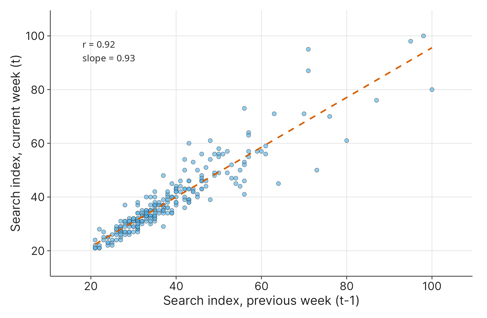

# Time Series Analysis

## 12.1 Introduction

Throughout this book, we have largely looked at static snapshots of data. However, the world is dynamic, and the systems we study in the social sciences change constantly. **Time series analysis** is a set of statistical techniques designed to evaluate data points collected in a specific chronological order over regular intervals.

Before we look at our data, it is important to understand the goals of time series analysis: identifying overarching **trends**, predictable **cyclical patterns** (like seasonality), and random **irregular movements**. Why is this necessary? You might wonder why we cannot simply use the simple linear regression tools from Chapter 4, placing "Time" on the x-axis and drawing a line of best fit.  

 

There are two major reasons. First, a simple straight line might show a general upward or downward trend, but it completely ignores recurring cycles. Human behavior, economics, and nature rarely move in a perfectly straight line. If we only look at a linear trend, we completely miss the reality that retail sales surge every December or that depression metrics shift during winter months. Second, linear regression relies on the assumption that every data point is independent. Chronological data inherently violates this assumption. What happens today is highly connected to what happened yesterday. 

  

Imagine a health researcher analyzing public fitness habits to find out when people are most likely to start a new exercise routine. If a public health organization wants to launch a widespread fitness campaign, timing is everything. They need to separate genuine, long-term shifts in public health interest from temporary, predictable seasonal spikes to allocate their resources effectively.

To explore these patterns, our motivating dataset for this chapter is `gym_membership_searches.csv` (Google LLC, 2026). This dataset contains weekly Google search popularity data for the term "gym membership" in the United States over a five-year period. This provides an excellent foundation for capturing real-world consumer behavior and health-related seasonality. Google Trends isolates a random sample of search traffic to calculate how frequently a specific term is searched relative to the total number of searches conducted during that exact time window. This relative frequency prevents raw population growth or shifting internet access rates from artificially inflating the data over time.

  

The dataset includes the following variables:

- **`Week`**: A categorical variable recording the starting date for the week of data collection, recorded in MM-DD-YY format (ranging from 05-16-21 to 05-17-26).   
- **`gym membership`**: A numerical variable tracking the normalized search interest index for the phrase "gym membership." Google scales these values from 0 to 100, where 100 represents the absolute peak search volume during the five-year window, and other values represent a percentage of that peak.   

By the end of this chapter, you will transition away from the visual tools we used previously. If you were given a single numerical variable like search volume in Chapter 1, your first instinct would be to build a histogram to see its distribution, but doing so would completely destroy the chronological order of the data. Even a standard scatterplot fails to emphasize the sequence from one week to the next. Instead, you will learn to visualize time using continuous line charts. You will also explore **autocorrelation**, which explains exactly how chronological data violates the independence assumption. Finally, we will introduce the conceptual foundations of forecasting so you can use structural models to predict future behavioral peaks.

## 12.2 The Purpose of Time Series Analysis

When we analyze data collected chronologically, our primary goal is to break the data down into understandable, predictable components. True time series analysis is much more sophisticated than simply placing time on the x-axis and drawing a line of best fit through the center of the data. While a simple linear regression model might show us a general upward trajectory, it completely smooths over the rich, dynamic reality of human behavior.

In time series analysis, we aim to identify three distinct structural elements within our data:   

1. **Trends**: The long-term, overarching direction of the data over time. A trend tells us whether the baseline of our measurement is generally increasing, decreasing, or remaining stable.   
2. **Cyclical Patterns**: Predictable, repeating fluctuations that occur at regular intervals. In social science and behavioral research, we often refer to this as seasonality. For example, retail spending spikes in December, and recreational travel peaks in July.   
3. **Irregular Movements**: Random noise, unpredictable shocks, or sudden anomalies that do not repeat.   

If a health organization wants to launch an effective fitness campaign, relying solely on a simple regression line is dangerous. A straight line ignores the cyclical patterns, which are often the most actionable pieces of information in the entire dataset. To fully understand these distinct movements, we cannot rely solely on summary statistics or simple regression metrics. We must look at the data.

### Visualizing Time: The Time Series Plot

If you were given a single numerical variable like the `gym membership` search index, your training from Chapter 1 might lead you directly to a histogram. However, if we build a histogram for this dataset, we only see the frequency of certain search volumes. We learn *how often* the index hits 50, but we completely lose the context of *when* it happens. A histogram destroys the chronological sequence, erasing the timeline entirely.

To preserve the timeline, we use a **time series plot**. A time series plot is essentially a specialized line chart where time is always placed on the horizontal x-axis, and the numerical variable of interest is placed on the vertical y-axis. By connecting each chronological data point with a continuous line, we can visually trace the data from one week to the next.

{fig-alt="Line chart of weekly gym search interest over five years. A gradual upward trend with sharp winter peaks. Winter peaks are about 37 in the season ending 2022, 48 in 2023, 54 in 2024, 64 in 2025, and 100 in February 2026."}

When we evaluate the time series plot for our fitness data, the power of visual analysis becomes immediately clear. First, we can see a positive long-term trend; the overall baseline of search interest is noticeably higher in 2026 than it was in 2021. Second, we see massive, undeniable cyclical patterns. There is a sharp, distinct spike in search volume every single winter, perfectly aligning with the cultural phenomenon of New Year's fitness resolutions.  

 

Crucially, the time series plot reveals a structural change that simple summary metrics would easily miss: the seasonal spikes are actually getting larger each year. The distance between the summer baseline and the winter peak is expanding. This highlights why visuals are an essential first step in understanding chronological data.   

### The Limits of Automated Tools

Recognizing these expanding cyclical patterns matters because automated forecasting models often struggle to capture them perfectly. For instance, if we push this dataset into an advanced predictive model (like an ARIMA forecast, which we will discuss later in the chapter), the algorithm will successfully recognize the winter cycle and predict another spike for the upcoming year. However, it may only predict a *typical* magnitude for that upcoming winter spike, failing to account for the fact that the spikes are growing larger over time. Human intuition and visual inspection remain critical safeguards against relying too heavily on automated algorithms.   

### A Hint at the Independence Violation

As you look at the continuous, flowing line of the time series plot, you might intuitively realize that these data points are deeply connected. The search volume in one week is heavily influenced by the search volume of the week immediately prior. If we were to create a scatterplot comparing each week against its own past week, we would see a strong linear relationship with a slope close to 1.

This deep, sequential connection is called **autocorrelation**, and it fundamentally breaks the rules of traditional inferential statistics. In the next section, we will explore exactly how this independence violation forces us to abandon standard regression in favor of specialized time series tools.   

## 12.3 The Independence Violation: Autocorrelation

In our previous chapters on linear regression, we relied on a foundational assumption: independence. We assumed that each observation in a dataset was a completely separate, isolated event. If we survey one student about their sleep habits, their answer should not mechanically dictate the answer of the next student we randomly select.

When dealing with time series data, this independence assumption completely collapses. The search volume for gym memberships during the second week of January is not an isolated event. It is deeply connected to the search volume from the first week of January. If public interest is surging this week, it is highly likely to remain high next week.   

Statisticians call this sequential connection **autocorrelation**. The prefix "auto" means "self." Therefore, autocorrelation is simply the measure of how a single variable correlates with its own past values.   

To measure this, we mathematically shift our data by one time period, creating what is known as a **lag**. A lag-1 autocorrelation compares the data at a specific time (week t) to the data from the chronological step immediately prior (week t−1). Instead of comparing fitness searches to an outside variable like the economy, we compare the fitness searches this week directly to the fitness searches last week.   

{fig-alt="Scatterplot of this week's gym search index against last week's. Points cluster tightly along a positive line from about 20 to 100; r = 0.92 and the fitted slope is 0.93."}

When you look at this scatterplot, notice that you are no longer looking at time on the x-axis. Instead, you are looking at *past behavior*. The visual evidence of this connection is striking. You will see a tight, clear linear trend with a slope close to 1. When we calculate the linear correlation coefficient (r) for this lag-1 relationship, we get a value of 0.92. This mathematically demonstrates that a high search volume in week t directly relates to the search volume in week t+1.   

### Trend vs. Autocorrelation: Understanding the Difference

At this point, students often confuse an **overall linear trend** with **autocorrelation**. They sound similar on the surface: isn't predicting a value based on a slope exactly what we did in Chapter 4? You need to understand why these are entirely different concepts.

A **linear trend** describes the relationship between the *calendar* and our variable. In our dataset, the overall upward trend simply tells us that as the years go by, general baseline interest in gym memberships increases. If we draw a line of best fit, knowing that week 200 is further along the x-axis than week 10 tells us to expect a higher value simply because more time has passed.

**Autocorrelation**, on the other hand, describes *momentum*. It has nothing to do with how many years have passed; it has everything to do with what happened *yesterday*. Imagine a massive, unpredicted spike in fitness searches occurs because a celebrity launches a viral workout challenge. A standard linear trend line cannot predict this spike because it only looks at the calendar. However, autocorrelation recognizes that because searches were anomalously huge last week, they will carry that momentum and be huge again this week. Trend is about long-term trajectory; autocorrelation is about short-term stickiness.

### The Consequences for Linear Regression

Why does this momentum matter so much? In Chapter 4, our regression models assumed that the distance between our data points and the line of best fit (the residuals) was entirely random noise. We assumed every single data point was a brand new, independent piece of evidence.

Because autocorrelation creates momentum, the data points are essentially copying each other. If we force a standard linear regression model onto this data, the math completely ignores the 0.92 autocorrelation. The model believes it has 262 entirely independent, unique pieces of evidence. In reality, because the weeks are just echoing one another, we actually have far less unique information than the model thinks.   

When a regression model double-counts evidence like this, it becomes wildly overconfident. It artificially shrinks the standard errors, falsely inflates the test statistics, and produces p-values that look incredibly "significant" but are mathematically meaningless. To make accurate, honest predictions about the future, we must abandon simple straight lines and adopt specialized models built specifically to handle the momentum of intertwined data.

## 12.4 Forecasting: An Introduction to ARIMA Models

Once we understand the overarching trajectory and the sequential momentum of our data, our next goal is often to predict the future. In time series analysis, predicting future values based on historical patterns is called **forecasting**.   

While there are many forecasting algorithms, one of the most common structural models used in research is the **ARIMA** model. ARIMA stands for AutoRegressive Integrated Moving Average. While the mathematics behind this model are complex, its conceptual form is highly intuitive. Instead of trying to force a single straight line through messy data, an ARIMA model breaks the data down into pieces, analyzes the behavior of each piece, and then reassembles them to project the next chronological steps.   

You can think of the conceptual form of an ARIMA model as a formula made of distinct behavioral ingredients:

> Future Value = Overarching Trend + Cyclical Seasonality + Recent Momentum + Correction for Past Shocks

To understand how the software builds this recipe, we can look at the three parts of the ARIMA acronym:

- **AutoRegressive (AR):** This handles the momentum or autocorrelation we discussed in the previous section. It recognizes that if gym searches were high yesterday, they will likely be high today.
- **Integrated (I):** This handles the overarching trend. Before the model can analyze the repeating cyclical patterns, it temporarily mathematically strips away the upward or downward calendar trajectory. This allows the model to analyze the pure seasonal cycles on a level playing field.
- **Moving Average (MA):** This handles the random noise or irregular movements. If an unexpected shock occurred last week (like a viral fitness trend causing a random spike), this component adjusts the forecast to account for the fact that the data is currently recovering from a surprise.

### What ARIMA Does and Does Not Do

An ARIMA model is an incredibly powerful tool for projecting established historical patterns into the future. It uses the internal structure of the data itself to map out where the numbers are most likely to go next.   

However, you must understand its limitations. An ARIMA model does not explain *why* something is happening; it is purely predictive, not causal. It also cannot predict unprecedented, structural anomalies. If a global event completely closed all fitness centers tomorrow, the ARIMA model would fail completely because it only knows how to repeat the past.

### Forecasting the Fitness Data

Let us apply this model to our `gym_membership_searches.csv` dataset to see what the software predicts for the upcoming year.

{fig-alt="Time series line plot from 2021 through 2027. Observed weekly searches rise with winter peaks; the dashed forecast starts in May 2026 and peaks at 70.3 in February 2027, inside a shaded band that widens through 2027."}

Looking at the right side of the visual output, you will see a dashed blue line extending past our final data point in May 2026 into the future. The ARIMA model has successfully recognized the cyclical pattern and is formally predicting another search spike for the upcoming winter.   

However, notice the shaded blue region surrounding that predicted line. This is the model's confidence interval, often called a prediction interval in forecasting. Just like the confidence intervals we calculated for means in Chapter 3, this shaded area represents the margin of error. As the model tries to predict further and further into the future, the shaded region grows wider. The model is acknowledging a fundamental truth: forecasting tomorrow is fairly safe, but forecasting next year involves significantly more uncertainty.   

Finally, this forecast provides a perfect reminder of why human researchers must always review automated output. If you look closely at the predicted winter spike, the ARIMA model anticipates another *typical* winter peak, landing below the 2026 record. However, our visual analysis in Section 12.2 revealed that these winter spikes are actually growing larger every single year. The algorithm did not capture that growth. Time series software is a powerful assistant, but the researcher's visual intuition must always remain the final check.   

## 12.5 Common Mistakes / Misconceptions

As you go out and build your own time series plots and prediction models, keep these common mistakes in mind:

- **Modeling Before Graphing:** One of the most dangerous traps in data analysis is feeding numbers directly into an algorithm without looking at them first. As we saw with the growing seasonal spikes in our fitness data, a visual time series plot will often reveal structural shifts that the automated math completely misses. Never build a model, whether it is a simple regression or an advanced forecasting tool, without exploring a relevant graph. The visual evidence should always guide your choice of analytical method, because the graph will often find something the math cannot.   
- **Applying Linear Regression to Chronological Data:** Because simple linear regression is so versatile, researchers often assume they can just use time as the explanatory variable on the horizontal axis. However, doing so violates the core assumption of independence. Standard regression ignores autocorrelation and smooths over cyclical patterns, leading to wildly overconfident $p$-values and fundamentally flawed conclusions. As a general rule, we should not use standard linear regression to handle time series data.   
- **Treating Forecasts as Guarantees:** When looking at an ARIMA forecast, it is tempting to focus entirely on the solid predicted line and treat it as a guaranteed certainty. However, time series models only know how to repeat historical patterns. They cannot predict unprecedented real-world shocks, such as a sudden economic crisis or a disruptive new technology. You must always pay close attention to the widening prediction intervals (the shaded margin of error). The further into the future you project, the less certainty you actually have.   
- **Confusing Prediction with Causation:** Time series analysis is excellent at identifying *what* is happening and *when* it is happening, but it cannot tell you *why*. A structural model might accurately predict a massive surge in fitness searches next January, but the algorithm has no concept of New Year's resolutions, human psychology, or winter weather. It simply recognizes a numerical pattern. It is always the researcher's job to provide the theoretical context that explains the mathematical pattern.

## 12.6 Key Concepts

1. **The Architecture of Time:** Time series analysis is designed to evaluate chronologically ordered data by breaking it down into three distinct structural components: overarching trends, predictable cyclical patterns (seasonality), and random irregular movements.   
2. **Preserving the Timeline:** We cannot use tools like histograms for sequential data because they destroy the chronological order. Instead, we rely on time series plots to visually trace the data over time.   
3. **The Independence Violation:** Chronological data inherently breaks the fundamental regression assumption of independence. Because today's data is heavily influenced by yesterday's data, we cannot treat each observation as a brand new, isolated piece of evidence.   
4. **Autocorrelation (Momentum):** This is the measure of how a single variable correlates with its own past values. When we compare an observation at time $t$ to its lag at time $t-1$, we measure the short-term stickiness or momentum of the data.   
5. **The Danger of Standard Regression:** Using a simple line of best fit on time series data ignores cyclical seasonality and autocorrelation, resulting in a model that is mathematically overconfident and practically flawed.   
6. **Forecasting:** Specialized structural algorithms, like the ARIMA model, map historical trends and momentum to predict future values. However, these predictions are not guarantees, and their accompanying prediction intervals grow wider as they project further into the unknown future.   

## 12.7 New Notation

| **Symbol** | **How it is read aloud** | **What it represents in plain words**                        |
| ---------- | ------------------------ | ------------------------------------------------------------ |
| $t$        | "t"                      | A specific index point in time, usually representing the current chronological observation (e.g., "this week"). |
| $t-1$      | "t minus one"            | The time period immediately preceding the current observation. This is used to create a "lag" to measure autocorrelation (e.g., "last week"). |
| $t+1$      | "t plus one"             | The time period immediately following the current observation (e.g., "next week" or a forecasted step). |

: Table 12.1: Notation introduced in this chapter.

## 12.8 Exercises

### Interpretation

1. An economist looks at a time series plot of monthly housing prices over a ten-year span. The line moves up and down predictably every single year but finishes significantly higher at the end of the decade than it started. Identify the "trend" and the "cyclical pattern" in this description.
2. A sociologist tracks daily social media usage for a cohort of teenagers. They calculate a lag-1 autocorrelation coefficient of $r = 0.85$. Explain in plain English what this number tells the researcher about how yesterday's social media usage relates to today's usage.
3. A public health researcher reviews an ARIMA forecast for weekly reported influenza cases over the next two years. They notice the shaded prediction interval around the forecasted line is narrow for the first month but becomes extremely wide by the second year. What does this widening shaded region mean conceptually?

### Choosing a Method

4. A political scientist wants to analyze how a mayor's public approval rating fluctuates month by month over a four-year term. A research assistant suggests building a histogram of the approval ratings. Explain why a histogram is the wrong visual tool for this data, and state which visualization the assistant should use instead.
5. An education researcher has ten years of weekly library attendance data. They want to predict next week's attendance. They decide to run a simple linear regression using "Week" as the independent predictor variable. Explain the primary statistical assumption the researcher is violating by using standard linear regression on this chronological data.
6. A retail analyst is examining five years of weekly sales data for winter coats. They want to isolate the overarching baseline growth of the company from the massive sales spikes that happen every November. What type of statistical modeling framework is specifically designed to separate overarching trends from cyclical patterns?

### Communicating Results

7. Think of a specific variable within your own field of study (e.g., psychology, economics, sociology, health sciences) that would likely exhibit predictable cyclical behavior over time. Describe the variable, state what the timeline would be (e.g., daily, weekly, monthly), and explain what real-world factor would cause the repeating seasonal pattern.
8. A researcher uses time series analysis to evaluate historical daily stock market prices and accurately forecasts a short-term drop for the following week. During a press conference, a reporter asks the researcher to explain *why* the market will drop. Explain the limitation of time series forecasting the researcher must communicate to the reporter.
9. You are presenting a time series analysis of weekly food bank donations. A colleague points out that a standard linear regression model yields a very low $p$-value for the overall trend, proving the upward trajectory is highly significant. Explain to your colleague why they cannot trust that $p$-value when the data has strong autocorrelation.

### Software Application

For this section, you will use statistical software to analyze two search series. The gym data are in `gym_membership_searches.csv`, a weekly series from May 2021 through May 2026. The sunscreen data are in `sunscreen_searches.csv`, a monthly series from October 2021 through October 2026. Google Trends now reports the sunscreen term monthly, so the two series have different time steps.

10. **Visualizing Contrasting Cycles**: You will begin by exploring the raw visual differences between the two search terms.
a) Use your software to generate a time series line plot for the `gym membership` search index across the `Week` timeline.
b) Use your software to generate a second time series line plot for the `sunscreen` search index across the `Month` timeline.
c) Compare the two plots. In what specific months or seasons do the cyclical peaks occur for gym memberships, and when do they occur for sunscreen?
11. **Measuring Momentum**: Let us mathematically verify the independence violation for the sunscreen variable.
a) Use your software to create a new "lag-1" variable for the `sunscreen` index (shifting the data back by exactly one month).
b) Generate a scatterplot placing the lagged sunscreen variable on the x-axis and the current month's sunscreen variable on the y-axis. Describe the visual relationship.
c) Calculate the linear correlation coefficient ($r$) between the current month and the prior month. Does this value indicate strong autocorrelation?
12. **Forecasting the Future**: Assume you work for a public health agency planning an educational skin-safety campaign.
a) Run an ARIMA model on the `sunscreen` variable to forecast search interest for the next 12 months.
b) Look at the forecasted visual plot. Does the algorithm successfully predict another cyclical spike, and if so, in which month is it expected?
c) Examine the shaded prediction interval around the forecasted line. What does this shaded area tell you about the safety of predicting search volumes a few months from now versus a full year from now?
